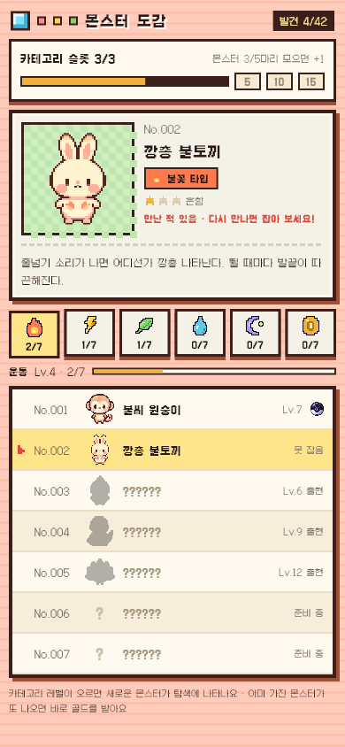

# 탐색에서 만나기만 해도 도감에 등록

- 날짜: 2026-10-15
- 상태: 구현 완료 (사용자 요청 → 바로 구현, 요청에 없던 부분은 **[가정]**)
- 관련: 결정 D-17, 브랜치 `feature/habit-manage` (커밋 전)

## 1. 왜 만드나
- **문제**: 탐색에서 몬스터를 만났는데 잡지 못하면 도감에 아무것도 남지 않았다 (실루엣 그대로).
- **목표**: 만난 몬스터는 잡지 못해도 도감에 남는다.
- **하지 않는 것**: 만난 횟수 · 날짜 기록, 만난 종에게 다른 보상.

## 2. 누가 · 언제 쓰나
- 탐색에서 몬스터를 만난 모든 사용자. 볼을 안 던지고 넘기거나, 던졌는데 도망쳐도 해당.

## 3. 규칙
- 탐색에서 몬스터가 나타나는 순간 그 종이 도감에 등록된다 (꽝이면 아무것도 등록되지 않는다).
- 등록된 종은 도감에서 그림 · 이름 · 희귀도 · 설명이 보인다.
- 가진 종: "보유 중 · Lv · 단계" + 성실볼 표시. 만나기만 한 종: "만난 적 있음 · 아직 못 잡았어요" (지금 탐색에서 나올 수 있으면 "다시 만나면 잡아 보세요!"), 목록 오른쪽에 "못 잡음".
- 도감 상단 "발견 N/42"와 카테고리 탭의 "N/7"은 **등록 수**(본 종 + 가진 종, API의 `seenCount`).
- 카테고리 칸(5 · 10 · 15마다 +1)은 **가진 종 수**(`dexCount`)로만 센다. ~~[가정] 등록 수로 센다~~ → API 명세 v5에 맞춰 바꿈 (D-19).

## 4. 화면
- 도감 상세 카드와 목록만 바뀐다. 새 화면 없음.

## 5. 예외 · 경계
- 이미 가진 종을 다시 만나도 도감 수는 늘지 않는다 (이미 등록됨).
- 서버를 붙이면: 등장(`ENCOUNTER`) 때 `monster.dex_entry`를 만들어야 한다 — DB · API 담당과 맞추기.

## 6. 다른 곳에 미치는 영향
- 앱: `GameState.explore()`, `features/dex/dex_screen.dart`, 테스트 2개 추가 (만나면 등록 · 도감 표시).
- 서버 · DB: 위 5번.

## 7. 완료 기준
- [x] 만난 뒤 잡지 않아도 도감에 이름 · 그림이 보인다
- [x] `flutter analyze` 이상 없음, `flutter test` 82개 통과
- [x] 도감 화면 390폭 캡처 확인 (임시 골든)
- [ ] 에뮬레이터에서 탐색 → 넘기기 → 도감 확인 — 아직 못 함

## 8. 정해야 할 것
- [x] 카테고리 칸 기준 → 가진 종 (API 명세 v5)
- [x] 도감 아래 안내 문구 → "이미 가진 몬스터가 또 나오면 바로 골드를 받아요" (가진 종은 이제 볼 없이 바로 골드라 맞는 말)

## 9. 결과
- 확인한 것: 테스트 82개, 도감 캡처.
- 확인하지 못한 것: 실기기.
- 화면: 
