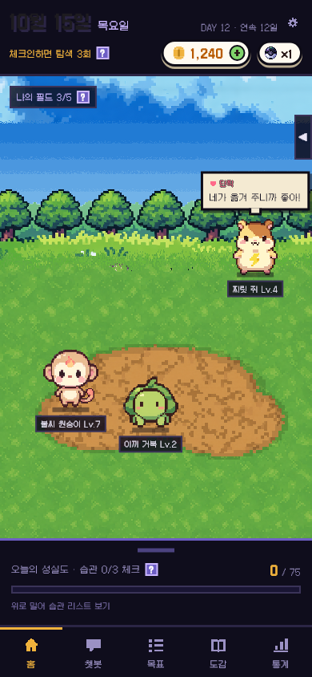

# 홈 오른쪽 아이콘 줄 숨기기 (오른쪽으로 밀기)

- 날짜: 2026-10-15
- 상태: 구현 완료 — 사용자 요청("아이콘 오른쪽으로 스와이프하면 안 보이게")을 바로 구현. 요청에 없던 부분은 **[가정]**
- 관련: `2026-10-15-필드-몬스터-끌기.md` (몬스터가 다닐 영역), 브랜치 `feature/monster-art-v2`

## 1. 왜 만드나
- **문제**: 오른쪽 위 상점 · 가방 · 출석 · 습관 아이콘이 필드를 가려서, 몬스터를 보거나 옮길 공간이 좁다.
- **목표**: 아이콘을 잠깐 치워 필드를 넓게 쓴다.
- **하지 않는 것**: 숨김 상태 저장(앱을 다시 켜면 다시 보임), 왼쪽 "나의 필드" 바 숨기기. **[가정]**

## 2. 누가 · 언제 쓰나
- 홈에서 몬스터를 구경하거나 옮기는 사람.
- 흐름: 아이콘 줄을 오른쪽으로 민다 → 줄이 화면 밖으로 미끄러져 나가고 오른쪽 끝에 작은 손잡이(◀)가 남는다 → 손잡이를 누르거나 왼쪽으로 밀면 다시 나온다.

## 3. 규칙
- 아이콘 줄 위에서 오른쪽으로 24px 넘게 밀거나 빠르게 튕기면 숨는다 (0.25초 애니메이션). **[가정: 24px · 300px/초]**
- 숨기면 손잡이(폭 22 · 높이 56, "◀")가 오른쪽 끝에 남는다. 누르거나 왼쪽으로 튕기면 다시 나온다. **[가정: 손잡이 모양]**
- 아이콘을 짧게 누르면 지금처럼 각 창이 열린다 (누르기와 밀기는 Flutter가 구분).
- 숨긴 동안 몬스터는 아이콘이 있던 자리까지 다닐 수 있다. 손잡이만 피한다. 다시 보이면 겹친 몬스터는 다음 걸음에 비켜 간다.
- 튜토리얼이 시작되면 아이콘을 다시 보이게 한다 (튜토리얼이 아이콘을 가리키므로).

## 4. 화면
- 디자인 시안에 없는 추가 기능. 새 패키지 없음. `features/home/home_screen.dart`만 바뀜.

## 5. 예외 · 경계
- 스크린리더: 손잡이는 "아이콘 보이기" 버튼으로 읽힌다. 숨기기는 손가락으로만 (스크린리더 사용자는 숨길 일이 없다고 봄). **[가정]**
- 서버 · DB: 없음.

## 6. 다른 곳에 미치는 영향
- 앱: 홈 화면, 몬스터 영역 계산(`_place` · `_buttonsRect`), 테스트 1개.

## 7. 완료 기준
- [x] 밀면 숨고, 손잡이를 누르면 다시 나온다 (테스트)
- [x] 숨긴 뒤 몬스터가 오른쪽 끝까지 간다 (캡처)
- [x] `flutter analyze` 이상 없음, `flutter test` 전부 통과
- [ ] 에뮬레이터에서 손가락으로 밀어 보기 — 아직 못 함

## 8. 정해야 할 것
- [ ] 숨긴 상태를 앱을 껐다 켜도 기억할지

## 9. 결과
- 확인한 것: 테스트, 390폭 캡처.
- 확인하지 못한 것: 실기기.
- 화면: 
