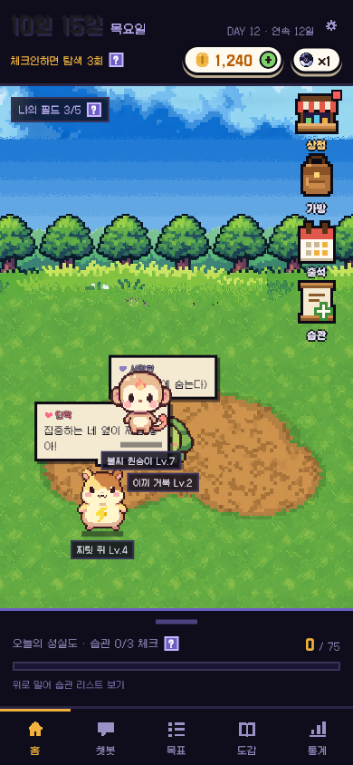
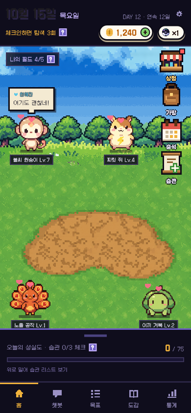

# 홈 필드에서 몬스터 끌어 옮기기

- 날짜: 2026-10-15
- 상태: 구현 완료 (8번은 사용자가 정함: A + 하루 1번 호감도 +1)
- 관련: 결정 D-20, 브랜치 `feature/habit-manage` (커밋 전)

## 1. 왜 만드나
- **문제**: 홈 필드의 몬스터는 혼자 돌아다니고, 사용자는 눌러서 정보 창을 여는 것밖에 못 한다.
- **목표**: 몬스터를 손가락으로 집어 원하는 자리에 놓을 수 있다. 만지는 재미를 준다.
- **하지 않는 것**: 골드 · EXP 보상, 몬스터끼리 상호작용, 위치 저장(앱을 다시 켜면 처음 자리). **[가정]**

## 2. 누가 · 언제 쓰나
- 사용자: 홈에 들어온 모든 사람.
- 사용 흐름:
  1. 필드의 몬스터를 누른 채로 움직인다.
  2. 몬스터가 손가락을 따라온다 (살짝 들린 모습 + 그림자).
  3. 손을 떼면 그 자리에 내려앉는다.

## 3. 규칙
- 짧게 누르고 떼면 지금처럼 정보 창이 열린다. 누른 채 움직이면 끌기다. (Flutter가 "탭"과 "끌기"를 알아서 구분한다)
- 끄는 동안 그 몬스터는 혼자 걷지 않고 말풍선도 띄우지 않는다. 다른 몬스터는 계속 돌아다닌다.
- ~~필드 밖(하늘 · 아래 시트 · 오른쪽 아이콘 줄)으로는 못 나간다. 지금 몬스터가 걸어 다니는 영역 안에서만 놓인다.~~ → (10-15 사용자 요청) **잔디 전체**에서 자유롭게. 위: 발이 숲 바로 아래 잔디에 닿는 곳(화면이 짧아 숲이 잘리면 필드 맨 위). 아래: 이름표가 접힌 시트 위에 보이는 곳. 왼쪽: 말풍선이 덜 잘리게 20px 틈. ~~오른쪽 아이콘 줄 위로도 갈 수 있다~~ → (같은 날 사용자 지적: 몬스터가 버튼을 가리면 안 됨) **버튼을 가리지 않는다**: 위는 "나의 필드" 바 아래, ~~오른쪽은 상점 · 가방 · 출석 · 습관 아이콘 줄 왼쪽까지~~ → (같은 날 사용자 지적: 아이콘 아래 잔디로 못 감) **아이콘 줄이 있는 곳만 피하고, 그 아래 잔디는 다닐 수 있다** (겹치면 왼쪽으로 비키거나 아래로 내려가기 중 덜 움직이는 쪽). 아이콘을 숨기면 손잡이만 피한다 (`2026-10-15-아이콘-숨기기.md`). 혼자 걸을 때도 같은 영역을 쓴다. 배경이 화면 크기마다 다르게 잘려서 px로 계산한다.
- 놓은 뒤: 3초(`Economy.dragRest`) 그 자리에 있다가 다시 돌아다닌다. (사용자 결정: A)
- **보상**: 몬스터마다 하루 1번, 처음 놓을 때 호감도 +1 (`Economy.dragAffectionGain`). 호감도가 이미 10이면 오르지 않고 그날 기회도 쓰지 않는다. (사용자 결정)
- 놓을 때 반응 (10-15 사용자 제안 반영): **매번 말풍선으로 한마디**(호감도 단계별 3개 중 하나, 예: "여기도 괜찮네!"), 호감도가 오르면 **하트 세 개가 뿅뿅** 올라가며 사라진다(약 1초). 단계가 바뀌면 토스트 "○○와 단짝 사이가 됐어요!". ~~호감도 오를 때마다 토스트~~는 하트로 바꿈. 끄는 동안은 10px 들려 있다.
- 끄는 몬스터는 다른 몬스터보다 위에 그린다.
- 튜토리얼 중 · 상점 · 가방 · 교감 창이 열려 있을 때는 끌 수 없다 (지금 몬스터가 멈추는 조건과 같다).

## 4. 화면
- 디자인 시안에 없는 추가 기능. 새 화면 · 버튼 없음. 홈 필드만 바뀐다.
- 새 패키지 필요 없음.

## 5. 예외 · 경계
- 끄는 중에 다른 손가락으로 다른 몬스터를 끄는 경우: 한 번에 한 마리만. **[가정]**
- 좁은 화면(360폭)에서도 필드 영역 안에서만 움직인다.
- 화면 접근성(스크린리더): 끌기는 손가락 전용. 스크린리더 사용자는 지금처럼 "정보 보기"만.
- 서버: 위치는 저장하지 않는다. 호감도는 6번 참고.

## 6. 다른 곳에 미치는 영향
- 앱: `features/home/home_screen.dart`(필드 몬스터 위치 · 걷기 타이머), 테스트 추가.
- 서버 · DB: 위치는 저장 안 함. 단, **호감도 +1은 서버에도 있어야 한다** — `POST /monsters/{id}/affection`에 끌기 종류(예: `DRAG`)와 "오늘 했는지" 기록이 필요 → DB · API 담당에게 요청 (`backend/db/README.md`).
- 문서: 작업-기록, 프로젝트-이해(홈 설명 한 줄).

## 7. 완료 기준
- [x] 끌면 따라오고, 놓으면 그 자리에 내려앉는다 (테스트 + 캡처)
- [x] 짧게 누르면 여전히 정보 창이 열린다 (기존 홈 테스트)
- [x] 필드 밖으로 나가지 않는다 (걷는 영역과 같은 범위로 막음)
- [x] `flutter analyze` 이상 없음, `flutter test` 85개 통과
- [ ] 360폭 · 에뮬레이터에서 직접 끌어 보기 — 아직 못 함 (390폭 캡처만)

## 8. 정해야 할 것
- [x] 놓은 뒤 → A (잠깐 쉬었다가 다시 돌아다니기)
- [x] 보상 → 하루 1번 호감도 +1 (`economy-v1.md`에 적음)
- [ ] [가정] "하루 1번"을 몬스터마다로 함 (쓰다듬기 · 놀아주기와 같게). 하루 전체 1번이 맞으면 바꾸기

## 9. 결과
- 기획과 달라진 점: 범위를 세 번 고쳤다 (걷는 띠 → 잔디 전체 → 버튼 피하기 → 아이콘 아래 잔디 허용). 놓을 때 반응은 토스트 → 말풍선 + 하트.
- 확인한 것: 테스트 86개, 390 · 360폭 캡처. 확인하지 못한 것: 에뮬레이터에서 손가락으로 끌기.
- 화면:
  - 
  - 
