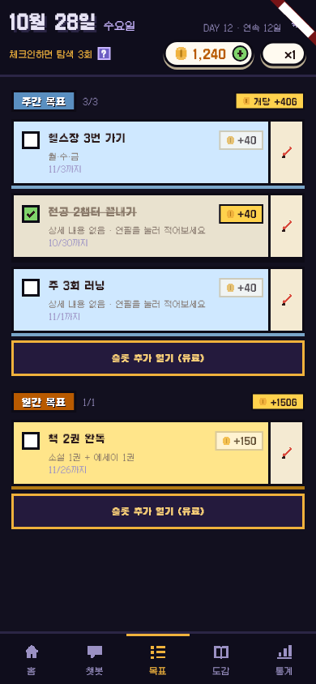
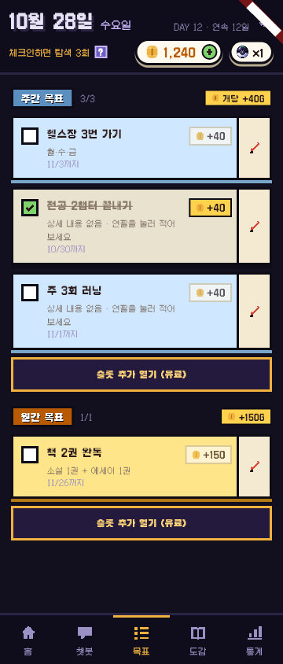
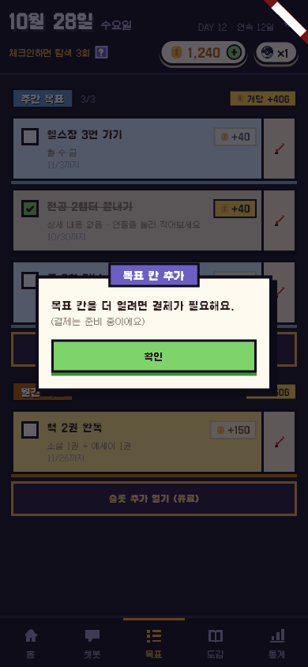

# 목표 서버 연결 · 세운 날부터 기간 · 유료 칸 안내 창 (4-2)

- 날짜: 2026-10-23 (10-28 기간 규칙 B로 다시 씀)
- 상태: 구현 완료 (10-28)
- 관련: `feature/backend-game-system` · 진행현황 1장 C1 · 결정 D-48(예정) · 명세 v5 8장 · DB 스키마 v1.7 `goal`

## 1. 왜 만드나
- **문제**
  - 서버 모드에서 목표 등록 · 수정 · 삭제 · 완료가 앱 안에서만 바뀐다. 다시 켜면 사라지고 완료 골드도 서버 지갑에 안 들어간다.
  - 지금 명세 · DB는 목표 기간이 **달력 주(월 ~ 일) · 달력 달(1일 ~ 말일)**이다. 그래서 일요일에 세운 주간 목표는 끝내 완료할 수 없다. 등록 당일은 완료할 수 없고(C1), 다음 날 월요일은 이미 지난주이기 때문이다.
  - "슬롯 추가 열기 (유료 · 기록용)" 버튼이 결제 없이 칸을 그냥 연다.
- **목표**
  - 목표 기간을 **세운 날부터** 센다 (주간 7일 · 월간 30일). 언제 세워도 완료할 수 있는 날이 같다.
  - 목표 4가지 동작이 서버에 남고, 완료 골드가 서버 지갑 · 원장에 들어간다.
  - 유료 칸은 "결제가 필요해요" 창만 띄운다.
- **하지 않는 것**
  - 실제 결제 · 유료 칸 지급 (`goal_slot_grant`는 `schema_later.sql`, MVP 제외)
  - 기간이 끝난 목표를 다시 보는 화면
  - 시연(로컬) 모드의 기간 · C1 규칙 (지금처럼 기간 없이 동작)

## 2. 누가 · 언제 쓰나
- 사용자: 매일 쓰는 사람 (온보딩에서 주간 목표 1개는 이미 등록됨)
- 상황: 하단 탭 "목표" 화면
- 사용 흐름:
  1. 10-23(목)에 주간 목표 "헬스장 3번"을 세운다 → 기간 10-23 ~ 10-29, 목표 옆에 "10/29까지".
  2. 10-23에 체크를 누르면 "목표는 다음 날부터 완료할 수 있어요".
  3. 10-25에 체크 → 완료, 40G. 이 칸은 10-29까지 "완료"로 남아 있다 (칸 차지).
  4. 10-30이 되면 그 목표는 목록에서 빠지고 칸이 빈다 → 새 목표를 넣을 수 있다.
  5. 3칸이 모두 차 있으면 "슬롯 추가 열기 (유료)" 버튼 → 누르면 "목표 칸 추가" 창 → [확인].

## 3. 규칙

### 기간 (사용자 결정 10-23 · 10-28)
- 기간은 **등록한 날(업무 날짜)부터 날짜로** 센다. 시각은 보지 않는다.
- 주간 목표는 7일, 월간 목표는 30일이다. 예: 10-23에 등록하면 주간은 10-23 ~ 10-29, 월간은 10-23 ~ 11-21.
- 기간 끝 날의 다음 날(주간 10-30)부터 그 목표는 "지난 목표"다. 상태값은 따로 만들지 않고 날짜로 판단한다.
- 온보딩에서 세운 목표도 온보딩한 날부터 센다.

### 칸
- 주간 3칸(+ `extra_weekly_slots`, 결제 전엔 0) · 월간 1칸.
- **기간이 남아 있는 목표는 진행 중이든 완료든 칸을 차지한다.** 칸이 비는 때는 ① 기간이 끝났을 때 ② 삭제했을 때뿐이다.
  - 이유: 완료하자마자 칸이 비면 "등록 → 다음 날 완료 → 또 등록"을 반복해 하루 최대 270G(주간 3 × 40 + 월간 150)를 벌 수 있다. 이 규칙이면 칸 하나에서 받는 보상은 7일(30일)에 한 번으로, 달력 주 때와 같다.
- 칸이 차 있으면 등록은 422 `GOAL_SLOT_FULL`.

### 등록 · 수정 · 삭제 · 완료 (명세 8장 + C1)
- 제목은 1~50자(앞뒤 공백 제외), 상세는 0~500자다. 어기면 400.
- **[가정]** 상세가 빈 문자열이거나 공백뿐이면 `null`로 저장한다 (앱은 빈 칸을 `""`로 보낸다).
- 수정은 보낸 필드만 바꾼다.
  - `detail: null`이면 상세를 지운다.
  - `title: null`이면 400이다.
  - **[가정]** `goalType`을 보내면 400이다.
- 완료하면 주간 40G · 월간 150G(`weekly_goal_gold` · `monthly_goal_gold`)를 지갑에 넣고 원장에 `GOAL_WEEKLY` · `GOAL_MONTHLY`(ref = 목표 id)로 남긴다. 완료는 되돌릴 수 없다.
- **등록한 날에는 완료할 수 없다**: 409 `GOAL_TOO_EARLY` "목표는 다음 날부터 완료할 수 있어요" (C1, 사용자 10-23 명세에 넣기로).
- 완료한 목표는 수정 · 삭제 · 완료 모두 409 `GOAL_COMPLETED`.
- 기간이 끝난 목표는 수정 · 삭제 · 완료 모두 409 `GOAL_PERIOD_ENDED`.
- 남의 목표 · 없는 목표 · 삭제한 목표는 404 (C3).
- 검사 순서: 소유권 404 → 값 400 → 완료됨 409 → 기간 끝 409 → 등록 당일 409 → 칸 422.
- 등록 · 완료는 `Idempotency-Key`가 필수다 (A3 · 명세). 같은 키로 다시 보내면 첫 결과를 돌려주고, 골드는 한 번만 준다.
- 같은 사용자의 요청은 `goal_user` 행을 잠가 차례로 처리한다.

### 목록 `GET /goals`
- 기간이 남은(끝 날 ≥ 오늘) 삭제 안 된 목표만 준다.
- 목표마다 `periodStart` · `periodEnd`를 준다. 기간 칸(`weekly` · `monthly`) 머리의 `periodStart`는 목표마다 달라져서 뺀다.

| 항목 | 값 | 근거 |
| --- | --- | --- |
| 주간 칸 | 3 | `weekly_goal_slots` · `Economy.weeklyGoalSlots` |
| 월간 칸 | 1 | `monthly_goal_slots` · `Economy.monthlyGoalSlots` |
| 주간 보상 | 40G | `weekly_goal_gold` |
| 월간 보상 | 150G | `monthly_goal_gold` |
| 주간 기간 | **7일 (새 값)** | 사용자 10-23 "세운 순간부터 일주일" → 설정 키 `weekly_goal_days` 추가 |
| 월간 기간 | **30일 (새 값)** | 사용자 10-28 추천안 → 설정 키 `monthly_goal_days` 추가 |

## 4. 화면
- 목표 화면(`goals_screen.dart`)
  - **유료 칸 버튼**
    - 지금: 주간에만 "슬롯 추가 열기 (유료 · 기록용)"이 있고, 누르면 칸이 +1 된다.
    - 바뀜: 주간 · 월간 모두 칸이 차면 나온다. 누르면 창만 뜨고 칸은 늘지 않는다.
  - **창**: 제목 "목표 칸 추가", 본문 "목표 칸을 더 열려면 결제가 필요해요. (결제는 준비 중이에요)", 버튼 [확인]. 기존 `showInfoPopup` 모양을 쓴다. 서버 · 시연 모드 모두 같다.
  - **[가정]** 버튼 문구는 "슬롯 추가 열기 (유료)"로 바꾼다. "기록용"은 칸이 열리던 때의 설명이다.
  - **[가정]** 서버 모드에서는 목표마다 작은 글씨로 "10/29까지"를 보여 준다. 기간이 목표마다 달라져 마감을 알려야 한다. 시연 모드는 기간이 없어 안 보인다.
- 창과 "~까지" 표시는 시안에 없는 추가다 (창은 사용자 결정 10-21).

## 5. 예외 · 경계
- 등록 당일 체크 → 409 → 토스트 "목표는 다음 날부터 완료할 수 있어요". 체크는 진행 중 그대로.
- 기간 마지막 날(주간 7일째)에는 완료할 수 있다. 다음 날부터는 목록에서 빠진다.
- 완료 못 한 채 기간이 끝난 목표: 보상 없이 빠지고, DB에는 `ACTIVE`로 남는다 (지난 목표는 날짜로 거른다).
- 앱이 켜진 채 날이 바뀌면 화면에는 지난 목표가 남아 있다. 누르면 409 `GOAL_PERIOD_ENDED` 토스트가 뜨고, 다음 불러오기에서 빠진다.
- 칸이 찬 상태에서 한 목표의 기간이 끝나면 다음 불러오기부터 "+ 목표 추가"가 다시 보인다.
- 버튼 연타: 등록 · 완료는 중복 방지 키로 한 번만 처리된다.
- 360폭: 버튼 문구와 "~까지"가 한 줄에 들어가는지 캡처로 확인한다.

## 6. 다른 곳에 미치는 영향
- **DB (윤서 작성 — 사용자 요청 10-28로 Claude가 고침)**
  - `schema.sql`: 제약 `ck_goal_period_start`(주간 = 월요일, 월간 = 1일)를 빼고, 주석 "주는 월요일 · 월은 1일 시작"을 "등록한 날부터 7일 / 30일"로 고친다. 새 컬럼은 없다 (끝 날 = 시작 + 기간 − 1).
  - `seed.sql`: `config.balance_config`에 `weekly_goal_days` 7 · `monthly_goal_days` 30 두 줄을 추가한다.
  - `verify.sql`: "수요일 시작 거절" 확인 줄을 고친다.
  - **이 PC의 로컬 Docker DB**: 제약 삭제와 설정 2줄 추가를 SQL로 한 번 실행한다 (실행 전에 다시 확인받음). 서버 테스트는 매번 새 DB라 상관없다.
- **명세 (윤서 작성 — 사용자 요청)**: "v5 보충 (10-28) — 목표 기간"
  - 8장 첫 문장
  - `GET /goals` 응답 모양
  - 칸 규칙
  - `GOAL_PERIOD_ENDED`의 뜻
  - 오류 표에 `409 GOAL_TOO_EARLY`
- **서버**
  - `goal/` Controller · Service · Repository
  - 온보딩 목표 등록 (등록한 날 기준)
  - `BalanceConfig` 2개
  - `ErrorCode` 4개 (`GOAL_SLOT_FULL` · `GOAL_COMPLETED` · `GOAL_PERIOD_ENDED` · `GOAL_TOO_EARLY`)
  - `GoalApiTest`, 기존 목표 조회 테스트 수정
- **앱**
  - `http_game_repository.dart` 목표 4개와 `GET /goals` 새 모양
  - `Goal` 모델에 마감일 (서버 모드만)
  - `goals_screen.dart` (유료 버튼 · 창 · "~까지")
  - 테스트
- **문서**: `결정-기록` D-48, `기획-변경-이력`, `프로젝트-이해`(목표 규칙), `economy-v1`(기간 수치), `backend/README.md` API 표, `backend/db/README.md`, `frontend/서버연동-메모.md` 2장, `할-일.md`, `작업-기록`

## 7. 완료 기준
- [ ] 서버 `GoalApiTest`
  - 등록하면 기간이 오늘 ~ +6일 / +29일
  - 칸 초과 422
  - 완료해도 기간 동안 칸 차지, 기간이 끝나면 빔, 삭제하면 바로 빔
  - 수정: 안 보냄과 null을 구분
  - 완료 골드 · 원장
  - 당일 완료 409
  - 완료 후 변경 409
  - 기간 끝 409
  - 남의 목표 404
  - 같은 키로 다시 보내도 골드 1회
- [ ] `./gradlew test` 전부 통과 (`verify.sql`은 로컬 DB에서 실행해 통과)
- [ ] 앱 서버 모드에서 목표 4개가 서버로 감 (MockClient 테스트)
- [ ] 유료 버튼이 주간 · 월간 모두 창을 띄우고 칸은 안 늘어남 (위젯 테스트)
- [ ] `flutter analyze` 이상 없음, `flutter test` 전부 통과
- [ ] 화면을 눈으로 확인 (390폭 · 360폭) — 유료 버튼 · 창 · "~까지" 캡처
- [ ] 6장 문서 갱신

## 8. 정해야 할 것
- [x] 앱 범위: 서버 + 앱 연결 + 유료 칸 창까지 하고, 메모로 프론트 담당에게 알림 (사용자 10-23)
- [x] `GOAL_TOO_EARLY` 명세에 넣기 · 문구 그대로 (사용자 10-23)
- [x] 기간을 세운 날부터 (사용자 10-23 B)
- [x] 완료해도 기간 끝까지 칸 차지 · 월간 30일 · 날짜 단위 · 기간 끝난 목표는 빠짐 · 삭제하면 칸 빔 (사용자 10-28 추천안)
- [x] [가정] 빈 상세 → null, `goalType`을 보내면 400, 버튼 문구 (사용자 10-23 "그대로 만드는데")
- [x] 서버 모드 "10/29까지" 표시 (사용자 10-28)
- [x] 기간 일수를 설정 키 2개(`seed.sql`)로 (사용자 10-28)

## 9. 결과 (구현 뒤에 쓴다)
- 기획과 달라진 점
  - 유료 창의 본문은 `showInfoPopup` 모양(굵은 줄 + 흐린 줄)에 맞춰 "목표 칸을 더 열려면 결제가 필요해요." / "(결제는 준비 중이에요)" 두 줄로 나눴다 (글자는 같음).
  - `GET /goals`의 목표 한 줄에 `goalType`도 넣었다 (등록 응답과 같은 모양으로).
- 확인한 것: 서버 테스트 **139개 통과** (새 `GoalApiTest` 15개 · 기존 2개 수정), `schema` + `seed` + `verify.sql`을 새 컨테이너에서 실행해 모두 PASS (새 검사 2개 포함).
  앱 `flutter analyze` 이상 없음, 테스트 **125개 통과** (새 6개). 화면 캡처 390 · 360폭 · 창.
- 확인하지 못한 것: 실제 서버(8081)에 요청 · 실제 폰 · 웹에서 눌러 보기. 로컬 Docker DB는 10-28에 SQL로 반영함 (사용자 확인) — 반영 뒤 서버를 켜 보지는 않음.
- 화면
  
  
  
- 다음에 할 일: 4-3 도감 · 카테고리 열기.
