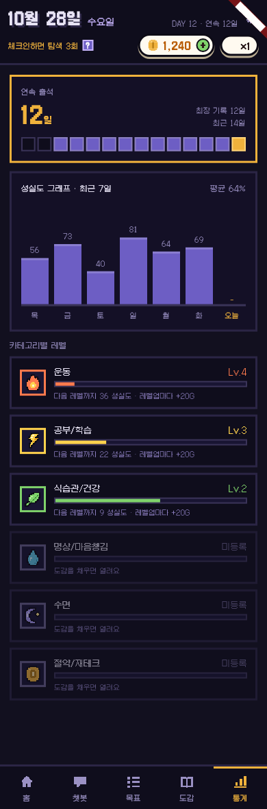
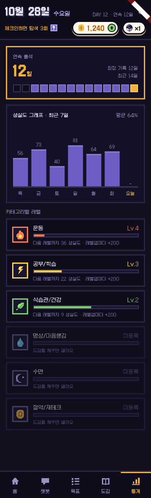

# 통계 화면 + 서버 API (4-4)

- 날짜: 2026-10-28
- 상태: 구현 완료 (10-28)
- 관련: `feature/backend-game-system` · 명세 v5 6장 · 진행현황 B2(`expRequired`) · 디자인 시안 `prototype-source.dc.html` "통계"

## 1. 왜 만드나
- **문제**: 통계 탭이 "준비 중"이다.
- **목표**: 시안의 통계 화면 3칸을 만들고, 서버 모드는 `GET /stats` 값으로 그린다.
- **하지 않는 것**: 7일보다 긴 기간 · 습관별 그래프 · 기간 고르기, 차트 패키지 (막대는 기본 위젯으로 그린다).

## 2. 사용 흐름
1. 하단 탭 "통계"를 누르면 서버에서 통계를 받아 그린다 (탭을 열 때마다 새로).
2. 위에서부터: 연속 출석 → 최근 7일 성실도 → 카테고리별 레벨.

## 3. 규칙 (서버, 명세 6장 그대로)
- **출석**: 연속 · 최장 일수 + 최근 14일(오래된 날부터) 출석 여부 (`habit.attendance`).
- **성실도**: 최근 7일(오늘 포함) 그날 체크인의 최신 달성률 %(다시 체크 반영). 체크인 안 한 날은 null. 평균은 null을 뺀 날들로.
- **카테고리**: 연 카테고리는 레벨 · 최대 레벨 · 이번 레벨에서 모은 경험치 · 이번 레벨에 필요한 경험치 · 레벨업 골드. 잠긴 카테고리는 이름과 "열지 않음"만. 최대 레벨이면 필요한 경험치는 null.
  - 이름은 B2대로 `expToNextLevel` 대신 `expRequired` (체크인 응답 D-43과 같은 뜻).

## 4. 화면 (시안 그대로)
| 칸 | 내용 |
| --- | --- |
| 연속 출석 | 큰 숫자 "N일", 오른쪽 "최장 기록 N일 · 최근 14일", 아래 14칸 (출석 보라 · 안 함 어두움 · 오늘 금색) |
| 성실도 그래프 · 최근 7일 | 오른쪽 "평균 N%", 막대 7개(오늘 금색) + 위에 값 + 아래 요일. 안 한 날은 막대 없음 · "-" |
| 카테고리별 레벨 | 6줄: 아이콘 · 이름 · "Lv.N"/"미등록" · 진행 막대 · "다음 레벨까지 N 성실도 · 레벨업마다 +20G" / "도감을 채우면 열려요" |

- 시안의 막대 값은 점수(0 ~ 75)인데 명세는 달성률 %다 → **[가정]** %로 그린다 (막대 높이 = %, 값 "80").

## 5. 예외
- 가입 첫날: 14칸 중 오늘만, 7일 중 오늘만(체크인 전이면 전부 "-"), 평균은 "-".
- 불러오기 실패: 토스트 + 다시 시도 버튼 **[가정]**.
- 360폭: 막대 7개 · 요일이 한 줄에 들어가는지 캡처로 확인.
- 시연 모드: **[가정]** 앱이 가진 값(연속 출석 · 카테고리 레벨) + 시안의 샘플 7일 값으로 그린다.

## 6. 영향
- 서버: 조율 서비스 `stats/` (습관 모듈: 출석 · 체크인 · 카테고리), `StatsApiTest`.
- 앱: `GameRepository.loadStats()` (서버 `GET /stats` / 시연 샘플), `features/stats/stats_screen.dart` 새로, 테스트, 캡처 390 · 360.
- 문서: 결정 D-50, API 표, 프로젝트 이해, 할-일, 진행현황, `frontend/서버연동-메모.md` 4장.

## 7. 완료 기준
- [ ] 서버 테스트: 14일 · 7일 순서와 개수, 안 한 날 null, 다시 체크하면 최신 값, 평균은 null 빼고, 잠긴 카테고리는 레벨 없음, 최대 레벨 null
- [ ] `./gradlew test` · `flutter analyze` · `flutter test` 통과, 화면 캡처 390 · 360폭

## 8. 정해야 할 것
- [x] 막대는 달성률 %(명세) — 시안의 점수 대신 (사용자 확정 10-28)
- [x] 통계 탭을 열 때마다 새로 불러옴 (사용자 확정 10-28)
- [x] 시연 모드는 샘플 7일 값 (사용자 확정 10-28)
- [x] 서버 + 앱 같이, `frontend/서버연동-메모.md`로 알림 (사용자 확정 10-28)

## 9. 결과 (구현 뒤에 쓴다)
- 기획과 달라진 점: 최고 레벨 카테고리는 "최고 레벨 달성!"(시안에 없던 경우). 시연 모드 최장 기록은 지금 연속 일수(기록이 없어서). 안 보이는 탭에서는 로딩 표시를 그리지 않음.
- 확인한 것: 서버 테스트 **150개 통과** (새 `StatsApiTest` 3개 — 첫날 · 14일/7일 범위 · 다시 체크 최신 값 · 평균 · 잠긴/최대 레벨 카테고리). 앱 `flutter analyze` 이상 없음, 테스트 **130개 통과** (새 2개). 캡처 390 · 360폭을 눈으로 확인 (시연 모드).
- 확인하지 못한 것: 서버 모드 화면을 실제 서버(8081)로 띄워 보기, 폰 · 웹.
- 화면
  
  
- 다음에 할 일: 5단계 (AI 대사 · 알림).
