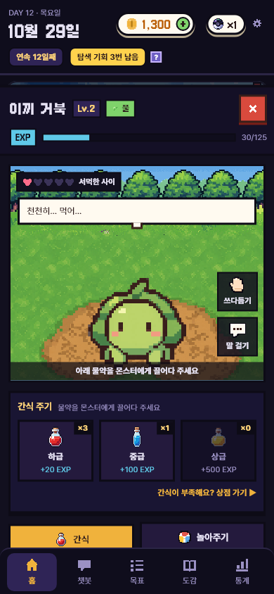
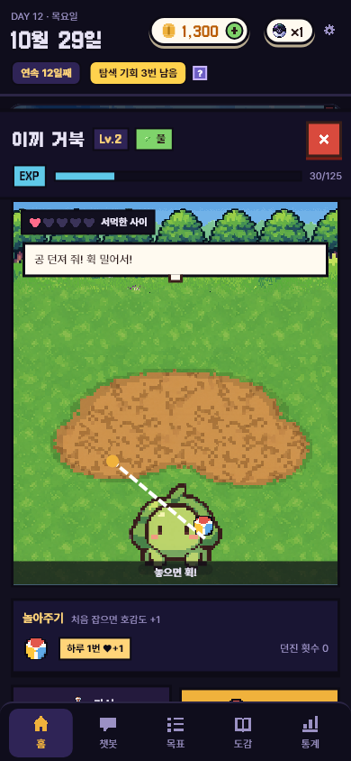
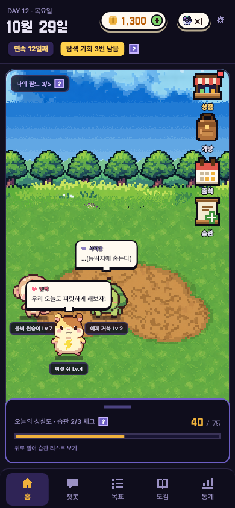

# 교감 창 개편 (공 던지기 · 물약 끌어 주기) + 홈 다듬기

- 날짜: 2026-10-29
- 상태: 구현 완료 (10-29)
- 관련: 브랜치 `feature/backend-game-system`, 디자인 시안 https://claude.ai/artifact/4fBCYaFjedcnPBQvDFGNKJ (교감 · 공 던지기 · 홈 판)

> 시안을 여러 번 고쳐서 정한 내용이다. 색 → 밝은 라벤더 → 피치 → 기존 색 → **밤 보라**, 모양 → 둥글게 → 덜 둥글게 → 교감 창은 **네모 픽셀**.

## 1. 왜 만드나
- **문제**: 교감 창이 "단순 버튼 4개 + 글자 목록"이라 몬스터와 노는 느낌이 없다. 색도 주황 머리 · 하늘 · 크림 · 검정이 섞여 홈(밤 보라)과 따로 논다. 홈 필드의 몬스터는 그림마다 가로 · 세로 비율이 달라 크기가 들쭉날쭉하다.
- **목표**: 물약은 몬스터에게 **끌어다 주고**, 놀아주기는 땅을 눌러 **공을 던지면 몬스터가 그 자리로 뛰어가** 잡는다. 화면은 홈과 같은 밤 보라 · 네모 픽셀로 맞춘다.
- **하지 않는 것**: 상점 · 가방 · 도감 등 다른 창의 색 바꾸기(이번엔 교감 창만), 호감도 · EXP 수치 변경, 서버 API 변경.

## 2. 누가 · 언제 쓰나
- 사용자: 매일 앱을 여는 사람. 홈 필드에서 몬스터를 눌러 교감 창을 연다.
- 사용 흐름
  1. 몬스터를 누르면 교감 창이 열린다. 기본 탭은 **간식**.
  2. 간식: 물약 칸을 길게 눌러 무대의 몬스터 위로 끌어다 놓으면 먹는다. 톡 누르기만 해도 먹는다.
  3. 놀아주기: 무대가 길어지고, 땅을 톡 누르면 공이 그 자리로 날아가고 몬스터가 뛰어가 잡는다.
  4. 쓰다듬기: 무대 위 몬스터를 문지르면 게이지가 차고, 다 차면 오늘의 쓰다듬기 완료.
  5. 말 걸기: 대사를 듣는다.

## 3. 규칙
- 교감 창 순서: 머리(이름 · Lv · 카테고리 · 닫기 · EXP 막대) → 무대 → **선택한 행동의 칸** → 행동 버튼 4개 → 가방에 넣기 · 대화 상대로.
- 행동 버튼 4개: 쓰다듬기 · 간식 · 놀아주기 · 말 걸기. 고른 버튼은 금색. 오늘 보상을 받은 것(쓰다듬기 · 놀아주기)에는 초록 ✓.
- 간식: 물약을 몬스터 위로 끌어다 놓거나 톡 누르면 먹인다 (지금과 같은 `GameRepository.feed`). 0개인 물약은 끌 수 없고 "상점 가기"가 보인다.
- 놀아주기: 무대 높이가 늘어난다. 땅(무대 아래쪽)을 누르면 공이 그 좌표로 날아가고, 몬스터가 그 좌표로 뛰어가 잡는다.
  - 오늘 처음 잡으면 `GameRepository.play`를 불러 ♥+1 (하루 1번, 지금 규칙 그대로). 그 뒤로는 서버를 부르지 않고 놀기만 한다.
  - 공이 날아가는 중 · 몬스터가 뛰는 중에는 다시 던질 수 없다.
  - 하늘 · 나무 쪽을 눌러도 공은 땅으로 떨어진다 (무대 위쪽 [가정] 40%는 던질 수 없는 곳).
- 쓰다듬기: 지금과 같다 (문지른 거리만큼 게이지, 하루 1번 ♥+2). 게이지는 무대 아래 칸에 보인다.
- 무대 배경은 홈 필드 그림, 몬스터는 무대 가운데 아래에 선다.
- "1차 진화까지 Lv.N" 같은 진화 안내는 **보여 주지 않는다** (사용자 요청).
- 홈: 필드의 몬스터는 모두 **같은 정사각형 칸([가정] 72×72)** 안에 비율 그대로 맞추고 발을 칸 바닥에 붙인다. 종마다 따로 정하던 높이(`fieldHeight`)는 없앤다.
- 홈 상단: "체크인하면 탐색 3회"는 없앤다. 챗봇 체크를 마친 뒤에만 "탐색 기회 N번 남음"을 보여 준다.
- 놀아주기 아이콘은 성실볼과 헷갈리지 않게 **비치볼** 픽셀 그림으로, 간식 아이콘은 **하급 물약 그림**으로 바꾼다.

| 항목 | 값 | 근거 |
| --- | --- | --- |
| 놀아주기 무대 높이 | [가정] 400px (평소 250px) | 시안 470px는 360폭 화면에서 아래가 잘려 줄임 |
| 공 날아가는 시간 · 몬스터 뛰는 시간 | [가정] 0.45초 · 0.7초 | 시안에서 정함 |
| 필드 몬스터 칸 | [가정] 72×72 | 지금 `fieldHeight`의 가운데 값(58 ~ 76) |

호감도 · EXP 수치는 그대로 (`Economy.petAffectionGain` · `playAffectionGain`).

## 4. 화면
- 시안: 위 링크의 "교감 — 간식 끌어 주기" · "교감 — 공 던지기" · "홈" 판. 밤 보라(`AppColors.night` 계열) + 3px 검정 테두리 + 아래로 떨어지는 그림자.
- 새로 만드는 것: 물약 끌어 주기, 땅을 눌러 공 던지기, 비치볼 아이콘.

## 5. 예외 · 경계
- 물약이 하나도 없을 때: 간식 칸에 0개 칸만 → "상점 가기".
- 최종형(Lv.20)일 때 물약: 지금처럼 "이미 최종형이에요".
- 오늘 이미 놀아줬을 때: 공놀이는 되고 보상 표시만 "오늘 ♥+1 받음".
- 좁은 화면(360×640): 창이 화면보다 길면 스크롤된다. 놀아주기 중에는 무대 위에서 스크롤이 일어나지 않게 한다.
- 서버 모드: `play` · `feed` · `pet`은 지금처럼 `GameRepository`를 거친다. 실패하면 오류 토스트, 화면 연출은 되돌리지 않는다.

## 6. 다른 곳에 미치는 영향
- 앱: `features/home/monster_overlay.dart`(대부분 새로), `home_screen.dart`(몬스터 칸), `main_shell.dart`(탐색 문구), `data/pixel_icons.dart`(비치볼), `data/models.dart` · `catalog.dart`(`fieldHeight` 삭제), 테스트 `home_test.dart`.
- 서버 · DB: 없음.
- 문서: `프로젝트-이해.md`(교감 · 홈), `결정-기록.md`, `기획-변경-이력.md`.

## 7. 완료 기준
- [ ] 물약을 끌어다 놓으면 먹는다 / 톡 눌러도 먹는다
- [ ] 놀아주기에서 땅을 누르면 공이 날아가고 몬스터가 그 자리로 간다, 첫 번째만 ♥+1
- [ ] 진화 안내 글이 없다
- [ ] 필드 몬스터가 같은 칸 크기로 보인다
- [ ] 체크 전엔 탐색 문구가 없고, 체크 후 "탐색 기회 N번 남음"
- [ ] `flutter analyze` 이상 없음, `flutter test` 전부 통과
- [ ] 화면 캡처 (390폭 · 360폭)
- [ ] 작업 기록 · 결정 기록 · 프로젝트 이해 갱신

## 8. 정해야 할 것
- [ ] 상점 · 가방 등 다른 창도 밤 보라로 맞출지 (사용자)
- [ ] [가정] 칸들 (무대 높이 · 시간 · 몬스터 칸 72) 확인 (사용자)

> 「현재」(10-29 오후 바뀜): 물약은 **끌어다 놓기만**, 놀아주기는 **스와이프 방향 · 세기대로 던지기**, 쓰다듬기 · 말 걸기는 무대 위 작은 버튼, 무대 310 · 430px, 아래 버튼은 간식 · 놀아주기 2개(작게). 위 3장의 "톡 누르면 먹인다" · "땅을 누르면"은 옛 내용.

## 9. 결과 (구현 뒤에 쓴다)
- 기획과 달라진 점: 놀아주기 중에도 창 스크롤은 막지 않는다 (360폭에서 아래 버튼에 닿아야 해서 — 막는 것은 쓰다듬기 때만). 물약 끌기는 **길게 눌러** 시작한다(그냥 끌면 스크롤과 겹침). 상점 · 상단 바 · 탭도 같은 날 시안대로 둥글게 바꿈(D-54).
- 확인한 것: `flutter test` 133개 통과 — 물약 톡 · 끌어 놓기, 공 던지기(첫 번째만 ♥+1, 두 번째는 놀기만), 진화 안내 없음, 체크 전 탐색 문구 없음. 390 · 360폭 캡처.
- 확인하지 못한 것: 실제 폰에서 손맛, 서버 모드.
- 화면:
    
- 다음에 할 일: 8장의 [가정] 확인, 가방 · 도감 등 다른 창 모양 맞추기.
