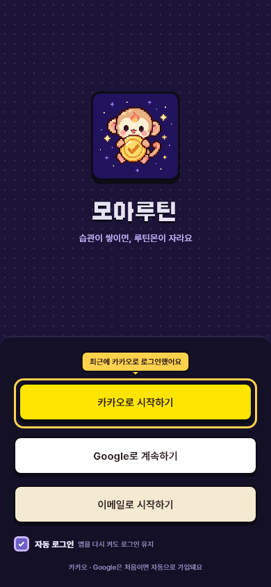
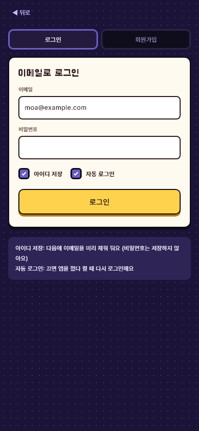

# 로그인 편의 (자동 로그인 · 최근 로그인 말풍선 · 아이디 저장)

- 날짜: 2026-10-29
- 상태: 구현 완료 (10-29)
- 관련: 브랜치 `feature/backend-game-system`, 디자인 시안 https://claude.ai/artifact/4fBCYaFjedcnPBQvDFGNKJ (로그인 · 이메일 로그인 판)

## 1. 왜 만드나
- **문제**: 로그아웃했다가 다시 들어올 때 무엇으로 가입했는지 헷갈리고, 이메일을 매번 다시 쳐야 한다. 자동 로그인을 끌 방법도 없다.
- **목표**: 마지막으로 쓴 로그인 수단을 말풍선으로 알려 주고, 이메일은 저장해 미리 채우고, 자동 로그인을 켜고 끌 수 있게 한다.
- **하지 않는 것**: 비밀번호 저장(보안 — 자동 로그인으로 충분), 여러 계정 목록, 서버 API 변경.

## 2. 누가 · 언제 쓰나
- 사용자: 로그아웃했거나, 자동 로그인을 끈 사람, 폰을 바꾼 게 아닌 같은 기기의 사람.
- 사용 흐름
  1. 앱을 켠다. 자동 로그인이 켜져 있고 저장된 로그인이 살아 있으면 바로 홈.
  2. 로그인 화면이 나오면, 지난번에 쓴 버튼 위에 "최근에 ○○로 로그인했어요" 말풍선이 있다.
  3. 이메일로 들어가면 "아이디 저장"을 켜 둔 경우 이메일이 미리 채워져 있다.

## 3. 규칙
- 로그인에 성공하면 그 수단(카카오 · Google · 이메일)을 "최근 로그인"으로 이 기기에 저장한다. 로그아웃해도 지우지 않는다.
- 로그인 화면은 최근 로그인이 있으면 그 버튼 위에 말풍선을 띄운다. 없으면(처음 쓰는 기기) 아무것도 없다.
- 자동 로그인 체크(로그인 화면 · 이메일 로그인 화면, 기본 **켜짐**):
  - 켜짐: 지금처럼 refresh 토큰을 기기의 안전한 저장소에 두고, 앱을 켤 때 복원한다.
  - 꺼짐: 앱을 켤 때 저장된 로그인을 쓰지 않고 지운다 → 로그인 화면. (이번 실행 안에서는 로그인 상태가 유지된다.)
- 아이디 저장 체크(이메일 로그인 화면, 기본 [가정] **켜짐**): 켜고 로그인에 성공하면 이메일을 저장해 다음에 미리 채운다. 끄면 저장된 이메일을 지운다. **비밀번호는 저장하지 않는다.**
- 저장 위치: 이미 쓰고 있는 `flutter_secure_storage`(Android Keystore · iOS Keychain · 웹은 브라우저 저장소). 새 패키지 없음.
- 시연 모드(서버 없음)에서도 말풍선 · 아이디 저장은 같다. 자동 로그인은 원래 복원할 것이 없어 의미가 없다.

## 4. 화면
- 로그인 화면: 최근 로그인 버튼 위 노란 말풍선 + 그 버튼 금색 테두리, 버튼들 아래 "자동 로그인" 체크.
- 이메일 로그인 화면(로그인 탭): 비밀번호 아래 "아이디 저장" · "자동 로그인" 체크. 회원가입 탭에서는 "자동 로그인"만.
- 픽셀 체크 상자는 새로 만든다 (기존 `PixelIcons.checkStroke` 사용).

## 5. 예외 · 경계
- 저장소 읽기가 실패하면(웹 개인 창 등) 기본값으로 보여 준다 (말풍선 없음, 체크는 기본값).
- 서버가 꺼져 있을 때 자동 로그인 복원 실패: 지금처럼 토큰을 남겨 두고 로그인 화면.
- 이메일 형식이 아닌 값은 저장하지 않는다 (성공한 로그인만 저장하므로 생기지 않음).

## 6. 다른 곳에 미치는 영향
- 앱: `core/auth/login_prefs.dart`(새), `auth_service.dart`(`AuthController`, `AuthService.forgetSavedLogin`), `http_auth_service.dart`, `features/auth/login_screen.dart` · `email_auth_screen.dart`, `app.dart` · `main.dart`, 테스트 `auth_test.dart`.
- 서버 · DB: 없음.
- 문서: `프로젝트-이해.md`(로그인), `결정-기록.md`.

## 7. 완료 기준
- [ ] 로그인 성공 → 로그아웃 → 로그인 화면에 최근 수단 말풍선
- [ ] 아이디 저장 켜고 이메일 로그인 → 다시 열면 이메일이 채워져 있다 / 끄면 비어 있다
- [ ] 자동 로그인 끄고 앱을 다시 켜면 로그인 화면
- [ ] `flutter analyze` 이상 없음, `flutter test` 전부 통과
- [ ] 화면 캡처
- [ ] 작업 기록 · 결정 기록 · 프로젝트 이해 갱신

## 8. 정해야 할 것
- [ ] 아이디 저장 기본값 켜짐 [가정] 확인 (사용자)

## 9. 결과 (구현 뒤에 쓴다)
- 기획과 달라진 점: 로그인 · 이메일 화면을 시안대로 둥근 모서리로 같이 바꿈(D-54). 이메일 로그인 탭 아래에 두 체크의 설명 상자를 둠.
- 확인한 것: `flutter test` — 로그아웃 뒤 "최근에 이메일로 로그인했어요" 말풍선 · 이메일 미리 채움, 저장 · 지우기(`AuthController`), 자동 로그인 끔 → 복원하지 않고 저장된 로그인 지움. 캡처.
- 확인하지 못한 것: 실제 기기 안전 저장소(`SecureLoginPrefsStore`)에 남는지 (폰 · 웹에서 앱을 다시 켜 보기).
- 화면:
   
- 다음에 할 일: 아이디 저장 기본값(켜짐) 확인.
