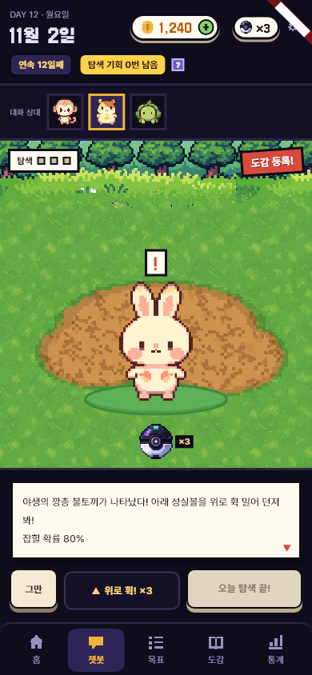
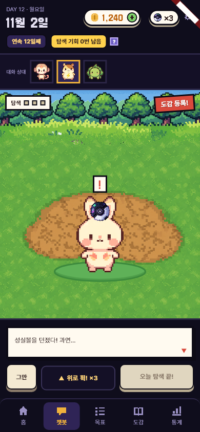
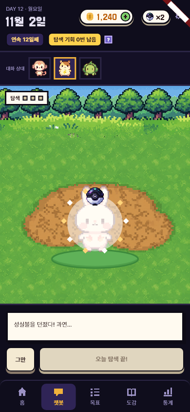
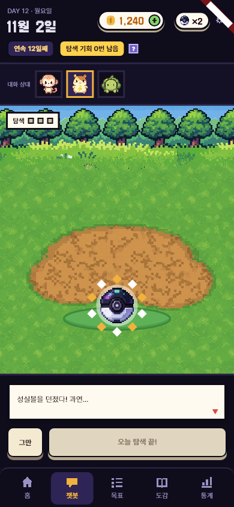
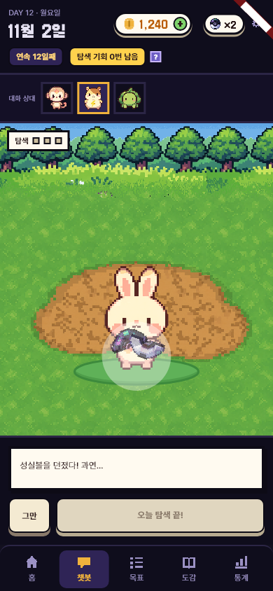

# 성실볼 직접 던지기 (탐색)

- 날짜: 2026-11-02
- 상태: 구현 완료 (2026-11-02)
- 관련: 탐색(`features/chat/explore_view.dart`) · 교감 창 놀아주기의 스와이프 던지기(D-52)

> 사용자가 고른 것 (11-02): 빗나가면 **볼을 쓰지 않고 다시 던진다**. 추측으로 채운 칸은 **[가정]**.

## 1. 왜 만드나
- **문제**: 지금은 [볼 던지기] 버튼을 누르면 볼이 흔들리고 결과가 나온다. "잡는다"는 손맛이 없다.
- **목표**: 손가락으로 볼을 **휙 밀어 던지고**, 날아가 맞고 빨려 들어가고 흔들리고 잡히는(또는 튀어나오는) 과정을 **이펙트로** 보여 준다.
- **하지 않는 것**: 잡을 확률 바꾸기(서버 규칙 그대로), 커브볼 · 명중 위치 보너스 같은 새 규칙, 소리 새로 만들기(있는 효과음 우선 **[가정]**).

## 2. 누가 · 언제 쓰나
- 사용자: 체크인 뒤 탐색에서 몬스터를 만난 사람.
- 흐름:
  1. 몬스터가 나타나면 화면 아래 가운데에 성실볼이 놓여 있다 ("볼을 위로 밀어 던져요").
  2. 볼을 잡고 위로 휙 민다 → 민 방향 · 세기대로 포물선을 그리며 회전하며 날아간다.
  3. **맞으면**: 번쩍 → 몬스터가 빛이 되어 볼로 빨려 들어감 → 볼이 땅에 떨어져 1 ~ 3번 흔들림 → 잡힘(별 터짐 · 딸깍) / 놓침(볼이 깨지듯 열리고 몬스터가 튀어나옴).
  4. **빗나가면**: 볼이 화면 밖/땅에 떨어졌다가 원래 자리로 굴러 돌아온다. 볼 수 그대로.

## 3. 규칙
- 맞았는지는 앱이 판정: 날아간 볼이 몬스터 그림의 상자(조금 넉넉하게)에 닿으면 맞음.
- **맞았을 때만** 서버에 던지기(`throwBall`)를 보낸다 → 그때 볼 1개 소모, 결과(잡힘/놓침)는 서버가 정한다.
- 흔들림 횟수는 연출만: 잡힘 3번, 놓침 1 ~ 2번 **[가정]**.
- 빗나감은 횟수 제한 없음. 볼이 0개면 던질 볼이 없고 [볼 사기] 버튼 (지금과 같음).
- 접근성: 화면 읽기에서는 "볼 던지기" 동작 하나로 바로 맞힌 것처럼 처리 (교감 창 물약과 같은 방식).

| 항목 | 값 | 근거 |
| --- | --- | --- |
| 맞음 판정 상자 | 몬스터 그림 크기의 1.2배 | **[가정]** 너무 어렵지 않게 |
| 최소 밀기 세기 | 300 px/s 미만이면 던지지 않고 볼이 제자리 | **[가정]** 실수로 톡 친 것 거르기 |
| 날아가는 시간 | 0.5초 안팎 | 교감 창 공(0.45초)과 맞춤 |

## 4. 화면
- 시안에 없음, 새로 만든다. 탐색 화면의 몬스터 · 배경은 그대로, 아래 [볼 던지기] 버튼 자리를 **볼 놓는 자리**로 바꾼다. [다시 탐색] · [그만]은 남긴다.
- 이펙트: 회전 · 그림자 · 맞는 순간 흰 번쩍 · 빛 줄기 빨려 들기 · 흔들림 · 별 조각 터짐 / 깨진 조각. 모두 Flutter 위젯 애니메이션으로 (새 패키지 없음 **[가정]**).

## 5. 예외 · 경계
- 던지는 중 · 결과 기다리는 중에는 다시 던질 수 없다.
- 서버 오류: 볼은 안 쓴 것으로 되돌리고 "다시 던져 주세요" (지금 오류 처리와 같음).
- 앱을 끄면: 지금처럼 만난 몬스터는 남아 있다(`pendingEncounter`).
- 360폭: 볼 자리 · 몬스터 위치 비율로.
- 위젯 테스트: 반복 애니메이션 없이(정해진 시간 뒤 끝남) — `pump`만으로 테스트가 끝나게.

## 6. 다른 곳에 미치는 영향
- 앱: `explore_view.dart`(볼 · 이펙트), `chat_controller.dart`의 던지기 흐름(맞았을 때만 호출), 탐색 테스트.
- 서버 · DB: 없음 (같은 `throwBall` API).
- 문서: 프로젝트-이해(탐색 설명) · 결정-기록(빗나가면 볼 안 씀).

## 7. 완료 기준
- [ ] 위로 밀어 던지기 · 맞음/빗나감 판정 · 빗나가면 볼 그대로
- [ ] 잡힘/놓침 이펙트 끝까지 (캡처 여러 장)
- [ ] 기존 탐색 테스트 + 새 테스트(빗나감 볼 유지, 맞음 볼 1개 소모)
- [ ] `flutter analyze` · `flutter test` 통과, 390폭 · 360폭 캡처
- [ ] 작업-기록 · 결정-기록 · 프로젝트-이해 갱신

## 8. 정해야 할 것
- [ ] 판정 상자 1.2배 · 최소 세기 — 만져 보고 사용자가 조정
- [ ] 잡힘 · 놓침 효과음 새로 넣을지 — 사용자

## 9. 결과 (구현 뒤에 쓴다)
- 기획과 달라진 점: 흔들림은 잡힘 좌우 6번(약 1.2초) · 놓침 3번. 아래 줄 가운데 버튼 자리는 "▲ 위로 휙! ×N" 안내(누르는 버튼 아님), 볼이 0개면 [볼 사기]. 짧게 밀어도 잡히게 손을 대는 즉시 볼을 잡는다. 효과음은 넣지 않음.
- 확인한 것: `flutter analyze` 이상 없음, `flutter test` 148개 통과 (살짝 밀기 → 제자리, 빗나감 → 볼 그대로, 맞음 → 볼 1개 · 잡힘/놓침 팝업). 연출을 0.11초 간격 프레임으로 찍어 눈으로 확인.
- 확인하지 못한 것: 실제 폰에서 손맛(세기 0.18 · 판정 1.2배가 적당한지), 360폭.
- 화면:

| 준비 | 날아감 | 빨려 들기 | 잡힘 (별) | 놓침 (튀어나옴) |
| --- | --- | --- | --- | --- |
|  |  |  |  |  |

- 다음에 할 일: 폰에서 만져 보고 세기 · 판정 조정, 효과음(사용자 결정).
