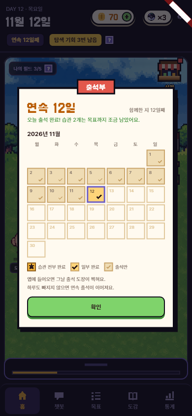
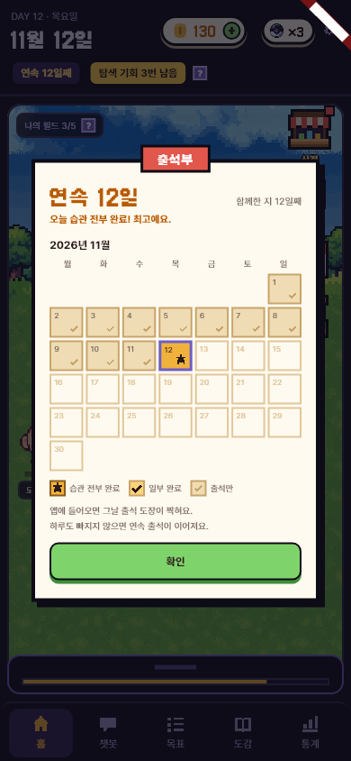
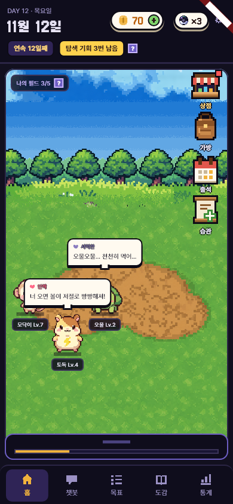
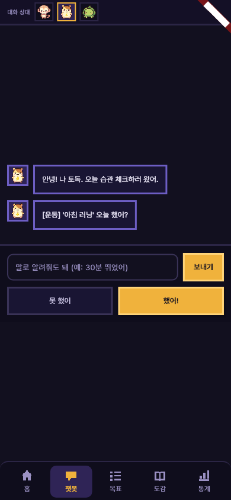
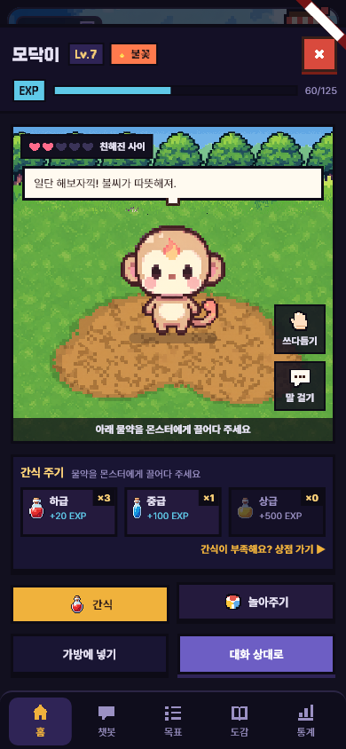

# UI 다듬기 — 출석부 습관 결과 · 챗봇 자판 · 홈 시트 · 교감 창

- 날짜: 2026-11-12
- 상태: 구현 완료
- 관련: 브랜치 `feature/ui-fixes` · 결정 D-68

## 1. 왜 만드나
- **문제** (사용자가 써 보고 말한 네 가지):
  1. 출석부에서 습관을 다 한 날과 덜 한 날이 똑같이 보인다.
  2. 챗봇에서 자판을 올리면 위쪽(상단 바 · 탭 줄 · 대화 상대 줄)이 커서 대화가 안 보인다.
  3. 홈 아래 슬라이드 시트가 접혀 있어도 글자가 많고 커서 필드를 가린다.
  4. 교감 창(캐릭터 상세)이 상단 바 아래에서 열려, 위가 비어 보인다.
- **목표**: 네 화면을 더 깔끔하게 하고, 출석부만 봐도 오늘 습관을 얼마나 했는지 알게 한다.
- **하지 않는 것**: 지난 날의 습관 결과 저장 (앱에 저장소가 없고 서버 API도 없다 — 8장).

## 2. 누가 · 언제 쓰나
- 매일 쓰는 사람이 홈 → 출석 아이콘, 챗봇에서 말로 답하기, 홈에서 몬스터 누르기.

## 3. 규칙
- **출석부 오늘 칸**은 세 가지로 그린다.
  - 습관 전부 완료: 오늘 물은 습관을 모두 기록했고, 모두 목표를 채웠다(점수 ≥ `Economy.targetHitScore` = 20, 달성률 100%) → 진한 금색 칸 + 별.
  - 일부 완료: 체크인은 했지만 하나라도 목표에 못 미치거나 기록이 없다 → 연한 금색 칸 + 체크.
  - 체크인 전: 출석 도장만 (연한 칸 + 작은 연한 체크).
- **지난 날 칸**은 출석했으면 "출석만" 도장. (날짜별 습관 결과가 없다)
- 출석부 위 문구: 전부 = "오늘 습관 전부 완료! 최고예요." / 일부 = "오늘 출석 완료! 습관 N개는 목표까지 조금 남았어요." / 체크 전 = "오늘 출석 완료! 습관 체크도 해 볼까요?"
- 달력 아래에 범례 3칸(습관 전부 완료 · 일부 완료 · 출석만).
- **챗봇 탭에서 자판이 올라오면** 상단 바와 [챗봇 | 공부 타이머] 줄을 숨기고, 대화 상대 줄을 얇게(칸 46 → 32) 한다. 자판을 내리면 돌아온다.
- **홈 시트가 접히면** 글자 없이 손잡이 + 성실도 막대만 (높이 108 → 44). 누르거나 위로 밀면 펼쳐진다. 성실도 ? 는 펼친 "오늘의 성실도" 쪽에 있다. 읽기 도우미에는 점수 · 체크 수를 말로 알린다.
- **교감 창이 열려 있는 동안** 상단 바를 숨겨 창이 화면 위 끝까지 찬다.

## 4. 화면
- 프로토타입에 없는 변경 (출석부 자체가 추가 기능).

## 5. 예외 · 경계
- 습관이 하나도 없으면 결과 없음(체크 전과 같게).
- 서버 모드: 오늘 결과는 서버 체크인 응답의 점수(`scoreOf`)로 같은 규칙. D-51(자기 보고 상한 20)이 들어와도 기준이 20이라 그대로 맞다.
- 다시 체크(resubmit)로 값을 고치면 출석부 오늘 칸도 최신 값으로 바뀐다.

## 6. 다른 곳에 미치는 영향
- 앱: `GameState.todayHabitResult` · `todayHabitsLeft` 추가, `MainShell.setTopBarHidden`, `ChatScreen.keyboardOpen`. 테스트 2개(guide · home) 고침.
- 서버 · DB: 없음 (지난 날 결과는 8장 제안).

## 7. 완료 기준
- [x] `flutter analyze` 이상 없음, `flutter test` 152개 전부 통과
- [x] 골든 캡처로 눈 확인 (390폭)
- [x] 작업-기록 · 결정-기록 · 기획-변경-이력 · 프로젝트-이해

## 8. 정해야 할 것
- [ ] 지난 날도 "전부/일부"로 보이려면 서버에 날짜별 체크 결과가 필요하다. 예: `GET /me/attendance?month=2026-11` → 날짜별 `{attended, checkedIn, allTargetsHit}` (DB `habit.daily_checkin`에서 계산). **윤서에게 제안** — 명세는 Claude가 고치지 않는다.

## 9. 결과
- 기획과 달라진 점: 처음엔 "전부 완료 = 습관마다 만점(25)"으로 말했지만, 코드에 이미 있는 "목표를 딱 채운 점수" `targetHitScore`(20)로 바꿨다. 25는 목표를 넘겨야 나오는 점수라 "다 했다"보다 엄격하다.
- 확인한 것: 테스트 152개 통과, 골든 PNG 5장 눈 확인. 확인하지 못한 것: 360폭, 실제 자판(에뮬레이터에서 확인 예정).
- 화면:
  - 
  - 
  - 
  -  (테스트에서 자판 자리 300px을 비운 모습 — 실제로는 자판이 아래 탭을 덮는다)
  - 
