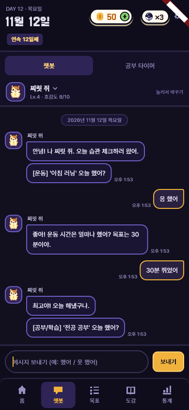
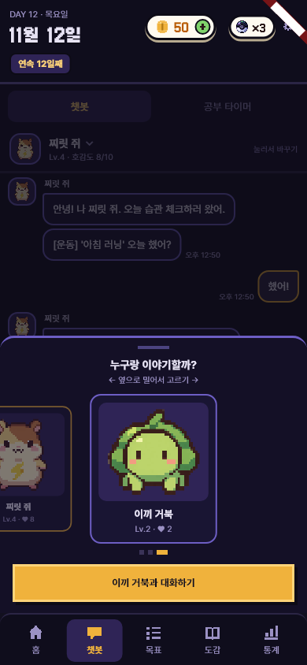

# 챗봇 메신저형 화면 (카톡 같은 채팅방)

- 날짜: 2026-11-12
- 상태: 구현 완료 (색은 그대로, 화면 구성만)
- 관련: 브랜치 `feature/light-design` (`feature/ui-fixes` 위) · 밝은 화면 시안 `docs/design/light/라이트-시안.html`

## 1. 왜 만드나
- **문제**: 챗봇이 "게임 대화창"처럼 보여서 캐릭터와 이야기하는 느낌이 약하다. 위쪽 "대화 상대" 줄이 늘 자리를 차지한다.
- **목표**: 메신저(카톡) 채팅방처럼 보이게 해서 캐릭터들이랑 카톡하는 느낌. 대화 상대는 프로필을 눌러 옆으로 밀어 고른다.
- **하지 않는 것**: 색 바꾸기(밝은 화면은 따로 — 시안만 만들어 둠), 몬스터마다 채팅방을 따로 두는 것, 대화 기록 저장, 카카오 상징색(노랑) 쓰기.

## 2. 누가 · 언제 쓰나
- 매일 챗봇 탭에서 습관을 체크하거나 말을 거는 사람.

## 3. 규칙
- 채팅방 위 **머리글**: 대화 상대 프로필(둥근 네모) · 이름 · ⌄ · "Lv.N · 호감도 n/10". 친구가 2마리 이상이면 오른쪽에 "눌러서 바꾸기".
- 머리글을 누르면 **상대 고르기 창**이 아래에서 올라온다. 카드를 양옆으로 밀면 가운데 카드가 커지고(나머지는 작고 흐림), 점이 따라간다. 버튼 "○○와 대화하기"로 바꾼다. 지금 상대면 버튼은 "지금 ○○와 이야기 중"(누르면 닫힘). 바깥을 눌러도 닫힌다.
- 방금 잡은 몬스터는 결과 팝업을 닫은 뒤에 고르기 창에 나온다 (전과 같음).
- **말풍선**: 몬스터는 왼쪽, 나는 오른쪽. 같은 쪽이 이어서 말하면 프로필 · 이름은 첫 말풍선에만, 시간("오후 2:13")은 마지막 말풍선 옆에만. 맨 위에 날짜 줄.
- 시간은 그 말이 화면에 처음 나온 시각이다 (대화 기록을 저장하지 않으므로 앱을 다시 켜면 새로 찍힌다).
- **입력 줄**: ~~빠른 답장 버튼(했어! / 못 했어 / 30분)~~ → **없앰 (사용자 11-12 "그냥 채팅방으로만")**. 알약 모양 입력칸 + 보내기 하나로 말로만 답한다. 안내 글: "메시지 보내기 (예: 했어 / 못 했어)", 양을 물을 때는 "(예: 30분 했어)".
- 시연 모드(AI 없음)는 말을 직접 읽는다: "못/안 했어 · 아니" → 0, 숫자 → 그 값, "했어 · 응 · 다 했어" → 했다/안 했다 습관은 1, 양을 재는 습관은 "얼마나 했어?"로 되묻는다. 못 알아들으면 "'30분 했어'나 '못 했어'처럼 말해 줄래?". 서버 모드는 전처럼 AI 해석.
- 말로 답하면 제출 전에 확인 카드("이대로 기록할까?" — 고칠래 / 맞아!)가 한 번 나온다 (D-57 그대로).
- 확인 카드 · 오늘 습관 체크 시작 · 다시 체크 · 탐색하기 버튼은 그대로 (답이 아니라 할 일 버튼).
- 색은 지금 어두운 색 그대로 (상대 말풍선 = 진보라 + 보라 테두리, 내 말풍선 = 어두운 보라 + 금색 테두리).

## 4. 화면
- 프로토타입에 없는 새 구성 (사용자 요청 11-12).

## 5. 예외 · 경계
- 친구가 없으면 머리글은 "대화 상대 없음", 눌러도 안 열린다.
- 자판이 열리면 머리글을 얇게 (프로필 30, 레벨 줄 · "눌러서 바꾸기" 숨김) — UI 다듬기(11-12)와 같은 규칙.
- 좁은 화면: 말풍선은 폭의 68%까지, 시간이 붙어 넘치면 말풍선이 줄어든다.

## 6. 다른 곳에 미치는 영향
- 앱: `chat_controller.dart`(시연 모드 말 읽기 `_readLocally`, 타이머 안내 문구) · `chat_screen.dart` (`_roomHeader` · `_PartnerPicker` · `_Bubble` · `_PillField` · `_SendButton` · `_DayDivider`). 모델 · 규칙은 그대로.
- 테스트: `chat_test` — 대화 상대 줄 대신 고르기 창을 열어 밀고 바꾸는 것으로. 버튼 대신 `say(tester, '못 했어')`(`game_harness.dart`)로 말하고 확인 카드 [맞아!]. bgm · catch_ball · ai_chat 테스트도 같이.

## 7. 완료 기준
- [x] `flutter analyze` 이상 없음, `flutter test` 152개 통과
- [x] 골든 캡처 2장 눈 확인
- [ ] 에뮬레이터에서 밀기 손맛 확인 (사용자)

## 8. 정해야 할 것
- [ ] 밝은 화면(시안)을 앱에 입힐지 — 사용자
- [ ] [챗봇 | 공부 타이머] 줄을 계속 둘지 (머리글과 겹쳐 위가 두 줄) — 사용자

## 9. 결과
- 화면:
  - 
  - 
- 막혔던 것: "▾" 글자가 글꼴에 없어 네모로 나와 아이콘(⌄)으로 바꿈. 말풍선 + 시간이 좁은 화면에서 8px 넘쳐 말풍선이 줄어들게 고침. 고르기 창은 가운데 근처 카드만 그려서 테스트는 밀어서 찾게 함.
