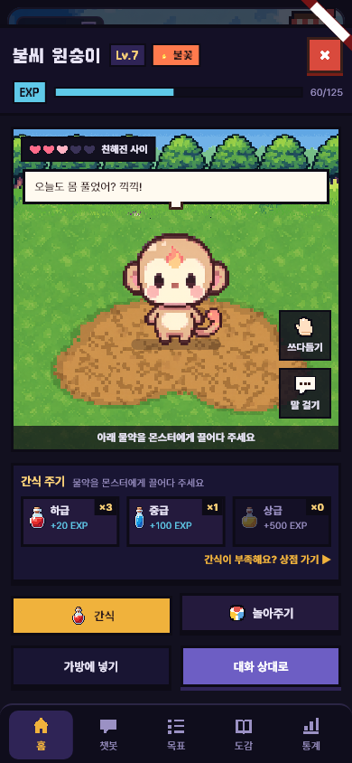
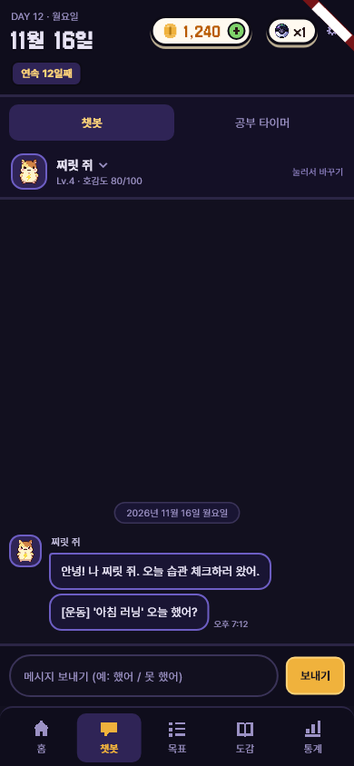

# 호감도 밸런스 — 천천히 오르게

- 날짜: 2026-11-16
- 상태: 앱 구현 완료 · 서버는 설정값 변경 제안 (윤서 확인 전)
- 관련: `docs/economy-v1.md` 호감도 · D-20(필드 끌기) · D-46(서버 모드 끌기 호감도 끔) · D-77 · DB `balance_config` (`affection_*`) · 서버 제안 `docs/제안/2026-11-16-호감도-밸런스-서버.md`

## 1. 왜 만드나
- **문제**: 하루 +3(쓰다듬기 +2 · 놀아주기 +1)이라 첫 파트너(시작 3)는 **이틀이면 단짝**, 사흘이면 최대. 잡은 몬스터도 사흘이면 단짝. 금방 끝나서 "친해지는 과정"이 없다 (사용자 11-16).
- **목표**: 매일 다 챙기면 **친해짐까지 약 6일, 단짝까지 약 2주**, 최대까지 약 3주 (사용자 11-16 "단짝 2주는 잡으면 좋겠는데 친해짐도 좀 더 늘려서").
- **하지 않는 것**
  - 새로 오르는 길(간식 · 체크인 호감도) — 사용자 11-16 "간식 부분 그냥 없애고 기존 스키마랑 변동 없이 기준만 바꿔서 숫자만". 물약을 "간식"이라 부르기도 어색했다. → **서버는 `balance_config` 값만 바꾸면 되고 코드 · 스키마 · 명세는 그대로.**
  - 호감도 보상(골드 · EXP), 안 보면 줄기 (힐링물).

## 2. 누가 · 언제 쓰나
- 매일 홈에서 몬스터를 쓰다듬고 놀아 주는 사람.

## 3. 규칙

> **현재**: 0~100 · 친해짐 30 / 단짝 70 · 쓰다듬기 +3 · 놀아주기 +2 (하루 +5) · 첫 파트너 5부터

| 항목 | 지금 | 바꾼 뒤 | 근거 |
| --- | --- | --- | --- |
| 호감도 범위 | 0 ~ 10 | **0 ~ 100** | 0~10에서는 하루 +1 · +1(최소)만 돼도 이틀이면 친해짐. 2주를 만들려면 칸이 더 잘아야 한다 |
| 단계 하한 (친해짐 / 단짝) | 4 / 7 | **30 / 70** | 단짝 비율은 그대로(70%), 친해짐은 40% → 30% |
| 쓰다듬기 (하루 1번) | +2 | **+3** | 쓰다듬기가 놀아주기보다 큰 지금 관계 유지 |
| 놀아주기 (하루 1번) | +1 | **+2** | |
| 필드 끌기 (시연 모드만, D-46) | +1 | +1 그대로 | 서버 모드는 계속 끔 |
| 첫 파트너 시작 호감도 | 3 | **5** | 잡은 몬스터보다 하루쯤 앞서게 |
| **하루 최대** (서버 모드) | +3 | **+5** | 단짝 70 ÷ 5 = 14일 |

### 걸리는 날

| | 친해짐(30) | 단짝(70) | 최대(100) |
| --- | --- | --- | --- |
| 첫 파트너 — 지금 (3부터, +3/일) | 1일 | 2일 | 3일 |
| 첫 파트너 — 바꾼 뒤 (5부터, +5/일) | **5일** | **13일** | **19일** |
| 잡은 몬스터 — 지금 (0부터) | 2일 | 3일 | 4일 |
| 잡은 몬스터 — 바꾼 뒤 (0부터, +5/일) | **6일** | **14일** | **20일** |
| 잡은 몬스터, 쓰다듬기만 (+3/일) | 10일 | 24일 | 34일 |

- 오른 뒤 달라지는 것은 지금과 같다: 단계별 대사 · AI 말투 · 하트 표시.
- 하트 5칸: 한 칸 = 20점, 10점 이상 남으면 반 칸.

## 4. 화면
- 교감 창 하트 5칸 (한 칸 = 20). 챗봇 머리글 "호감도 n/100". 그 밖에 모양은 그대로.

## 5. 예외 · 경계
- **이미 쌓인 호감도(서버 DB)**: 0~10 → ×10으로 옮긴다 (4 → 40). 단계가 그대로 유지된다 (4=친해짐 → 40=친해짐, 7=단짝 → 70=단짝). 데이터만 바꾸는 SQL 한 줄 (서버 제안).
- 최대(100)에서는 더 오르지 않는다 (99에서 쓰다듬기 → +1).

## 6. 다른 곳에 미치는 영향
- 앱: `economy.dart`(상수 + 단계 하한 · 하트 한 칸) · `models.dart`(`tierOf`가 상수 사용) · `monster_overlay.dart`(하트) · `game_state.dart`(시연 샘플 몬스터 값 ×10) · 테스트. 챗봇 머리글은 `Economy.maxAffection`을 이미 써서 "/100"이 저절로.
- **서버 · DB (윤서)**: `balance_config` 5개 값 바꾸기 + 기존 호감도 ×10. 서버는 이 값을 설정에서 읽고(`BalanceConfig`), `affection` 열은 `CHECK (affection >= 0)`뿐이라 **코드 · 스키마 변경 없음**. → `docs/제안/2026-11-16-호감도-밸런스-서버.md`
- **앱과 서버를 같이 내보낸다**: 앱만 바뀌고 서버가 0~10을 주면 하트가 거의 비어 보이고 모두 "서먹한 사이"가 된다.
- 문서: economy-v1 호감도 · 결정-기록 D-77 · 기획-변경-이력 · 프로젝트-이해.

## 7. 완료 기준
- [x] 앱 상수 바꿈, `flutter analyze` 이상 없음 · `flutter test` 159개 통과
- [x] 하트 · 머리글 캡처 확인
- [ ] 서버 제안 → 윤서 확인 · `balance_config` 반영
- [x] 기록 갱신

## 8. 정해야 할 것
- [x] 숫자 — 사용자 11-16 ("단짝 2주" → 간식 · 체크인 빼고 숫자만)
- [ ] 서버 값 반영 시점 — 윤서 (앱 `dev` 머지와 같이)

## 10. 간식 아이템 (11-16 확정, D-79)
- 배경: 간식은 물약과 다른 **새 아이템**. 그림 · 상점 · 가격(골드)은 사용자(성수연), 서버 API는 윤서, 호감도 수치 · 앱 연결은 Claude.
- 원칙: 하루 최대는 **+5 그대로** — 단짝 약 2주 기준을 지킨다.
- Claude 제안은 쓰다듬기 2 · 놀아주기 2 · 간식 1 (골드로 호감도를 사는 길을 작게) → **사용자 결정: 쓰다듬기 1 · 간식 2** ("쓰다듬기를 1로 간식을 2로").

> **현재**: 쓰다듬기 +1 · 놀아주기 +2 · 간식 +2 (몬스터마다 하루 첫 간식만) — 하루 +5

| 항목 | 전 | 지금 |
| --- | --- | --- |
| 쓰다듬기 | +3 | **+1** |
| 놀아주기 | +2 | +2 |
| 간식 (몬스터마다 하루 1번, 그 뒤엔 먹기만) | — | **+2** |
| 하루 최대 | +5 | +5 그대로 |

| 잡은 몬스터 (0부터) | 친해짐(30) | 단짝(70) | 최대(100) |
| --- | --- | --- | --- |
| 셋 다 (+5/일) | 6일 | 14일 | 20일 |
| 간식 없이 쓰다듬기 + 놀아주기 (+3/일) | 10일 | 24일 | 34일 |
| 쓰다듬기만 (+1/일) | 30일 | 70일 | 100일 |

- 간식을 사는 사람이 확실히 빨리 친해진다 (간식이 하루 몫의 40%). 상점 가격으로 조절 (사용자).
- 앱 지금 한 것: `Economy.petAffectionGain` 1, `Economy.feedAffectionGain` 2 (상수만). **남은 것** (간식 아이템 · API가 나오면): 시연 모드 간식 규칙, 교감 창 간식 칸에서 하트 오르기, 몬스터 "오늘 간식 줌" 표시, 서버 응답 반영, 테스트.
- 서버 (윤서): `affection_pet_gain` 3 → 1, 새 키 `affection_feed_gain` 2, 간식 API 응답에 호감도 · 오늘 줬는지.

## 9. 결과
- 화면:
  - 
  - 
- 바뀐 과정: 1차안(하루 +10, 단짝 1주) → 2차안(간식 +1 · 체크인 +2 추가, 단짝 2주) → **최종: 새 길 없이 기존 두 행동 숫자만** (서버 코드 · 스키마 변경 없이 가려고).
- 막혔던 것: 임시 골든 테스트에서 `MaterialApp`에 앱 테마를 안 넣어 한글이 네모로 나옴 → `theme: AppTheme.build()`.
