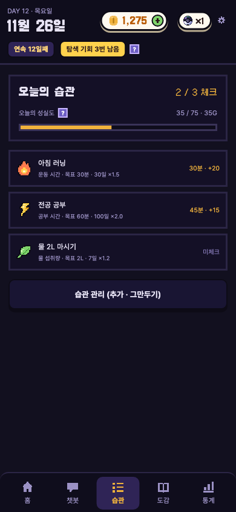
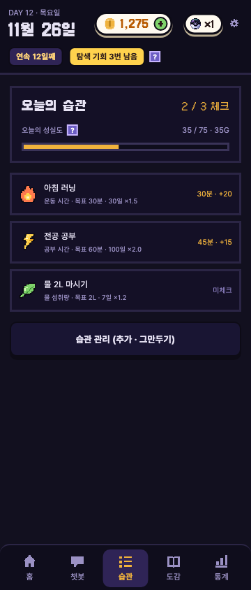
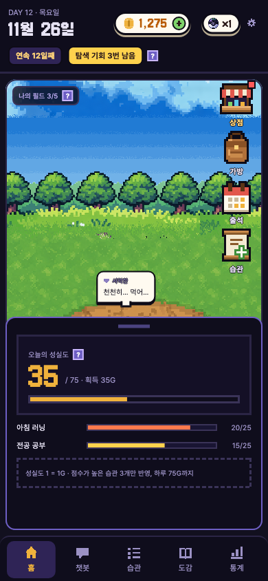
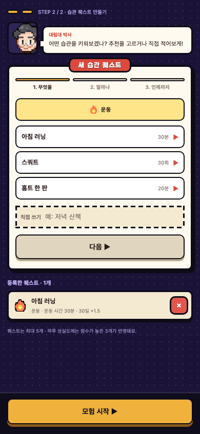

# 습관 탭 · 목표 제거

- 날짜: 2026-11-25
- 상태: 구현 완료 (사용자 11-25 확인 — 바텀시트는 남기고 성실도만, 목표 앱 코드 전부 삭제, 퀘스트는 이번에 하지 않음)
- 관련: 브랜치 `feature/habit-tab` · 퀘스트 [기획서](2026-11-12-퀘스트-시스템.md) (팀원이 나중에 진행)

## 1. 왜 만드나
- **문제**: 홈에서 습관 리스트를 보려면 바텀시트를 펼친 뒤 [습관 리스트] 탭을 골라야 한다. "홈에서 습관 리스트를 한눈에 볼 수 있는 장치가 있으면 좋겠다"는 피드백을 받았다 (11-25).
  가운데 탭인 목표(주간 · 월간)는 앞으로 일일 · 주간 퀘스트로 대신할 예정이다.
- **목표**: 하단 가운데 탭에서 바로 오늘 습관 리스트를 본다. 목표 기능은 앱에서 없앤다.
- **하지 않는 것**
  - 퀘스트 구현 (팀원이 나중에 — 퀘스트 기획서는 이번에 고치지 않는다)
  - 서버 `/goals` API · DB 테이블 정리 (서버 담당이 정한다 → 8장 제안)
  - 줄어든 골드를 다른 수치로 메우기 (6장)

## 2. 누가 · 언제 쓰나
- 사용자: 매일 쓰는 사람
- 상황: 하단 탭을 오가다가, 또는 체크인 전후에 오늘 한 것 · 남은 것을 보고 싶을 때
- 사용 흐름:
  1. 하단 가운데 **습관** 탭을 누른다.
  2. 맨 위에 오늘 체크 수와 성실도, 아래에 내 습관이 한 줄씩 보인다 (체크 상태 · 값 · 점수).
  3. 체크 전이면 "챗봇에게 오늘 습관 체크받기"로 챗봇 탭에 간다.
  4. "습관 관리"를 누르면 지금의 습관 관리 화면(추가 · 그만두기)이 열린다.

## 3. 규칙
- 하단 탭은 `홈 · 챗봇 · 습관 · 도감 · 통계` 순서다. 습관 탭 아이콘은 지금 목표 탭이 쓰던 체크리스트 아이콘을 그대로 쓴다.
- 습관 탭의 한 줄은 지금 바텀시트의 [습관 리스트] 한 줄과 같은 내용이다 (값 · +점수 · 미체크 · "반영 안 됨").
- 홈 바텀시트는 남긴다. 접힌 모양(성실도 막대)은 그대로이고, 펼치면 **오늘의 성실도만** 보인다 ([습관 리스트 | 오늘의 성실도] 탭을 없앰).
- 온보딩은 2단계(카테고리 + 첫 파트너 → 습관)로 끝나고 바로 홈으로 간다. 서버에는 `goals: []`를 보낸다.
- 서버 모드에서 앱은 `GET /goals`를 더 부르지 않는다.
- 홈 오른쪽의 "습관" 아이콘(습관 관리 화면)은 그대로 둔다.

| 항목 | 전 | 후 | 근거 |
| --- | --- | --- | --- |
| 주간 목표 | 개당 40G · 3칸 | 없음 | 퀘스트로 대체 예정 (사용자 11-25) |
| 월간 목표 | 150G · 1칸 | 없음 | 같음 |

## 4. 화면
- 새로 만드는 것: 가운데 **습관** 탭 (`features/habits/habits_screen.dart`). 시안에는 없고, 바텀시트의 습관 리스트를 옮긴 것이다.
- 바뀌는 것: 홈 바텀시트(펼친 화면), 온보딩 단계 표시(1/3 → 1/2), 튜토리얼의 "오늘의 성실도" · "목표와 도감" 단계 문구, "골드 얻는 법"에서 목표 줄.

## 5. 예외 · 경계
- 습관이 하나도 없을 때: "아직 습관이 없어요" + 습관 관리 버튼.
- 오늘 체크를 마쳤을 때: 체크받기 버튼을 숨긴다 (지금 시트와 같음, 10-29).
- 좁은 화면(360폭): 지금 시트 한 줄과 같은 배치라 그대로 들어간다.
- 서버 모드: 습관 값은 `load()`가 채운 그대로 쓴다. 이미 목표를 만든 계정이 있어도 앱에서는 보이지 않는다 (서버 데이터는 남음).

## 6. 다른 곳에 미치는 영향
- 앱: `GameState`(goals · 목표 규칙 · `applyGoal…` 삭제), `GameRepository` 3곳(목표 메서드 삭제), `models.dart`(`Goal` · `GoalTier` 삭제), `economy.dart`(목표 상수 삭제), 온보딩(`step_goals.dart` 삭제), 셸 · 튜토리얼, 테스트(`goals_test.dart` 삭제 · 온보딩 · 안내 · 서버 연동 테스트 수정).
- 서버 · DB: 바꾸지 않는다.
- 경제: 표준 유저 수입에서 **주 120G + 월 150G**가 빠진다 (`economy-v1.md` 표준 유저 가정). 퀘스트가 생기기 전까지 진화 · 상점 소비가 그만큼 느려진다 — **알고 받아들임**, 퀘스트 때 다시 맞춘다.
- 문서: `economy-v1.md` · `결정-기록.md` · `기획-변경-이력.md` · `프로젝트-이해.md` · `작업-기록.md` · `frontend/CLAUDE.md`(목표 언급).

## 7. 완료 기준
- [x] 가운데 탭이 습관 리스트를 보여 준다
- [x] 바텀시트를 펼치면 오늘의 성실도만 보인다
- [x] 온보딩이 2단계로 끝나고 홈으로 간다
- [x] 앱 코드에 `Goal` · `/goals` · 목표 골드가 남아 있지 않다 (온보딩 요청의 빈 `goals: []`만 — 명세가 받는 필드)
- [x] `flutter analyze` 이상 없음, `flutter test` 전부 통과
- [x] 화면을 눈으로 확인 (390폭 · 360폭)
- [x] `작업-기록.md` · `결정-기록.md` · `프로젝트-이해.md` 갱신

## 8. 정해야 할 것
- [ ] 서버 `/goals` API · `goal` 테이블 · `POST /onboarding`의 `goals` 필드를 없앨지 — 서버 담당(윤서). 앱은 이미 안 쓴다.
- [ ] 퀘스트 기획서의 업적 "목표 달성"(4-6장 E) 처리 — 퀘스트 담당 팀원.
- [ ] 줄어든 수입을 퀘스트 보상으로 얼마나 메울지 — 퀘스트 담당 팀원.

## 9. 결과 (구현 뒤에 쓴다)
- 기획과 달라진 점: 바텀시트 펼친 높이를 470 → 310으로 줄였다 (성실도만 남아 아래가 비어서). 그 밖에는 기획대로
- 확인한 것: `flutter analyze` 이상 없음, `flutter test` 153개 통과 (새 `habits_screen_test.dart` 3개 포함), 캡처로 390폭 · 360폭
- 확인하지 못한 것: 실제 iPhone · 서버 모드에서 눌러 보기 (작업-기록 참고)
- 화면:
  -  
  - 
  - 
- 다음에 할 일: 8장의 정할 것 (서버 담당 · 퀘스트 담당)
