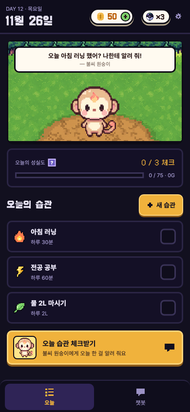
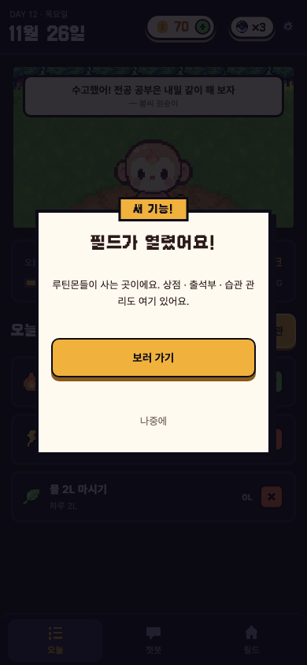

# 기능 단계별 열기 · 튜토리얼 확장

- 날짜: 2026-11-26
- 상태: 구현 완료 (사용자 11-26 — 행동으로 열기 · 앱에만 저장 · 축하 창 + 비추기 · 기존 사용자는 전부 열림)
- 관련: 피드백 11번 · [큰 개편 초안](2026-11-26-큰-개편-초안.md) D · 탭 개편 D-97

## 1. 왜 만드나
- **문제**: 처음 들어오면 탭 5개 · 필드 아이콘 5개가 한꺼번에 보여 무엇부터 할지 모른다. 튜토리얼은 온보딩 직후 8장을 한 번에 넘긴다.
- **목표**: 첫날은 **오늘 · 챗봇**만. 해 볼 때마다 기능이 하나씩 열리고, 열릴 때 그 기능만 짧게 안내한다.
- **하지 않는 것**: 서버 저장(기기를 바꾸면 다시 열림 — 조건이 서버 기록 기준이라 금방 다시 열림), 잠긴 기능을 자물쇠로 보여 주기(숨긴다).

## 2. 누가 · 언제
- 온보딩을 **새로 마친** 사람만. 이미 쓰던 사람(앱에 이 기록이 없는 사람) · 시연 샘플은 처음부터 전부 열림.

## 3. 규칙
| 열리는 것 | 조건 | 그 전 |
| --- | --- | --- |
| 필드 탭 (상점 · 출석 · 습관 아이콘 포함) | 첫 체크인 확정 (또는 온보딩 다음 날) | 아래 탭에 없음 |
| 가방 | 루틴몬 2마리 이상 (첫 포획) | 필드 아이콘 줄에 없음 |
| 선물함 | 받을 선물이 처음 생김 | 필드 아이콘 줄에 없음 |
| 도감 · 통계 탭 | 온보딩한 날로부터 3일째 | 아래 탭에 없음 |
- 한 번 열리면 계속 열려 있다 (선물을 다 받아도 선물함은 남음).
- 새로 열리면 축하 창 "새로운 기능이 열렸어요!" → [보러 가기]: 그 탭으로 가서 그 자리를 비추는 안내 한 장 / [나중에].
- 온보딩 직후 튜토리얼: 필드가 잠겨 있으면 오늘 · 챗봇 · 골드 안내만 (필드 · 아이콘 안내는 필드가 열릴 때).
- 저장: 기기 안 (`flutter_secure_storage`, 이미 쓰는 패키지) — 새로 시작했는지 · 시작한 날 · 열린 것.

## 4. 화면
- 아래 탭은 열린 것만. 필드 아이콘 줄에서 가방 · 선물함은 열린 뒤에.
- 축하 창: 아이콘 · 이름 · 한 줄 설명 · [보러 가기] [나중에] (기존 팝업 카드).
- 비추기: 기존 튜토리얼 화면(구멍 뚫린 어두운 막)을 한 장만.

## 5. 예외
- 여러 개가 한 번에 열리면 하나씩 차례로.
- 앱을 끄고 다시 켜도 이미 본 축하 창은 다시 안 뜸.
- 테스트 · 저장소가 없는 환경: 전부 열린 것으로.

## 6. 영향
- 앱: 새 `core/state/unlocks.dart`, `MainShell`(탭 · 축하 창 · 튜토리얼), `HomeScreen`(아이콘), 온보딩(시작 표시), `app.dart`(저장소). 서버 없음.

## 7. 완료 기준
- [x] 새로 시작한 사람: 오늘 · 챗봇만 → 체크인하면 필드 열림 · 축하 창 · 비추기
- [x] 기존 사용자 · 시연 샘플: 전부 열림
- [x] `flutter analyze` · `flutter test` 통과 (167개, `unlocks_test.dart` 3개), 폰 설치

## 9. 결과 (구현 뒤에 쓴다)
- 기획과 달라진 점: 필드는 "첫 체크인"만이 아니라 "기록이 하나라도 생김 / 온보딩 다음 날"에도 열림. 시연 모드에서 이번 주 출석 선물이 먼저 생기면 선물함이 필드보다 먼저 열릴 수 있음
- 확인하지 못한 것: 실제 폰에서 온보딩부터 새로 시작해 보기 (시연 모드는 온보딩을 다시 하려면 로그아웃 → 가입)
- 화면:  
