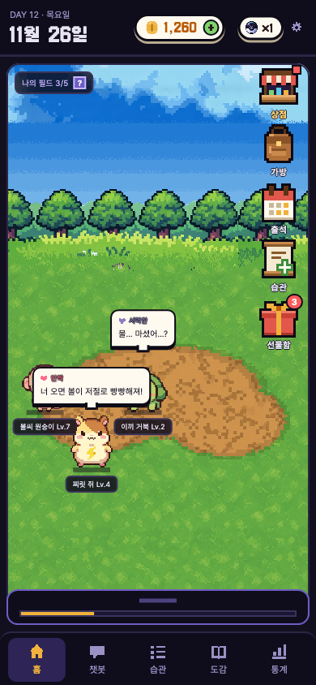
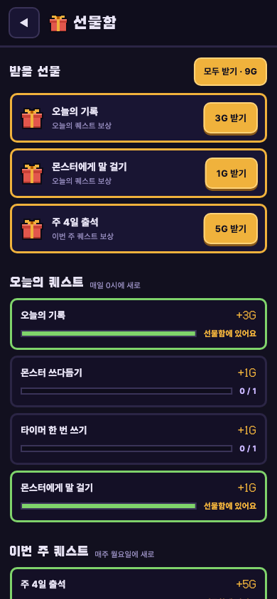

# 선물함 (퀘스트 보상 받기)

- 날짜: 2026-11-26
- 상태: 구현 완료 (앱) · 서버는 제안 (사용자 11-26 — "앱 먼저, 서버는 제안")
- 관련: 브랜치 `feature/habit-tab` · 퀘스트 [기획서](2026-11-12-퀘스트-시스템.md) · 명세 v9 10장 `GET /quests` · 서버 제안 `docs/제안/2026-11-26-퀘스트-보상-선물함.md`

## 1. 왜 만드나
- **문제**: 일일 · 주간 퀘스트(서버 완료, #24 · #25)는 앱에 보이는 곳이 없다. 보상 골드는 서버가 완료 순간 바로 지갑에 넣어서, 사용자는 퀘스트를 깼다는 걸 느끼기 어렵다.
- **목표**: 홈에 **선물함** 아이콘. 퀘스트 보상이 선물함에 쌓이고, 열어서 **[받기]** 를 눌러 골드를 받는다. 같은 화면에서 오늘 · 이번 주 퀘스트 진행을 본다.
- **하지 않는 것**: 서버 동작 변경(제안만 — 서버 · 명세 · DB는 윤서 담당), 깜짝 · 월간 · 업적 퀘스트, 퀘스트 완료 팝업.

## 2. 누가 · 언제 쓰나
- 사용자: 매일 쓰는 사람
- 흐름:
  1. 체크인 · 쓰다듬기 · 말 걸기 · 타이머로 퀘스트를 깬다.
  2. 홈 오른쪽 아이콘 줄의 **선물함**에 받을 선물 수가 빨간 숫자로 뜬다.
  3. 누르면 선물함: 위에 **받을 선물**(퀘스트 이름 · 골드 · [받기], [모두 받기]), 아래에 **오늘의 퀘스트 4개 · 이번 주 퀘스트 3개**(진행 막대 · 보상 · 완료 / 잠김).
  4. [받기] → 골드가 들어오고 "+3G 받았어요" 토스트.

## 3. 규칙
- 퀘스트 목록 · 보상 · 잠금 조건은 명세 v9 그대로 (일일 4개: 오늘의 기록 3G · 쓰다듬기 1G · 타이머 한 번 1G · 말 걸기 1G / 주간 3개 각 5G).
- **시연 모드**: 앱이 퀘스트를 계산한다. 완료한 퀘스트의 보상은 받기 전까지 선물함에 남고, [받기]를 눌러야 골드가 들어온다. 오늘 · 이번 주가 지나면 새로 시작 (시연 데이터는 앱을 끄면 사라짐).
  - 일일: 체크인 확정 / 아무 몬스터 쓰다듬기 / 공부 타이머로 1분 이상 기록 / 몬스터 말 걸기. 타이머는 "분" 습관이 없으면 잠김.
  - 주간: 이번 주 출석 일수(월 ~ 오늘) / 성실도 80%(60점) 이상인 날 — 시연은 **오늘만** 셈 / 오늘 "했어"인 카테고리 수 — 연 카테고리가 3개 미만이면 잠김.
- **서버 모드**: `GET /quests`를 선물함을 열 때마다 부른다. 서버가 이미 지급하므로 완료한 퀘스트는 "받음 · 자동 지급"으로 보이고 [받기]가 없다. 서버에 수령 API가 생기면(제안서) 시연과 같은 흐름으로 바꾼다.
- `enabled: false`면 선물함에 "지금은 퀘스트가 쉬는 중이에요".
- 놓친 퀘스트는 실패로 보이지 않는다 (진행 중 그대로, 다음 날 새로) — 퀘스트 기획 원칙.

## 4. 화면
- 홈 아이콘 줄(상점 · 가방 · 출석 · 습관) 맨 아래 **선물함** — 받을 선물이 있으면 빨간 숫자 배지.
- 선물함 화면(새 화면, 어두운 테마): ◀ · "선물함" → 받을 선물 카드들 + [모두 받기] → "오늘의 퀘스트" → "이번 주 퀘스트".

## 5. 예외 · 경계
- 받을 선물이 없으면 "받을 선물이 없어요 · 퀘스트를 깨면 여기 쌓여요".
- 잠긴 퀘스트: 회색 + 이유 ("시간 습관을 등록하면 도전할 수 있어요" / "카테고리를 N개 더 열면 도전할 수 있어요").
- 서버 조회 실패: 서버 문구 토스트, 목록은 비움.

## 6. 다른 곳에 미치는 영향
- 앱: `models.dart`(Quest · QuestBoard), `GameRepository.loadQuests` · `claimQuestReward`, `GameState`(시연 퀘스트 계산 · 받은 선물 · 오늘 말 걸기 / 타이머 표시), `home_screen.dart`(아이콘), 새 `features/gift/gift_box_screen.dart`, 챗봇 타이머 기록 시 표시.
- 서버 · DB: 없음 (제안서만).
- 문서: `결정-기록.md` · `작업-기록.md` · `프로젝트-이해.md` · `frontend/서버연동-메모.md` 8 · 9장 체크

## 7. 완료 기준
- [x] 홈에 선물함 아이콘 + 배지
- [x] 시연 모드: 퀘스트를 깨면 선물이 쌓이고 [받기] · [모두 받기]로 골드가 들어온다
- [x] 서버 모드: `GET /quests`로 진행이 보이고 완료는 "자동 지급"
- [x] `flutter analyze` 이상 없음, `flutter test` 통과, 캡처, 폰 설치
- [x] 서버 제안서 `docs/제안/2026-11-26-퀘스트-보상-선물함.md`

## 8. 정해야 할 것
- [ ] 서버를 수령형으로 바꿀지 (제안서) — 윤서
- [ ] 받지 않은 선물을 언제까지 보관할지 (제안: 7일) — 윤서 · 사용자

## 9. 결과 (구현 뒤에 쓴다)
- 기획과 달라진 점: 시연 "타이머 한 번 쓰기"는 공부 타이머로 1분 이상 기록했을 때 화면이 `GameState.noteTimerUsed()`를 부른다 (시연 표시만, 서버는 타이머 기록으로 셈)
- 확인한 것: `flutter analyze` 이상 없음, `flutter test` 160개 통과 (`gift_box_test.dart` 5개 — 시연 계산 · 받기 · 잠김 · 주간 출석 · 홈 배지 → 받기 · 서버 `GET /quests` 읽기)
- 확인하지 못한 것: 실제 서버(`GET /quests`)에 붙여 보기 — 퀘스트 서버는 아직 배포 전(서버연동-메모 8장)
- 화면:  
- 다음에 할 일: 윤서가 제안서를 보고 정하면 서버 모드 받기 연결 (제안서 3장)
