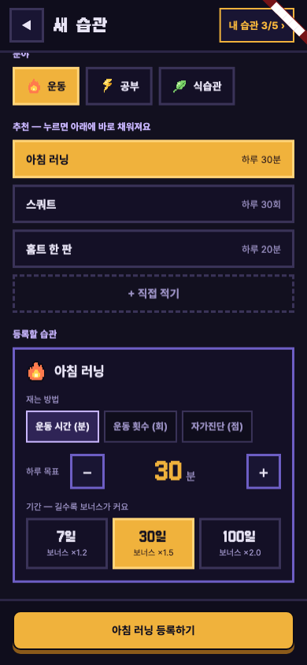
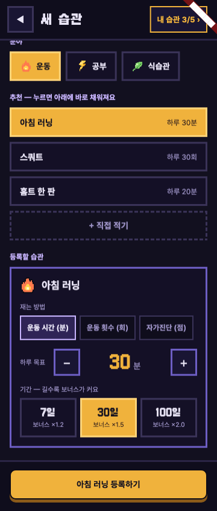
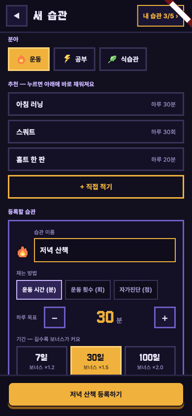
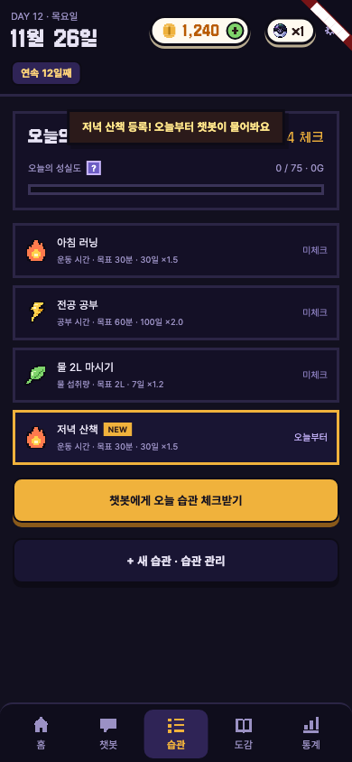

# 습관 빠른 추가

- 날짜: 2026-11-26
- 상태: 구현 완료 (사용자 11-26 확인 — 시안 [루틴몬 습관 빠른 추가](https://claude.ai/artifact/ESMTYaiiLcsavuhP4Adu6J) "이대로")
- 관련: 브랜치 `feature/habit-tab` · [습관 탭 · 목표 제거](2026-11-25-습관-탭-목표-제거.md)

## 1. 왜 만드나
- **문제**: 홈의 "습관" 아이콘으로 습관을 등록하는 게 너무 불편하다는 피드백 (11-26).
  추천 습관 하나를 넣는 데 화면 3번 · 탭 5번이 든다: 아이콘 → 내 습관 목록 → [+ 새 습관 추가] → ① 무엇을(추천) → ② 얼마나 [다음] → ③ 언제까지 [등록하기].
  추천을 고르면 목표 · 기간 기본값이 이미 정해져 있는데도 단계를 하나씩 넘겨야 하고, 아이콘을 누르면 등록이 아니라 목록이 먼저 뜬다.
- **목표**: 한 화면에서 고르고 바로 등록한다. 추천 습관은 **아이콘 → 추천 → 등록하기, 탭 3번**.
- **하지 않는 것**: 온보딩 2단계(첫 습관 등록) 화면은 그대로 둔다. 서버 · API는 바꾸지 않는다 (등록 요청 내용은 같다).

## 2. 누가 · 언제 쓰나
- 사용자: 습관을 하나 더 하고 싶어진, 매일 쓰는 사람
- 상황: 홈 오른쪽 "습관" 아이콘, 또는 습관 탭의 "습관 관리"
- 사용 흐름:
  1. 홈 "습관" 아이콘을 누르면 **새 습관** 화면이 바로 열린다 (자리가 꽉 찼으면 내 습관 목록).
  2. 분야 칩을 고르면 그 분야의 추천이 보인다.
  3. 추천을 누르면 아래 **등록 카드**에 이름 · 재는 방법 · 하루 목표 · 기간(기본 30일)이 채워진다.
  4. 그대로 **"○○ 등록하기"** 를 누르면 끝. 바꾸고 싶으면 카드에서 −/+ · 기간 · 재는 방법을 누른다.
  5. 등록하면 홈(또는 습관 탭)으로 돌아가고 "○○ 등록! 오늘부터 / 내일부터 챗봇이 물어봐요" 토스트.

## 3. 규칙
- 새 습관 화면은 한 장이다 (단계 · 진행 막대 · 다음 버튼 없음).
- 추천을 누르면 이름 · 재는 방법 · 하루 목표가 추천 값으로, 기간은 지금 고른 값(처음 30일)으로 채워진다.
- "직접 적기"를 누르면 등록 카드 맨 위가 이름 입력칸이 된다. 재는 방법은 그 분야의 첫 방법, 목표는 그 방법의 기본값.
- 분야를 바꾸면 고른 추천 · 적던 이름이 지워진다 (다른 분야 이름이 남지 않게).
- 이름이 없으면 등록 버튼은 "습관을 고르거나 적어 주세요"로 잠긴다.
- 홈 아이콘: 자리가 남았으면 새 습관 화면, 꽉 찼으면(5/5) 내 습관 목록.
- 새 습관 화면 위쪽 "내 습관 n/5 ›"로 목록(그만두기)에 갈 수 있다. 목록의 "+ 새 습관 추가"는 같은 새 습관 화면.
- 등록 문구: 오늘 체크인 전이면 "오늘부터", 후면 "내일부터" (지금 규칙과 같음 — 추가한 습관은 체크인 전이면 오늘, 후면 내일부터).
- 수치는 바뀌지 않는다 (기간 배수 7일 ×1.2 · 30일 ×1.5 · 100일 ×2.0, 최대 5개).

## 4. 화면
- 새로 그리는 것: `habit_manage_screen.dart`의 추가 화면 (단계형 → 한 장). 시안에 없는 화면이고, 온보딩의 단계형을 대신한다.
- 위: ◀ · "새 습관" · "내 습관 n/5 ›"
- 분야 칩 → 추천 목록(이름 · 하루 목표) + "직접 적기" → 등록 카드(이름 · 재는 방법 칩 · 하루 목표 −/+ · 기간 3칸) → 아래 고정 "○○ 등록하기"

## 5. 예외 · 경계
- 습관이 0개인 경우는 없다 (최소 1개). 꽉 찼으면 새 습관 화면 대신 목록.
- 열린 분야가 1개뿐이면 칩 1개.
- O/X 방식이면 하루 목표 대신 "매일 '오늘 했어?'라고 물어봐요" 한 줄.
- 좁은 화면(360폭): 재는 방법 칩은 줄바꿈, 기간 3칸은 한 줄.
- 서버 모드: 등록이 실패하면 지금처럼 서버 문구 토스트, 화면은 그대로 (다시 누를 수 있게).

## 6. 다른 곳에 미치는 영향
- 앱: `habit_manage_screen.dart`(추가 화면 · 시작 화면 선택 · 돌아갈 때 문구), `home_screen.dart` · `habits_screen.dart`(열 때 · 토스트), 테스트 `habit_manage_test.dart`
- 온보딩 컨트롤러는 그대로 같이 쓴다 (`OnboardingController`의 draft 값 · `addHabit`)
- 서버 · DB: 없음. 문서: `프로젝트-이해.md`(습관 추가 설명) · `작업-기록.md`

## 7. 완료 기준
- [x] 홈 아이콘 → 추천 → 등록하기, 탭 3번으로 등록된다
- [x] 직접 적기 · 목표 −/+ · 기간 · 재는 방법을 한 화면에서 바꿀 수 있다
- [x] 꽉 찼으면 아이콘이 목록을 연다
- [x] `flutter analyze` 이상 없음, `flutter test` 전부 통과
- [x] 화면을 눈으로 확인 (390폭 · 360폭) — 폰 설치는 작업-기록 참고

## 8. 정해야 할 것
- [ ] 온보딩 2단계도 같은 한 장 방식으로 바꿀지 — 사용자

## 9. 결과 (구현 뒤에 쓴다)
- 기획과 달라진 점
  - 등록하면 **습관 탭으로 가서** 토스트를 띄우고, 방금 넣은 습관을 금색 테두리 · **NEW** · "오늘부터 / 내일부터"로 보여 준다 (시안 ③에서 추가). `GameState.lastAddedHabitId`(화면 표시용, 저장 안 함)
  - 습관 탭 버튼 이름 "습관 관리 (추가 · 그만두기)" → **"+ 새 습관 · 습관 관리"** (누르면 바로 새 습관 화면)
  - −/+ 버튼 52 → 44px (카드 한 줄에 들어가게, 터치 영역은 44 유지)
- 확인한 것: `flutter analyze` 이상 없음, `flutter test` 155개 통과 (`habit_manage_test` 새 흐름 3개 · 꽉 찼을 때 목록), 캡처 390 · 360폭
- 확인하지 못한 것: 실제 폰의 키보드가 올라온 상태(직접 적기)에서 등록 버튼이 가려지지 않는지
- 화면:
  -  
  -  
- 다음에 할 일: 온보딩 2단계도 같은 방식으로 바꿀지 (8장)
