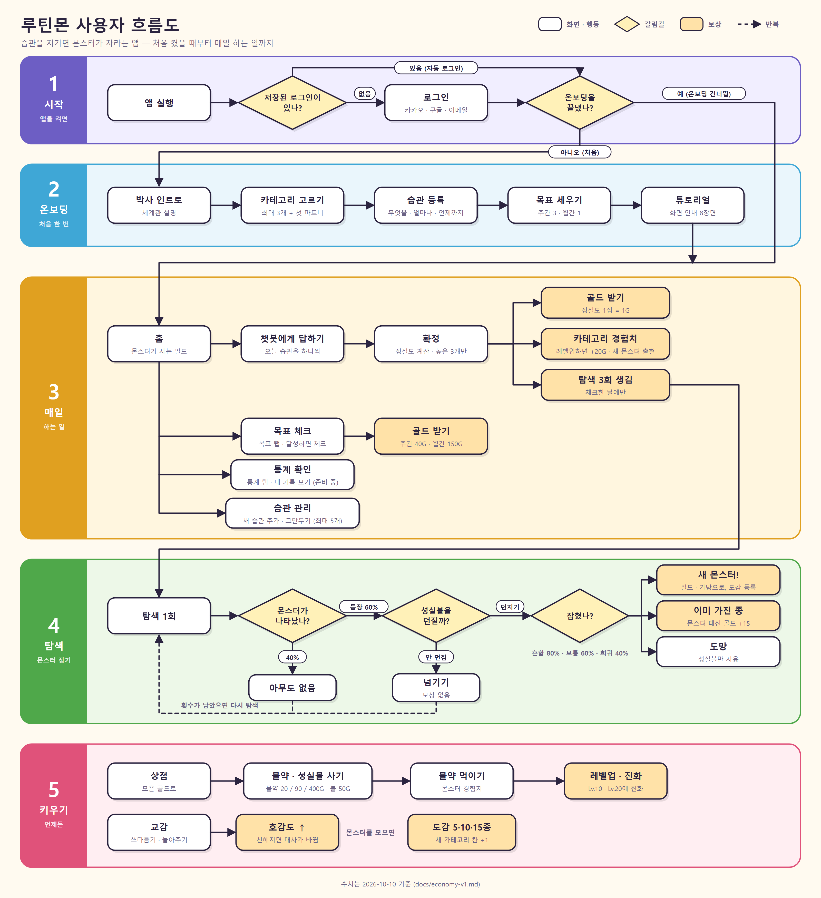

# 루틴몬 (구 습관 몬스터) — 작업 기록

Claude Code와 함께 한 작업을 날짜별로 남긴다. 다음 작업자(또는 새 Claude 대화)가 이 문서만 읽고 이어갈 수 있게 적는다.

- **작업 일지**(바로 아래): 작업이 끝날 때마다 맨 위에 추가한다. 같은 날이면 이어 쓴다.
- **0~7장**: 2026-10-03 ~ 10-08 작업을 한 번에 정리한 것. 그 뒤의 일은 일지에 있다.

일지 한 건의 모양:

```
### YYYY-MM-DD — 한 줄 제목
- 브랜치 · 커밋:
- 한 일: (무엇을 · 왜)
- 확인한 것: (테스트 수 · 눈으로 본 것)
- 확인하지 못한 것:
- 막혔던 것과 원인: (실패한 시도도 적는다)
- 정한 것: (→ 결정-기록 D-번호)
- 남은 일:
```

---

## 작업 일지

### 2026-10-15 — 흐름도 다시 그림 · 발표 자료 (문제 인식 · 흐름 · 마지막 장)
- 브랜치 · 커밋: 커밋 전.
- 한 일
  - **흐름도** (`docs/흐름도/루틴몬-사용자-흐름도.svg · .png`): 10-10판을 오늘 규칙으로 고침 — 홈 "들어오면 출석", 탐색 3회(전부 "못 했어"면 1회), 카테고리 최대 Lv.20, 탐색 단계를 "나타났나(65%) → 도감 등록 → 이미 가진 종? → 예: 볼 없이 +15G / 아니오: 성실볼 → 잡힘 · 도망"으로 새로 그림, 교감에 "끌어 옮기기", 카테고리 칸은 "가진 몬스터 5 · 10 · 15마리". 스크래치 패드의 생성 스크립트(`flow/make2.py`, SVG를 만들고 크롬 헤드리스로 PNG)로 만듦.
  - **발표 자료**: 문제 인식 장 문구 다듬기(제목 "습관 앱은 깔리지만, 습관은 남지 않는다", "100명 중 한 달 뒤 3명"(AppsFlyer 건강 · 피트니스 앱 30일 리텐션 약 3%), 마무리 "의지가 아니라 구조의 문제"). 흐름 장에 새 흐름도 · 목록 문구 갱신. 마지막 장 몬스터를 찌릿 쥐(옛 그림) → 불씨 원숭이.
- 확인한 것: 흐름도 PNG를 눈으로 확인(글자 넘침 · 겹침 두 군데 고침).
- 확인하지 못한 것: 발표 자료 슬라이드를 화면으로 다시 보지는 않음. 리텐션 수치는 Business of Apps가 인용한 AppsFlyer 자료(2022~2023)로, 습관 앱만의 숫자는 아님. JMIR 2024 문헌고찰(100일 안에 중앙값 70% 이탈)은 검색 요약으로만 확인.
- 흐름도: 
- **데모 장 화면 다시 찍음** (옛 몬스터가 찍혀 있었음): 홈(몬스터를 끌어 보기 좋게 배치) · 챗봇 · 탐색(깡총 불토끼 등장) · 도감(불씨 원숭이 + 만나기만 한 토끼). 슬라이드 그림 4장 교체.

  | | | | |
  | --- | --- | --- | --- |
  |  |  |  |  |

### 2026-10-15 — 아이콘 아래 잔디 · 아이콘 숨기기 · 스크린샷을 기록에 남기기
- 브랜치 · 커밋: `feature/monster-art-v2`.
- 한 일
  - **아이콘 아래 잔디**: 몬스터가 오른쪽 아이콘 줄 *아래쪽*으로도 못 가던 것(사용자 지적)을 고침. 이제 아이콘 줄이 차지한 사각형만 피하고, 겹치면 왼쪽으로 비키거나 아래로 내려가기 중 덜 움직이는 쪽으로 간다. 아이콘 줄 높이는 화면에서 직접 잰다.
  - **아이콘 숨기기** (`docs/기획/2026-10-15-아이콘-숨기기.md`): 아이콘 줄을 오른쪽으로 밀면 숨고, 오른쪽 끝 손잡이(◀)를 누르거나 왼쪽으로 밀면 다시 나온다. 숨긴 동안 몬스터는 오른쪽 끝까지 다닌다. 튜토리얼이 시작되면 다시 보인다.
  - **스크린샷 기록 규칙** (사용자 요청, D-21): 화면이 바뀌면 캡처를 `docs/스크린샷/날짜/`에 남기고 일지 · 기획서에 이미지로 넣는다. `CLAUDE.md` 2 · 5장, `docs/README.md`, 기획서 템플릿 9장에 반영. 오늘 바뀐 화면 6장을 찍어 넣음.
  - `docs/design/character.md`(사용자가 쓴 AI 그림 프롬프트 메모)도 커밋에 넣기로 함 (사용자 결정).
- 확인한 것: `flutter analyze` 이상 없음, `flutter test` 전부 통과 (새 테스트: 아이콘 숨기기 · 다시 보이기). 아래 캡처.
- 확인하지 못한 것: 에뮬레이터에서 손가락으로 밀기 · 끌기.
- 막혔던 것과 원인: 아이콘 숨기기 테스트가 실패 — 숨기기는 됐는데(디버그 출력으로 확인) 위치가 그대로였다. 상태가 바뀐 프레임에서 애니메이션이 *시작*만 하고, 한 번 더 그려야 시간이 흐른다 → `pump()`를 한 번 더. 또 `tester.drag` 한 번에 밀면 속도가 0으로 나와 "빠르게 튕기기" 판정이 안 됐다 → 여러 번 나눠 밀기.
- 오늘(10-15) 바뀐 화면:

  | | |
  | --- | --- |
  |  |  |
  | 몬스터 28종 + 진화 그림 4장 | 도감: 만나기만 한 종도 보인다, 7칸 · 준비 중 |
  |  |  |
  | 탐색: 가진 종은 볼 없이 바로 15G | 필드: 끄는 중 (들려서 맨 위) |
  |  |  |
  | 놓으면 말풍선 · 하트, 버튼은 안 가림 | 아이콘을 숨기면 오른쪽 끝까지 |

### 2026-10-15 — 몬스터 그림 교체 (5종 → 28종)
- 브랜치 · 커밋: `feature/habit-manage` 위에서 작업, 아직 커밋 안 함 (10-10의 출석 = 접속 변경도 함께 미커밋).
- 한 일
  - 사용자가 AI로 뽑은 픽셀 그림 32장(`OneDrive/바탕 화면/루틴몬/속성_동물N.png`)을 앱에 넣었다. 이름 끝 `2` = 진화 그림.
  - 그림 처리: 투명 여백을 잘라 내고 긴 변 384px로 줄임(BOX 축소, 전 그림과 같은 크기), 영문 파일 이름으로 `assets/images/monsters/`에 저장. 스크래치 패드의 Python(PIL) 스크립트로 처리 — 프로젝트 코드에는 Python이 없다.
  - `Catalog.species` 28종 (이름 · 설명 · 호감도별 대사 새로 씀), 첫 파트너 6종, `AppAssets` 32개.
  - 진화 그림: `MonsterSpecies.evolvedAsset` + `assetAt(level)` — Lv.10부터 진화 그림. 가진 몬스터를 그리는 6곳(필드 · 교감 창 · 가방 · 챗봇 칩 · 챗봇 아바타 · 튜토리얼)에 적용.
  - 샘플 데이터 몬스터: 늑대 · 쥐 · 새싹냥 → 원숭이 · 쥐 · 거북. 온보딩 실루엣도 새 그림.
  - 테스트 기대값을 새 종으로 바꿈. 명상 길에 이제 몬스터가 있어서 "몬스터 없는 길" 테스트 2개는 "명상 몬스터가 온다 / 명상 몬스터만 나온다"로 바꿈. 새 테스트 2개(진화 그림, 카테고리마다 첫 파트너 · 6칸 이하).
  - 기획서 `docs/기획/2026-10-15-몬스터-아트-교체.md`, 결정 D-16, 기획 변경 이력, 프로젝트-이해, 기획서 v2 3장 상자, DB 요청(`backend/db/README.md`).
- 확인한 것: `flutter analyze` 이상 없음, `flutter test` 81개 통과. 임시 골든 테스트로 390폭 홈(진화한 원숭이 · 코알라 포함) · 도감 · 28종 비교 그림을 눈으로 보고 지움.
- 확인하지 못한 것: 360폭, 에뮬레이터, 교감 창 · 탐색 화면의 새 그림 크기.
- 막혔던 것과 원인: 새 늑대 그림을 `wolf.png`로 저장하면서 **옛 늑대 그림 파일을 확인 없이 덮어썼다** (git에는 남아 있음: `git show HEAD:frontend/assets/images/monsters/wolf.png`). 
- 정한 것: D-16. 이름 · 희귀도 · 출현 레벨 · 첫 파트너는 Claude 가정 → 기획서 8장.
- 남은 일: 기획서 8장 결정, 옛 그림 4개 지울지, 발표 자료 데모 화면 다시 찍기, DB 종 시드.

### 2026-10-15 — 도감: 만나기만 해도 등록 · 새 로고 후보 · API 명세 v4 받음
- 브랜치 · 커밋: 위와 같음, 커밋 전.
- 한 일
  - 탐색에서 몬스터가 나타나면 잡지 않아도 도감에 등록 (`GameState.explore`). 도감은 "보유 중" / "만난 적 있음 · 못 잡음"을 구분하고, 발견 수 · 카테고리 칸도 등록 수로 셈. → `docs/기획/2026-10-15-도감-만나면-등록.md`, D-17
  - 새 그림체로 로고 후보 2장을 Higgsfield(GPT Image 2.5, 0.5 크레딧)로 만듦: 첫 파트너 6종 그림을 참고 이미지로 올리고 "불씨 원숭이가 체크 금화를 안은" 앱 아이콘. 파일은 `OneDrive/바탕 화면/루틴몬/로고/`. **앱의 `brand/logo.png`는 아직 안 바꿈.**
  - DB 담당이 준 API 명세 v4(`카카오톡 받은 파일/습관몬스터_API명세_v4 (1).md`)를 읽음. 앱 · 서버에는 아직 반영 안 함.
- 확인한 것: `flutter analyze` 이상 없음, `flutter test` 82개 통과, 도감 캡처(만난 토끼).
- 확인하지 못한 것: 실기기.
- 남은 일: API 명세 v4와 앱 규칙 차이 정리 · 반영 여부 결정 (아래 사용자 확인 필요).

### 2026-10-15 — 로고 교체 · 앱을 벗어나면 배경음악 멈춤
- 브랜치 · 커밋: 위와 같음, 커밋 전.
- 한 일
  - **로고**: 후보 2(별이 보라 · 노랑으로 섞인 쪽)로 결정 (D-18). 둥근 모서리 바깥의 흰 부분을 배경 남색(#21135D)으로 채워 꽉 찬 정사각형으로 만들고, 전에 아이콘을 넣었던 곳(`66f4e3d`)에 크기별로 전부 다시 넣음: 로그인 화면 `brand/logo.png`, Android(일반 · 적응형 전경 — 안전 영역에 맞게 66%로 줄여 가운데), iOS, macOS, 웹(파비콘 · 192 · 512 · maskable 80%), Windows `.ico`, `docs/design/app-icon/app_icon_1024.png`. 적응형 아이콘 배경색 #180D3C → #21135D. 발표 자료 표지 그림도 바꿈.
  - **배경음악 버그**: 앱을 벗어나도(홈 버튼 · 다른 앱 · 브라우저 탭 숨김) 음악이 계속 나왔다. 원인: 앱 상태(라이프사이클 — 앱이 화면에 보이는지/숨었는지 알려 주는 신호)를 듣지 않았다. `AudioBgm`이 `WidgetsBindingObserver`로 상태를 듣고 hidden · paused · detached면 일시정지, resumed면 이어서 재생. inactive(알림창 내림 · 창 포커스만 잃음)는 아직 화면이 보여서 그대로 둠 — Claude가 정함.
- 확인한 것: `flutter analyze` 이상 없음, `flutter test` 82개 통과. 아이콘 모서리 확대 확인.
- 확인하지 못한 것(로고 · 음악): **배경음악 일시정지는 실제 기기 · 에뮬레이터 · 브라우저에서 안 들어 봄** (테스트는 소리 없는 버전을 써서 확인 불가). 런처에 뜬 새 아이콘도 아직 못 봄 (앱을 다시 설치해야 바뀜).

### 2026-10-15 — API 명세 v4 · v5에 탐색 · 도감 규칙 맞추기
- 브랜치 · 커밋: 위와 같음, 커밋 전.
- 한 일 (D-19)
  - 탐색: 가진 종이 나오면 볼 없이 바로 15G(던지기 버튼 없이 "이미 친구인 ○○가 놀러 왔어요" + 금화 표시). 볼은 안 가진 종에게만. 꽝 35%. 첫 제출이 전부 "못 했어"면 탐색 1회.
  - 카테고리 레벨 최대 20 (1,900점). 종 출현 레벨을 1 · 3 · 6 · 9 · 12 · 15 · 18 순서로.
  - 도감 카테고리마다 7칸 (전체 42). 종이 없는 칸은 "준비 중". 카테고리 칸 진행은 **가진 종만** 셈(`GameState.caughtSpecies` 새로 만듦, v5).
  - 명세 v5에서 바뀐 것 확인: 만나면 도감 "본 종(`SEEN`)" 등록 — 앱 규칙(D-17)과 같아짐. 카테고리 칸은 가진 종만 — 이것만 앱을 고침.
- 확인한 것: `flutter analyze` 이상 없음, `flutter test` 83개 통과(새 테스트: 가진 종 → 바로 골드 · 전부 못 했어 → 1회 · 레벨 최대 20 · 본 종은 칸 진행에 안 셈). 임시 캡처로 탐색(가진 종 등장) · 공부 도감 7칸 확인.
- 확인하지 못한 것: 에뮬레이터.
- 막혔던 것: `sed -i`로 `dex_screen.dart`를 고쳤다가 줄바꿈이 CRLF → LF로 바뀜 (예전에도 겪은 문제). perl로 CRLF 되돌림. 문서는 perl 정규식에 한글을 넣었더니 안 맞아서(스크립트가 UTF-8로 읽히지 않음) Edit 도구로 고침.
- 남은 일: 탐색 가중치(명세에 값 없음), 하루가 바뀌는 처리(날짜 저장 — 서버 연동 때), 빈 도감 14칸을 채울 그림.

### 2026-10-15 — 홈 필드에서 몬스터 끌어 옮기기 · 서버가 안 뜨는 원인
- 브랜치 · 커밋: 새 브랜치 `feature/monster-art-v2` (오늘 작업 전부 + 10-10 출석 변경).
- 한 일
  - **끌어 옮기기** (D-20, `docs/기획/2026-10-15-필드-몬스터-끌기.md`): 누른 채 움직이면 몬스터가 손가락을 따라오고(10px 들림 · 맨 위에 그림), 놓으면 3초 쉬었다가 다시 걷는다. 걷는 영역 밖으로는 못 나간다. 몬스터마다 하루 1번 호감도 +1 + 토스트. 짧게 누르면 전처럼 교감 창. "나의 필드" 도움말에 한 줄 추가.
  - **서버 확인**: 8080 포트를 **다른 프로젝트(`C:\TreePlan\treeplan` 백엔드, java PID 42112, 10-14 17:47부터 실행 중)**가 쓰고 있어서 우리 서버가 같은 포트로 못 뜬다. 끄는 건 사용자 확인 후. 5432에는 PostgreSQL(IPv4)과 Docker(IPv6)가 함께 떠 있다 — 우리 서버가 붙는 DB가 헷갈릴 수 있어 같이 알림.
- 확인한 것: `flutter analyze` 이상 없음, `flutter test` 85개 통과 (새 테스트: 끌기 ♥ 하루 1번 · 끌면 따라오고 토스트). 끄는 중 · 놓은 뒤 화면 캡처 확인.
- 확인하지 못한 것: 에뮬레이터에서 손가락으로 끌어 보기, 360폭.
- 이어서 (사용자 요청): 끌 수 있는 범위를 **잔디 전체**로 넓힘(전: 걷는 영역 가운데 띠 — 오른쪽 아이콘 높이까지 못 올라감). 화면마다 배경이 다르게 잘려서 배경 그림의 잔디 시작 높이(32%)와 시트 높이로 px 계산. 놓으면 말풍선 한마디 + 호감도 오르면 하트 뿅뿅(토스트 대신). 390 · 360폭에서 네 구석으로 끌어 캡처 확인 — 360폭에서 몬스터가 필드 위로 넘어가던 것, 왼쪽 끝 말풍선이 잘리던 것을 고침.
- 이어서: 넓힌 범위에서 몬스터가 "나의 필드" 바(? 버튼)와 오른쪽 아이콘을 가렸다(사용자 지적) → 위는 바 아래, 오른쪽은 아이콘 줄 왼쪽까지로 막음. 390 · 360폭 네 구석 캡처로 확인.
- **서버**: 사용자 확인 후 TreePlan 서버(PID 42112)만 종료하고 터미널 탭 "루틴몬 서버"에서 `bootRun`(local 프로필) — 회원가입 요청 201 확인.
- 막혔던 것과 원인: 테스트에서 몬스터를 끌어도 안 움직였다. ① 테스트 환경은 그림을 읽기 전엔 그림 크기가 0이라 누를 곳이 없었다 → 그림을 먼저 읽어 둠(precache). ② `tester.drag`는 중간에 화면을 그리지 않아서, 손을 뗀 뒤의 2.4초 걷기 애니메이션으로 옮겨 갔다 → 움직일 때마다 화면을 그리는 제스처로 바꿈.

### 2026-10-10 — 튜토리얼 · 출석부, DB v1.5 맞추기, 조직 레포, 하네스 문서
- 브랜치 · 커밋: `feature/social-login-http-auth` `17874a8` → 새 브랜치 `feature/db-v1.5-rules` `6fb6c84`. 그 뒤 작업(하네스 문서 · 기획서 v2.1 · v1.6 검증 · 탭 순서)은 `feature/harness-docs-v1.6` `67fd67e`. 흐름도 이미지는 `feature/flowchart` `079a912`, 습관 추가 · 그만두기는 `feature/habit-manage` `ec6ef6e`.
- 한 일
  - **처음 쓰는 사람 안내**: 온보딩 직후 튜토리얼(8장면, 설정에서 다시 보기), 홈 출석 아이콘 + 출석부, "오늘의 성실도" · "탐색" · "나의 필드" 옆 ? 도움말, 골드 + 버튼을 골드 칩 안으로. → `docs/기획/2026-10-10-튜토리얼-출석부-도움말.md`
  - **DB v1.5 받음** (ERD · seed · verify · verify_later). 앱과 다른 규칙 6가지를 정리하고 정함:
    앱이 DB를 따름 4가지(탐색 꽝 40% · 희귀도별 포획 80/60/40% · 체크인 다시 제출 · 카테고리마다 초기 몬스터), DB가 앱을 따름 2가지(중복 → 골드 · 보상 없이 넘기기).
  - **서버**: `users.onboarding_step` → `onboarded_at`, `PATCH /me/onboarding` 본문 없음.
  - **backend/db**: 우리 쪽 변경안 SQL 2개 삭제, README를 v1.5 메모 + DB 담당 요청으로 다시 씀.
  - **조직 레포** `dynamicduo-daelim/habit_monster`에 브랜치 5개를 올리고 기본 저장소(`origin`)로 바꿈. 개인 레포는 `personal`.
  - **하네스 문서**: `CLAUDE.md`(루트) · `docs/README.md` · `docs/프로젝트-이해.md` · `docs/결정-기록.md` · `docs/기획/_템플릿.md` + 예시 1건, 이 일지.
  - **기획서 v2 → v2.1**: 본문은 두고 달라진 장마다 「현재 (v2.1)」 상자를 달았다. 바뀐 내용은 `docs/기획-변경-이력.md`(새 문서)에 한 줄씩.
  - **흐름도**: 처음엔 FigJam에 자동 배치로 그렸는데 보기 불편해서, 단계별 색 · 범례를 넣은 이미지로 다시 그림 → `docs/흐름도/루틴몬-사용자-흐름도.png` (원본 `.svg`). "매일" 단계에 목표 체크 · 통계 확인(준비 중)을 넣음.
  - **DB v1.6 `schema.sql` 받음**: 우리가 요청하려던 두 가지(중복 → 골드, 보상 없이 넘기기)가 반영돼 있었다. 임시 PostgreSQL 18에서 검증.
  - **아래 탭 순서**: 홈 · 챗봇 · 통계 · 도감 · 목표 → 홈 · 챗봇 · **목표** · 도감 · **통계**.
  - **습관 추가 · 그만두기**: 홈 출석 아이콘 아래 "습관" 아이콘 → "내 습관" 화면(목록 · 그만두기 · 온보딩과 같은 추가 폼). → `docs/기획/2026-10-10-습관-추가.md`
    첫 버전은 온보딩 폼을 그대로 써서 가독성이 나빴다 → 홈과 같은 어두운 테마로 다시 디자인(목록과 추가를 분리, 한 화면에 질문 하나, 큰 글자와 버튼).
  - **출석 기준 변경**: 습관 체크인 → 앱에 들어온 날 (하루 1번). 상단 바 · 출석부의 연속 일수도 접속 기준. → `docs/기획/2026-10-10-출석-접속-기준.md`
  - **중간발표 자료**: 시험 안내(7분 IR 피칭)에 맞춘 슬라이드 13장 초안 (claude.ai 슬라이드, 링크는 사용자 계정). 대괄호로 남긴 곳(팀 · 배경 이야기 · 설문 · 시연 영상)은 직접 채워야 한다.
- 확인한 것: `flutter analyze` 이상 없음, 앱 테스트 **79개 통과**(전 60 → 튜토리얼 등 +7 → 규칙 +5 → 탭 순서 +1 → 습관 추가 +6, 출석 변경은 기존 테스트를 고침), 서버 `./gradlew test` 통과. 화면은 임시 골든 테스트로 390 · 360폭 캡처를 눈으로 확인.
  - DB: `schema.sql`(v1.6) → `seed.sql` 적용 성공. `verify.sql`(v1.5) 104개 통과 · 2개 실패(v1.6에서 일부러 뒤집은 규칙을 옛 기준으로 검사하는 항목). 추가 검사 `backend/db/v1.6_extra_verify.sql` 15개 모두 통과. `schema_later.sql`도 적용 성공.
- 확인하지 못한 것: 에뮬레이터 · 실제 기기에서 눌러 보기. 탭 순서를 바꾼 화면을 눈으로 보기 (테스트로만 확인). `verify_later.sql`은 `verify.sql`이 실패로 끝나서 돌리지 못함.
- 막혔던 것과 원인
  - 구글 로그인 "실패했어요": 에뮬레이터의 Google Play 서비스가 23.18인데 `google_sign_in` 7.x는 25.24 이상이 필요. 구글 계정도 0개. 10-08의 에뮬레이터 초기화 때문. **미해결** — 에뮬레이터에서 Play 스토어 로그인 → Play 서비스 업데이트 필요.
  - 날짜가 두 자리인 날(10월 10일) 상단 바가 넘쳐 화면 테스트 여러 개가 깨짐 (날짜가 한 자리였던 10-08에는 통과) → 남는 폭만 쓰도록 수정.
  - 조직 레포 푸시 중 Claude의 자동 권한 검사가 브랜치 푸시를 막음 → 사용자가 직접 `git push`.
- 정한 것: D-06 ~ D-15 (D-07은 D-15로 바뀜)
- 남은 일
  1. DB 담당에게 `verify.sql` · `seed.sql` · ERD의 **v1.6 판** 받기 (지금 `verify.sql`은 2개 실패가 정상). `APPLE` 제공자 행을 뺄지 확인
  1-0. DB 담당에게 **접속 기준 연속 출석** 요청 (`backend/db/README.md`)
  1-1. 디자인 시안(`docs/design/`)의 탭 순서도 바꿀지 결정
  2. 에뮬레이터 Play 서비스 업데이트 후 카카오 · 구글 로그인 끝까지 확인 (SHA-1 `16:8B:90:…:92:D8` 등록 여부 포함)
  3. 새 사용자를 DAY 1 · 연속 0일로 시작하게 할지, 출석 보상을 줄지 결정
  4. `결정-기록.md` · `프로젝트-이해.md`의 **[채우기]** / "이유 미기록" 채우기
  5. 게임 API(습관 · 체크인 · 탐색 · 상점 · 목표) → `GameState`를 서버 호출로 교체

### 2026-10-08 — 작업 브랜치 정리, 시작 자원, 에뮬레이터 · 빌드 문제
- 브랜치 · 커밋: `feature/social-login-http-auth` 새로 만듦. `e836c79`(10-07~08에 커밋 못 한 소셜 로그인 · HTTP 인증 · DB v1.4 이름 변경), `5edabd2`(시작 자원 · 골드 얻는 법).
- 한 일
  - 시작 골드 50 · 성실볼 3개 (`Economy.startingGold` · `startingBalls`), 골드 옆 + 버튼과 "골드 얻는 법" 팝업.
  - 기존 테스트가 옛 시작값(골드 1,240 · 볼 1)에 기대고 있어서 `GameState.sample(gold:, balls:)` 인자를 추가하고 테스트에서 옛 값을 직접 넣음.
- 확인한 것: `flutter analyze` 이상 없음, 앱 테스트 60개 통과, `flutter build apk --debug` 성공(캐시 복구 뒤).
- 확인하지 못한 것: 화면에서 직접 눌러 보기.
- 막혔던 것과 원인 (**다음에 같은 일이 나면 여기부터 본다**)
  - **빌드 실패 `Could not read workspace metadata … metadata.bin`** (Kotlin 컴파일 단계라 Kotlin 문제처럼 보임): Claude가 Gradle 데몬(java)을 빌드 중에 강제 종료해서 `~/.gradle/caches/9.3.1/transforms` 캐시가 깨짐. → 그 폴더를 지우고 다시 빌드 (캐시 재생성에 36분). **교훈: Gradle 데몬을 강제로 끄지 않는다.**
  - **Claude의 Bash에서 Gradle이 `storage.googleapis.com`을 못 찾음** → PowerShell에서 빌드하면 됨.
  - **에뮬레이터가 부팅 화면에서 멈춤** (`Emulator didn't connect within 60 seconds`): 강제 종료 때 에뮬레이터 내부 데이터(packages.xml)가 깨짐. → Wipe Data로 초기화, RAM 2GB → 4GB. 초기화하면 구글 계정과 Play 서비스 업데이트가 사라진다 (10-10 구글 로그인 문제의 원인).
  - **에뮬레이터 · 빌드가 전체적으로 느림**: 배터리 사용 + Core Ultra(저전력 코어 배정) + Windows 메모리 무결성(Hyper-V 위에서 한 겹 더 가상화) + Defender 실시간 검사. → Defender 제외 폴더 추가함. 충전기 연결 · 전원 모드 "최고 성능" 권장. 가장 확실한 건 실제 폰 USB 연결.
  - **서버가 안 뜸 `port 8080 already in use`**: Oracle XE의 `OracleXETNSListener` 서비스가 8080을 씀. → 관리자 PowerShell에서 `Stop-Service OracleXETNSListener` (재부팅하면 다시 켜짐), 또는 `--server.port=8081`.
  - `bootRun`이 `80% EXECUTING`에서 멈춘 것처럼 보이는 건 정상 (서버가 켜져 있는 동안 계속 실행 중).
- 정한 것: D-05
- 남은 일: 10-10 일지로 이어짐.

---

## 0. 한눈에

| 항목 | 내용 |
| --- | --- |
| 앱 이름 | **루틴몬** (표시 이름만 변경, 패키지명 `com.habitmonster.habit_monster` 그대로 — 카카오·구글에 등록된 값) |
| 앱 | Flutter (`frontend/`), 픽셀 아트 · Galmuri11 폰트 |
| 서버 | Spring Boot 4.1 · Java 21 (`backend/server/`), 지금은 **인증만** 있음 |
| DB | PostgreSQL. 원본 설계는 OneDrive `카카오톡 받은 파일/` (v1.5는 `schema_erd/`, `schema.sql` v1.5는 아직 못 받음). 메모는 `backend/db/README.md` |
| 기준 문서 | `docs/프로젝트-이해.md`(전체 그림), `docs/habit-monster-기획서-v2.md`(기획서), `docs/design/prototype-source.dc.html`(디자인 기준), `docs/economy-v1.md`(수치), `docs/결정-기록.md` |
| 작업 규칙 | `CLAUDE.md`(루트: 이해 · 기획 · 기록 원칙) + `frontend/CLAUDE.md`(디자인 그대로, 색은 `AppColors`, 수치는 `Economy`, 픽셀 이미지는 `PixelImage`, 새 패키지는 이유 먼저) |
| 저장소 | `origin` = 조직 레포 `dynamicduo-daelim/habit_monster`, `personal` = 개인 레포 |
| 브랜치 | `main` ← `feature/db-rules-ball-catch` ← `feature/spring-auth-server` ← `feature/social-login-http-auth` ← **`feature/db-v1.5-rules`(현재 작업, 10-10)** |

---

## 1. 진행 순서 (커밋 기준)

| 날짜 | 커밋 | 한 일 |
| --- | --- | --- |
| 10-03 | `1f56ea4` | 기획서 · 디자인 시안을 Flutter 앱으로 옮김: 온보딩 · 홈 · 챗봇/탐색 · 도감 · 목표 |
| 10-05 | `66d7d54` | DB 리뷰 결과 반영(규칙 2~6) + 성실볼 "던져서 잡기" DB 변경안 |
| 10-05 | `66f4e3d` `c1026df` | 앱 아이콘: 알에서 깨어나는 몬스터 (포켓몬 느낌 임시 이미지 교체), 아이콘 모양 꽉 채우기 |
| 10-05 | `2a71c00` | 배경음악: 화면별 5곡(Suno) + 크로스페이드 + 끄기 |
| 10-05 | `0d581d0` | 인트로 박사 화면 깨짐 수정 |
| 10-07 | `ebdaeaf` | 로그인 화면 · 이메일 가입/로그인 · 설정 창(배경음악 · 로그아웃) |
| 10-07 | `cac8133` | Spring Boot 서버 기본 틀 — 인증 API |
| 10-07 | `f3b0a98` `84abee3` | 애플 로그인 제거 (유료 개발자 계정 필요) — 앱 · 서버 · DB |
| 10-07 | `b179508` | 앱 이름 → 루틴몬 |
| 10-07 | `858c87b` | (직접 수정) 디자인: 온보딩 습관 등록을 단계형으로 |
| 10-07 | `6dc849a` | 위 디자인을 앱에 반영 |
| 10-07~08 | **커밋 전** | 카카오 · 구글 실제 로그인 연결 + DB v1.4(기간 7/30/100일) 적용 — 아래 6장 |

---

## 2. 앱 (Flutter)

### 화면
- **로그인**: 카카오 · Google · 이메일 버튼. 처음 로그인 → 온보딩, 온보딩 끝낸 계정 → 바로 홈 (`features/auth/auth_gate.dart`)
- **온보딩**: 인트로(박사) → 1. 카테고리 + 첫 파트너 → 2. 습관 퀘스트(무엇을 · 얼마나 · 언제까지 3단계) → 3. 목표(주간 3 · 월간 1, 적은 목표 목록)
- **홈**: 필드 몬스터 · 호감도별 말풍선 · 슬라이드 시트(습관/성실도) · 상점(수량 팝업 → 구매 완료) · 가방 · 교감(톡 · 쓰다듬기 게이지 · 간식 · 놀아주기 · 말 걸기)
- **챗봇**: 대본형 습관 체크 → 하루 1번 확정 → 탐색(성실볼 던져서 잡기). 대사는 `ChatBrain` 인터페이스 뒤 (나중에 AI로 교체)
- **도감 · 목표**: 도감 5/10/15마리마다 카테고리 슬롯 +1, 목표 체크/수정/삭제. 통계는 준비 중
- **설정**(상단 톱니바퀴): 배경음악 켜기/끄기, 로그인 계정 표시, 로그아웃

### 구조에서 기억할 것
- 상태: `GameState`(ChangeNotifier) + `GameScope`, 로그인: `AuthController` + `AuthScope`, 음악: `Bgm` + `BgmScope`
- 서버 연결 지점: `GameState`의 메서드들이 API 응답 모양의 결과 객체를 돌려줌 (`DailyCheckinResult` · `EncounterResult` · `CatchResult`) → 나중에 서버 호출로 교체
- 시각 확인: 브라우저 패널 스크린샷은 한 박자 늦게 보임 → 임시 골든 테스트로 PNG를 찍어 확인 후 삭제

---

## 3. DB

### 리뷰 · 반영 (10-05)
- 공유받은 DB 설계를 검토하고 규칙 2~6(상위 3개 습관만 반영, 하루 1번 확정, 완료 목표 잠금, 탐색 풀 = 오늘 체크인한 카테고리, 도감 discovered 등)을 앱에 맞춤
- 규칙 1(성실볼 = 던져서 잡는 볼)은 DB 변경이 필요해서 변경안을 따로 작성 → `backend/db/v1.5_ball_catch.sql` + `v1.5_verify.sql` + `README.md`(쉬운 설명)

### 애플 제거 (10-07)
- `schema.sql`의 `auth_provider` 시드에서 `APPLE` 삭제, 논리물리모델 · ERD 문서 수정

### v1.4 적용 (10-08, 직접 수정한 파일)
- 습관 기간 **1주/1개월/3개월 → 7일/30일/100일** (코드 `D7/D30/D100`, 코드와 일수 불일치 CHECK 추가), `seed.sql` 새로 추가
- 새 `schema (1).sql`에 `APPLE`이 다시 들어 있어서 **그 줄만 빼고** 적용
- 임시 PostgreSQL 18에서 검증: `schema → seed → verify` **92/92 통과**, `+ v1.5_ball_catch → v1.5_verify` **23/23 통과**
- 성실볼 변경안 이름이 원본 v1.4와 겹쳐서 **v1.4 → v1.5**로 변경
- 앱의 기간 이름도 7일/30일/100일로 변경 (`data/catalog.dart`)

---

## 4. 로그인 · 서버

### 서버 (`backend/server`, Spring Boot)
- API: `POST /auth/signup` `/auth/login` `/auth/social/{kakao|google}` `/auth/refresh` `/auth/logout`, `GET /me`, `PATCH /me/onboarding`
- 오류 응답 `{code, message}` — message는 앱이 그대로 보여줌
- 보안: 비밀번호 BCrypt · 소셜 토큰은 서버가 카카오/구글에 직접 확인(카카오는 우리 앱 ID인지까지) · 같은 이메일이어도 계정 합치지 않음(Q-20) · refresh 토큰은 SHA-256만 저장, 쓸 때마다 교체, 재사용되면 전부 폐기 · 탈퇴 계정 로그인 거부
- 실행 (DB 없이): `backend/server`에서 `./gradlew bootRun --args='--spring.profiles.active=local'`
- ⚠️ 이 PC는 `JAVA_HOME`이 jdk-20이라 그대로는 빌드가 안 됨 → jdk-24로 바꾸거나 IntelliJ에서 Gradle JVM 21+
- 테스트 9개 통과 (10-07 기준)

### 소셜 로그인 키 (모두 공개해도 되는 값)
| 항목 | 값 | 쓰는 곳 |
| --- | --- | --- |
| 카카오 네이티브 앱 키 | `8d795d4d9a367e3678e1538467f12fe4` | 앱 |
| 카카오 앱 ID | `1600125` | 서버 `KAKAO_APP_ID` |
| 구글 웹 클라이언트 ID | `661947484282-v08ku1t429h6dtj70v710pvsm5ps2fhb.apps.googleusercontent.com` | 앱(serverClientId) · 서버 |
| 구글 Android 클라이언트 ID | `661947484282-or62s0gh1koggf27p0rlf0mf0m04s25q.apps.googleusercontent.com` | 서버 |
| Android 디버그 키 해시 / SHA-1 | `FouQC0AYlGTOdPKmAD/4w/n/ktg=` / `16:8B:90:...:92:D8` | 카카오 · 구글 콘솔 (이 PC 디버그 키 기준) |

카카오 REST API 키 · 어드민 키 · 구글 클라이언트 보안 비밀은 **어디에도 넣지 않는다.** 애플 로그인은 유료(연 $99)라 뺐다.

---

## 5. 정해진 것 (결정 기록)
- 로그인 수단: 카카오 · 구글 · 이메일 (애플 제외) / 로그인은 앱 시작 시 먼저
- 서버: Spring Boot / DB: PostgreSQL
- 앱 이름: 루틴몬 (볼로 끝나는 이름 · 영어 이름 후보도 검토했음)
- 아이콘: 알에서 깨어나는 몬스터 (포켓몬 느낌 금지)
- 배경음악: `audioplayers`(Windows 지원 때문에 just_audio 대신)

---

## 6. 커밋 전 작업 (10-07~08) — 마무리 필요

### 들어간 것
- 패키지: `kakao_flutter_sdk_user` · `google_sign_in` 7.2 · `flutter_secure_storage` · `http`
- `lib/core/config/app_config.dart` — `API_BASE_URL`(dart-define), 카카오 키 · 구글 웹 클라이언트 ID
- `lib/core/auth/social_login.dart` — 카카오(카카오톡 → 없으면 카카오계정), 구글 ID 토큰, 취소 처리, 웹은 "앱에서 이용해 주세요"
- `lib/core/auth/http_auth_service.dart` — 서버 호출, 자동 로그인(refresh), access 만료 시 1회 갱신, 로그아웃 시 서버 · 저장소 · SDK 모두 정리
- `main.dart` — `API_BASE_URL`이 있으면 진짜 로그인, 없으면 가짜 로그인(FakeAuthService)
- Android 매니페스트(인터넷 권한, 카카오 리다이렉트), 디버그 빌드 http 허용, iOS 카카오 스킴
- 서버 `application-local.properties`에 카카오 · 구글 값, 서버 테스트는 그 값을 비워서 외부 접속 안 하게
- 테스트 `test/http_auth_test.dart`

### 확인된 것
- `flutter analyze` 이상 없음, 앱 테스트 **60개 통과**, `flutter build apk --debug` 성공
- DB 검증 92/92, 23/23

### 남은 일
1. 서버 테스트 다시 실행 (`JAVA_HOME=jdk-24 ./gradlew test`) → 커밋 · 푸시
2. `docs/design/` 두 파일이 또 수정된 상태 — 직접 고친 거면 같이 커밋. 디자인의 기간 이름(1주일/1개월/3개월)도 7일/30일/100일로 맞출지 결정
3. 에뮬레이터 "연결이 안 된다" 확인: 서버를 켜고 `flutter run --dart-define=API_BASE_URL=http://10.0.2.2:8080` 로 실행해야 함 (에뮬레이터에서 PC = `10.0.2.2`, 실제 폰은 PC의 IP)
4. 실제 카카오 · 구글 로그인 테스트 (에뮬레이터에 구글 계정 / 카카오톡 또는 브라우저 로그인)
5. 그 다음: 습관 · 체크인 · 탐색 · 몬스터 · 상점 · 목표 API (`backend/README.md` API 초안) → `GameState`를 서버 호출로 교체
6. 나중: 웹 소셜 로그인(카카오 JS 키 · 구글 웹 버튼), 서버 CORS, 실제 PostgreSQL로 서버 띄워 보기, 애플 nonce 등

---

## 7. 참고
- `backend/README.md` — API 초안, 인증 API 계약, 프론트 연동 지점, AI 챗봇 연결 방법
- `backend/server/README.md` — 서버 실행 · 환경변수 · 구조
- `backend/db/README.md` — DB v1.5(공식)에서 바뀐 것 · 서버 반영 · 앱과 아직 다른 점 (10-10, 예전 성실볼 변경안 파일은 삭제)
- PC가 느릴 때: Gradle 데몬 · 에뮬레이터(약 3.4GB)가 무거움. 대화가 너무 길어지면 Claude 앱도 무거워지니 새 대화로 시작
