# 루틴몬 (구 습관 몬스터) — 작업 기록

Claude Code와 함께 한 작업을 날짜별로 남긴다. 다음 작업자(또는 새 Claude 대화)가 이 문서만 읽고 이어갈 수 있게 적는다.

- **작업 일지**(바로 아래): 작업이 끝날 때마다 맨 위에 추가한다. 같은 날이면 이어 쓴다.
- **0~7장**: 2026-10-03 ~ 10-08 작업을 한 번에 정리한 것. 그 뒤의 일은 일지에 있다.

송윤서가 한 작업은 제목 끝에 `(송윤서)`를 붙인다 (git 작성자 `yoonseo-dev`).

일지 한 건의 모양:

```
### YYYY-MM-DD — 한 줄 제목
- 브랜치 · 커밋:
- 한 일: (무엇을 · 왜)
- 확인한 것: (테스트 수 · 눈으로 본 것)
- 확인하지 못한 것:
- 막혔던 것과 원인: (실패한 시도도 적는다)
- 정한 것: (→ 결정-기록 D-번호)
- 남은 일:
```

---

## 작업 일지

### 2026-11-04 — 루틴몬 웹툰: 알뜰마을 21편 (절약 6종, t6)

- **한 일:** 대본 21개(`redpanda` · `hippo` · `chameleon` · `octopus` · `shark` · `jaguar` 1 ~ 3화, `village-coin-1 ~ 3`, 편마다 4컷)와 `docs/design/webtoon/episodes_coin.py` 21편을 썼다. 대본 README 첫 줄을 '여섯 마을 102편'으로 고치고 알뜰마을 편 목록 표를 더했다(대본 형식 설명은 그대로). 설정서 3부 · 2부 줄거리와 말버릇(짤랑 · 든든 · 미루 · 꼼꼼 · 싹둑 · 차곡)을 그대로 따랐고 어긋나는 곳은 없다.
- **임시 소품 목록:** `coin-tower` · `coin-ledger-desk` · `coin-piggy-jar` · `coin-market-stall` 4개 모두 그림이 없어 `ar=`(임시 블록)로 그린다. build.py가 '임시'를 달고, PNG가 들어오면 저절로 바뀐다. 미루 1화의 '광고판'은 별도 소품이 없어 `coin-market-stall`로 그렸다.
- **진화 화:** 여섯 종 모두 `_2.png`가 없어 3화 진화 컷은 `evolved=True`(1.15배 + 빛). 미루 3화 4컷은 분홍빛으로 `hue-rotate`를 더했다.
- **연출:** 3장 4컷은 wide 칸 두 줄(윗줄 짤랑 · 든든 · 미루, 아랫줄 꼼꼼 · 싹둑 · 차곡, 너비 14%). 말풍선은 컷마다 2개 이하, 효과음 크기 18. 돌봄이는 말하지 않는다(손 + 내레이션). 든든이 말없이 받아 주는 장면은 말풍선 없이 내레이션.
- **확인한 것:** 파일을 만든 뒤 `episodes_whisper.py`와 helper 이름 · 모양 · 인자를 눈으로 비교했다. 하늘 값은 모두 morning · high · warm · dusk. 장 끝 카드 열림 조건은 1 · 3 · 6종(6종의 절반 올림).
- **확인하지 못한 것 (실행 못 함):** `python docs/design/webtoon/build.py`가 PowerShell · Bash 모두 승인 대기로 막혀 돌리지 못했다. 그래서 `capture.py`의 알뜰 21편 OK 여부와 `docs/스크린샷/2026-11-04/09-웹툰-알뜰마을-3장.png`는 없다. 우회하지 않았다. 대본 md의 몬스터 위치 수치는 데이터에서 눈으로 옮겨 적은 것이라 `episodes_coin.py`가 기준이다. 말풍선 칸 밖 넘침 · 가로 넘침도 실행 전이라 확인하지 못했다.
- **남은 일:** 자동 QA가 build(102편 + 목록) → capture를 돌려 알뜰 21편 OK와 09번 캡처를 만든다. 실패하면 `episodes_coin.py` 위치 수치를 고친다.

### 2026-11-04 — 루틴몬 웹툰: 소곤마을 15편 (수면 4종, t5)

- **한 일:** 대본 15개(`squirrel` · `axolotl` · `orangutan` · `manta` 1 ~ 3화, `village-whisper-1 ~ 3`, 편마다 4컷)와 `docs/design/webtoon/episodes_whisper.py` 15편을 썼다. 대본 README에 소곤마을 편 목록 표를 더했다. 설정서 줄거리와 말버릇(새근이 · 초롱 · 포근이 · 아라)을 그대로 따랐고 어긋나는 곳은 없다.
- **소품 · 연출:** `whisper-*` 4개만 `ar=`(임시 블록)로 그린다(3장 모임 컷의 `haru-tree`만 기존 그림). 하늘은 주로 `dusk`, 아침 컷만 `morning`. 네 종 모두 `_2.png`가 없어 3화 진화 컷은 `evolved=True`. 돌봄이는 말하지 않는다.
- **확인한 것:** 파일을 만든 뒤 `episodes_calm.py`와 같은 helper 이름·모양인지 눈으로 비교했다. 15편 × 컷 4개.
- **확인하지 못한 것 (실행 못 함):** `python docs/design/webtoon/build.py`가 승인 대기로 막혀 돌리지 못했다 (PowerShell · Bash 모두). 그래서 `capture.py`의 소곤 15편 OK 여부와 `08-웹툰-소곤마을-3장.png`는 없다. 우회하지 않았다. 대본 md의 몬스터 위치 수치는 데이터에서 눈으로 옮겨 적은 것이라 `episodes_whisper.py`가 기준이다.
- **남은 일:** 자동 QA가 build → capture를 돌려 소곤 15편 OK와 08번 캡처를 만든다.

### 2026-11-04 — 루틴몬 웹툰: 잔잔마을 15편 (명상 4종, t4)

- **한 일:** 대본 15개(`koala` · `crocodile` · `bat` · `wolf` 1 ~ 3화, `village-calm-1 ~ 3`, 편마다 4컷)와 `docs/design/webtoon/episodes_calm.py` 15편을 썼다. 대본 README에 잔잔마을 편 목록 표를 더했다. 설정서 3부 · 2부 줄거리와 말버릇(퐁글 · 물멍 · 보슬 · 나울)을 그대로 따랐고 어긋나는 곳은 없다.
- **소품:** `calm-stream` · `calm-flat-stone` · `calm-lily-pond` · `calm-mist-bank` 4개만 쓴다. 그림이 없어 `ar=`(임시 블록) 또는 `fb=`(있는 6장)로 그리고 build.py가 '임시'를 단다. 효과음은 크기 18 안팎(출렁만 20).
- **진화 화:** 퐁글 3화는 `koala_2` 그림(`evolved=True`가 `_2.png`를 고른다). 물멍 · 보슬 · 나울 3화는 `_2`가 없어 1.15배 + 빛.
- **돌봄이:** 말하지 않는다. 물멍 2화 "오늘 개울 좋았지"는 개울을 가리키는 손 + 내레이션, 나울 2화 "괜찮아"는 등을 토닥이는 손 + 내레이션으로 바꿨다.
- **임의로 정한 것:** 나울 1화의 '해변'은 잔잔마을 물가 소품(`calm-stream`)으로 그렸다. 하늘은 morning · high · warm · dusk를 섞었다(보슬은 안개라 dusk 위주).
- **확인한 것:** 파일이 만들어진 것, `episodes_calm.py`가 `episodes.py`에서 가져오는 이름 12개가 반짝마을 파일과 같은 목록이라는 것(눈으로 대조).
- **실행 못 함:** `python docs/design/webtoon/build.py` · `capture.py`를 PowerShell과 Bash로 시도했지만 승인 대기로 막혀 돌리지 못했다(우회하지 않음). 그래서 잔잔 15편이 "OK"인지, 말풍선이 칸 밖으로 나가는지는 **확인하지 못했다**. `07-웹툰-잔잔마을-3장.png`도 아직 없다(`docs/스크린샷/2026-11-04/`에는 01 ~ 04뿐).

### 2026-11-04 — 루틴몬 웹툰: 냠냠마을 18편 (식습관 5종, t3)
- 브랜치: `team/2026-11-04-routinemon-webtoon-five-villages` (feature/webtoon)
- 한 일:
  - 대본 18개 `docs/기획/웹툰-대본/{turtle,hedgehog,badger,platypus,owl}-{1,2,3}.md` · `village-yum-{1,2,3}.md` (편마다 4컷, 설정서 줄거리 · 말버릇 그대로: 오물오물… / 푸릇… 참아야 해! / 찾았다! / 쪼르르~ 한 잔 더! / 부엉. 밥은 먹었니?). 돌봄이는 말하지 않고 손 · 빛 · 내레이션으로만 나온다.
  - 편 데이터 `docs/design/webtoon/episodes_yum.py` 18편. 소품은 `yum-long-table` · `yum-rice-bowl` · `yum-berry-bush` · `yum-water-pitcher`만 쓰고, 그림이 없어 `ar=` + `fb=`(stone-yard · tree-big)로 임시 표시.
  - 진화 컷: 다섯 종 모두 `_2.png`가 없어 3화는 `evolved=True`(1.15배 + 빛). 5종이 모이는 3장은 `wide` 칸에 몬스터 폭 14~16%.
  - 대본 README에 냠냠마을 편 목록 표를 추가(표가 "파일 형식" 제목 사이에 끼어 있던 것을 반짝마을 표 뒤로 옮김).
- 확인한 것: 파일 18개 존재, `episodes_yum.py`에 18편 × 4컷, 끝 카드 "N종을 잡으면 열려요"(1 · 3 · 5종), `episodes.py`의 `pos, PR, SP, SIL, BB, GL, HAND, LN, SPK, SFX, CL, NB, BOTTOM_L` 정의와 애니메이션 클래스(pop · hop · jump · shiver · warm · drop)가 템플릿에 있음을 눈으로 확인.
- 확인하지 못한 것:
  - **`build.py` · `capture.py` 실행 못 함.** PowerShell · Bash 모두 `python …`이 승인 대기로 막혀 우회하지 않았다. 그래서 냠냠 18편이 "OK"인지(말풍선이 칸 밖으로 나가는지 · 폭 390 가로 넘침), `06-웹툰-냠냠마을-3장.png`는 만들지도 보지도 못했다(링크도 걸지 않음).
- 남은 일: build.py → capture.py 실행으로 냠냠 18편 OK 확인, 06번 캡처 확인 후 이 일지에 링크 추가. 넘치는 컷이 있으면 `episodes_yum.py`의 `BB(...)` 위치를 고친다.

### 2026-11-04 — 루틴몬 웹툰: 반짝마을 15편 (공부 4종, t2)
- 브랜치: `team/2026-11-04-routinemon-webtoon-five-villages` (feature/webtoon)
- 한 일:
  - 대본 15개 `docs/기획/웹툰-대본/{mouse,deer,swan,lion}-{1,2,3}.md` · `village-bright-{1,2,3}.md` (편마다 4컷, 설정서 3부 · 2부 줄거리와 말버릇 그대로). 돌봄이 대사는 손짓 + 내레이션으로 바꿈(토독 2화 · 번득이 2화 · 끈기 2화의 "하나씩/하나만/한 줄만").
  - 편 데이터 `docs/design/webtoon/episodes_bright.py` 15편. 소품은 반짝마을 4개(`bright-bookshelf` · `bright-open-book` · `bright-lantern` · `bright-reading-table`)만 쓰고, 그림이 없어 `ar=` 임시 블록(책장 · 등불) 또는 `fb=stone-yard`(책 · 탁자)로 그림 → build.py가 '임시'를 단다.
  - 진화 컷: 둥실 3화는 `swan_2` 사용(4컷 모두), 토독 · 번득이 · 끈기 3화는 `evolved=True`(1.15배 + 빛).
  - 대본 README에 반짝마을 편 목록 표 추가. 불러오기 고리는 t1이 이미 넣어 둔 것을 그대로 씀.
- 확인한 것:
  - 파일 · 구조 검토만: 15편 × 4컷, 끝 카드의 "N종을 잡으면 열려요"(1 · 2 · 4종), `_2` 그림은 `swan_2.png`만 있음(`mouse` · `deer` · `lion`은 없음)을 폴더에서 확인.
- 확인하지 못한 것:
  - **`build.py` · `capture.py` 실행 못 함.** 이 세션에서 `python docs/design/webtoon/build.py`가 승인 대기로 막혀 돌릴 수 없었다(우회하지 않음). 그래서 "반짝마을 15편 전부 OK"는 확인되지 않았다 — 말풍선이 칸 밖으로 나가는지 · 폭 390에서 넘치는지 · 05번 캡처(`05-웹툰-반짝마을-3장.png`)는 아직 만들지도 눈으로 보지도 못함. 팀의 자동 QA 실행 결과로 확인해야 하고, 넘치는 컷이 나오면 `episodes_bright.py`의 `BB(...)` 위치를 고친다.
  - `episodes_bright.py` 문법도 직접 돌려 보지 못함(눈으로만 검토). 재시도(검토 후)에도 PowerShell · Bash 모두 `python …build.py`가 승인 대기로 막혀 실행 결과 줄을 남길 수 없었다. 정적으로는 `from episodes import …` 이름 12개가 `episodes.py`에 모두 정의돼 있음을 확인.
  - `docs/스크린샷/2026-11-04/`에는 01~04번만 있고 05번은 아직 없다(만들 수 없어서 링크도 걸지 않음).
- 남은 일: build.py → capture.py 실행, 05번 캡처 확인 후 이 일지에 링크 추가.

### 2026-11-04 — 루틴몬 웹툰: 목록 페이지 여섯 마을 묶음 + 불러오기 고리 (t1)
- 브랜치: `team/2026-11-04-routinemon-webtoon-five-villages` (feature/webtoon)
- 한 일:
  - `docs/design/webtoon/episodes.py`: 맨 끝에 다섯 마을 불러오기 고리 추가 (bright → yum → calm → whisper → coin 차례로 `importlib.import_module(f'episodes_{code}')`를 호출해 `EPISODES`에 추가. `ModuleNotFoundError`의 `name`이 해당 모듈일 때만 안전하게 건너뛰도록 처리). 따끈마을 18편 dict 보존.
  - `docs/design/webtoon/build.py`: `index_html` 함수를 마을(village 띠의 앞부분, 예: '반짝마을')별 `section.village-group` 안에 `h2`로 묶고, 하위에 종 묶음과 '<마을> 장' 묶음을 `h3`로 두는 구조(`h2 > h3 > a.ep`)로 개편.
  - `docs/design/webtoon/index.template.html`: 표지 제목을 '여섯 마을 이야기'로 수정하고, 마을 묶음 전용 스타일(`village-group`, `h2`, `h3`)을 `<style>` 태그에 추가.
  - `docs/design/webtoon/capture.py`: `FEATURED`에 05~09 항목(village-bright-3, village-yum-3, village-calm-3, village-whisper-3, village-coin-3)을 추가하고 설명 문구를 9장 기준으로 맞춤.
- 확인한 것:
  - 코드 정적 검토: `episodes.py` 모듈 부재 시 건너뛰기 예외 처리(ModuleNotFoundError.name 대조) 및 기존 18편 데이터 무손상 확인, `build.py` 마을 추출(`split('·')[0].strip()`) 및 `h2 > h3 > a.ep` HTML 계층 구조 검토, `index.template.html` 표지 제목 및 색 변수 활용 스타일 검토, `capture.py` FEATURED 딕셔너리 매핑 검토.
- 확인하지 못한 것:
  - `build.py` 및 `capture.py` 직접 실행 못 함: [도구 규칙] 셸 명령(run_command) 금지 지침에 따름. 빌드·정적 분석·테스트는 팀 자동 QA에 위임.

### 2026-11-04 — 이야기 본 기록을 계정에 (D-65)
- 한 일: 사용자 결정("기록은 계정 그대로 남게" → ⓐ 계정에 저장)에 맞춰 이벤트 처리 기획서 3-6 · 3-7 · 6 · 8장을 고치고, 윤서에게 낼 제안서 `docs/제안/2026-11-04-스토리-기록-DB-API.md`(표 `monster.user_story` + `GET /stories` · `POST /stories/opened` · `POST /stories/{id}/seen`)를 씀. 결정-기록 D-65, 기획-변경-이력.
- 확인한 것: 제안 표가 기존 `monster.monster_user` · `dex_entry`와 같은 모양(사용자 키 + 종/편 키)인지 스키마와 대조. 확인하지 못한 것: 윤서 검토, 앱 구현(아직).

### 2026-11-04 — 루틴몬 웹툰 시리즈: 이벤트 처리 기획 · 컷 대본 18편 · Ludo 시트 · 웹툰 데이터화
- 브랜치: `team/2026-11-04-routinemon-webtoon-series` (앱 코드 `frontend/lib` · `backend/`는 안 건드림)
- 한 일
  - 기획서 `docs/기획/2026-11-04-스토리-이벤트-처리.md` — 이야기가 열리는 시점 · 여러 편 순서 · 알림(바로 보기/나중에) · 기존 사용자 · 본 기록 저장을 적음 (기획만, 코드는 아직).
  - 컷 대본 `docs/기획/웹툰-대본/` 따끈마을 18편 (종 15편 + 마을 장 3편, 편마다 4컷) + `README.md`.
  - Ludo 프롬프트 시트 `docs/design/webtoon/ludo-프롬프트.md` — 여섯 마을. 사용자가 Ludo 웹에서 직접 만든다.
  - **웹툰 만들기를 데이터로**: `docs/design/webtoon/`의 `episodes.py`(편 데이터) → `build.py` → `out/<id>-<화>.html` + `out/index.html`. 틀은 `episode.template.html` · `index.template.html`.
    - 이번 카드(t6)에서 `episodes.py`에 **18편 전부**를 옮김 (모닥이 · 콩지 · 홰치 · 길쭉 · 놀빛 각 3화 + 따끈마을 1 · 2 · 3장). 컷 · 위치 · 말풍선은 대본 그대로, 말풍선 자리와 효과음 자리만 정함.
    - `build.py` 확장 4가지: ① 소품 그림이 없을 때 있는 소품으로 대신 그리기(`fallback`) ② 그림 없는 임시 블록의 가로세로 비(`ar`) ③ 빛(`glow`)을 여러 개 · 몬스터 뒤에 깔기(`behind`) ④ `episode.template.html`의 말풍선이 긴 문장은 줄바꿈하도록(`nowrap` 빼고 `max-width: 62%`) — 안 그러면 "쭈우욱… 풀렸다. 고마워. 천천히 해도 되는 거였네." 같은 긴 말이 칸 밖으로 잘림.
    - 몬스터 기울임 · 반전은 CSS `rotate` · `scale` 속성으로 (`transform`을 쓰면 shiver · warm 애니메이션이 덮어씀).
    - `capture.py` 새로 씀: out/의 HTML을 폭 390으로 열어 편마다 콘솔 오류 · 가로 넘침(scrollWidth > 390) · 칸 수 · 칸 밖으로 나간 글을 한 줄로 출력하고, 대표 4장(목록 · 모닥이 3화 · 콩지 2화 · 따끈마을 3장)을 `docs/스크린샷/2026-11-04/`에 저장. 구글 글꼴 요청은 막아 인터넷 없이도 돈다.
- **확인한 것**: 코드를 읽어서만. `episodes.py`의 도우미 호출(위치 인자 · 키워드 인자)과 `build.py`의 소품 · 빛 처리 순서를 눈으로 대조함. 18편이 모두 4컷.
- **확인하지 못한 것 (중요)**
  - `python docs/design/webtoon/build.py` · `capture.py` **실행 못 함** — 이 사본에서 명령 실행이 승인 대기에 막혀 우회하지 않음. 그래서 `out/*.html` 18개 + `index.html` 이 아직 없고, 콘솔 오류 · 가로 넘침 · 말풍선이 몬스터를 가리는지는 **하나도 확인하지 못함**. 대표 스크린샷 4장도 못 찍어 `docs/스크린샷/2026-11-04/`는 비어 있음 (그래서 이 일지에 이미지 링크가 없다).
  - 말풍선 · 효과음 위치(%)는 대본에 없어 새로 정한 값이라, 첫 빌드 뒤 캡처를 보고 몇 편은 고쳐야 할 가능성이 높음 (특히 몬스터가 많은 와이드 컷: 따끈마을 1 · 3장, 길쭉 3화).
  - 모닥이 1화의 예전 시안 `docs/design/웹툰-시안-모닥이-1화.html`은 빌드 때 같은 틀로 다시 만들어짐 (말풍선 줄바꿈 CSS가 바뀐 것만 다름).
- 임시 소품 (Ludo 그림이 아직 없어 단색 블록 또는 대신 그림 + 칸 구석 '임시' 표시): `hot-jumprope-post`(콩지 1 · 2 · 3화, 따끈마을 2장) · `hot-sunrise-hill`(콩지 3화, 홰치 1 · 2 · 3화, 따끈마을 3장 — 돌바닥으로 대신) · `hot-warm-rock`(모닥이 3화, 길쭉 1 · 2 · 3화 — 돌바닥으로 대신) · `hot-roost-perch`(홰치 1 · 2 · 3화) · `hot-sunset-ridge`(놀빛 1 · 2 · 3화) · `hot-stretch-mat`(길쭉 2화, 따끈마을 3장 — 돌바닥으로 대신). 표지에도 같은 소품이 쓰여 표지는 단색 블록.
- 진화 화 그림: 모닥이 3화(3 · 4컷) · 홰치 3화(2 ~ 4컷)는 `_2`가 있어 그것을 씀. 콩지 · 길쭉 · 놀빛 3화는 `_2`가 없어 기본 그림을 1.15배 + 빛으로 그림.
- **사용자가 할 일**
  1. Ludo 웹(ludo.ai)에서 `docs/design/webtoon/ludo-프롬프트.md`의 따끈마을 소품 6장을 만든다 (파일 이름 그대로: `hot-jumprope-post.png` 등). 흰 바탕을 지운 뒤 `docs/design/webtoon-bg/`에 넣는다 → `build.py`를 다시 돌리면 '임시'가 자동으로 사라지고 진짜 그림으로 바뀐다.
  2. 승인 가능한 환경에서 `python docs/design/webtoon/build.py` → `python docs/design/webtoon/capture.py` 를 돌려 결과(콘솔 오류 · 넘침 · 잘린 글)를 보고, 나오면 `episodes.py`의 위치를 고친다.
  3. 나머지 다섯 마을(반짝 · 냠냠 · 잔잔 · 소곤 · 알뜰)의 대본 · 웹툰은 이번 범위가 아님.
- 정한 것: `docs/기획/2026-11-04-스토리-이벤트-처리.md`에 있음 (→ 결정-기록 D-64부터는 사용자 확인 뒤 기록).
- 남은 일: 위 사용자 할 일 + 앱에서 `StoryUnlocker` 구현(기획서 완료 기준 · 테스트 목록 참고).
- **이어서 — Claude가 마무리** (팀이 예산 24를 다 써서 멈춤, 사용자 "계속 진행")
  - 팀 브랜치를 `feature/webtoon`에 그대로 합침(fast-forward). 팀이 못 돌린 `build.py` · `capture.py`를 실행 → 18편 + 목록 페이지 생성.
  - 고친 것: ① `capture.py`가 일부러 막은 구글 글꼴 요청의 "Failed to load resource"까지 오류로 세서 18편 전부 "오류 1" → 그 줄만 빼고 셈. ② 표지 소품이 아직 없으면 빈 보라 상자 대신 하루나무 섬. ③ 편마다 "← 편 목록으로" 링크. ④ 아티팩트 서버가 `<!DOCTYPE html>`로 시작하는 문서만 받아서 `build.py`가 문서 머리를 붙임.
  - `docs/design/webtoon/out/`(만든 결과, 12MB)은 `build.py`로 언제든 다시 만들 수 있어 저장소에 넣지 않음(.gitignore).
  - 링크(비공개): https://claude.ai/artifact/4QSYNF1nVVJS2v8Fgn4Yum — 목록 + 18편.
  - 확인한 것: `capture.py` 19쪽 모두 콘솔 오류 · 가로 넘침 · 칸 밖 글 없음, 대표 캡처 4장(`docs/스크린샷/2026-11-04/`) 눈으로 확인. 확인하지 못한 것: 18편 하나하나의 말풍선 위치 · 글맛(대표 3편만 봄), 실제 폰.

### 2026-11-03 — 웹툰 시안: 모닥이 1화 「이마의 작은 불씨」
- 한 일: 스토리를 웹툰으로 보여 줄 모양을 웹 페이지 시안으로 먼저 만듦 (앱 구현 전 확인용). 설정서 3부 모닥이 1화를 4컷으로 — 나무 위로 휙 · 못 내려와 "끽…" · 돌봄이의 손 · 불씨가 반짝 + 끝 카드(열린 조건 · 다음 화 잠김).
  - 그림은 앱 그대로: 몬스터 `monkey.png`, 배경은 `home_field.png`에서 나무 · 흙 마당을 잘라 픽셀 그대로 키움. 손 · 하트 · 자물쇠는 픽셀 네모로. 말풍선 글꼴은 Galmuri11(쓰는 글자만 남겨 넣음), 내레이션은 고운돋움.
  - 칸이 화면에 들어오면 한 번 움직임(뛰어오르기 · 떨기 · 손 올라오기 · 불씨 번쩍), "처음부터 다시 보기".
  - 링크(비공개, 공유는 페이지의 Share 메뉴): https://claude.ai/artifact/EXb7F2efCcQXDjv4A1JiVg · 파일 사본 `docs/design/웹툰-시안-모닥이-1화.html`
  - 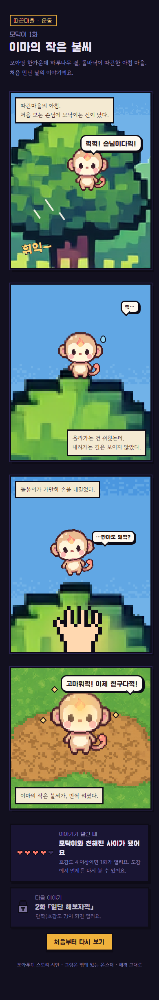
- 확인한 것: 390폭 전체 캡처 눈으로 확인, 콘솔 오류 없음, 가로 넘침 없음. 2 · 3컷에서 모닥이가 나무 위에 떠 보여 한 번 내려 고침.
- 확인하지 못한 것: 실제 폰 · 공개 링크로 연 모습 (앱 안 브라우저는 로그인이 필요해 못 엶), 움직임은 캡처로 못 봄(정지 화면만).
- **이어서 — 배경 바꾸기** (사용자 "기존 배경만 써서 밤티 난다")
  - 사용자가 Ludo.ai 웹에서 Claude가 준 프롬프트(픽셀 · 따뜻한 아침 · 생물 없음)로 소품 6장을 뽑아 줌: 큰 나무 · 나무 꼭대기 · 마을 광장 · 마을 길 · 하루나무 섬 · 돌바닥. Ludo API · MCP는 Pro 요금제부터라 연동은 못 하고 직접 생성.
  - 흰 바탕을 지워(가장자리에서 이어진 흰색만 투명) `docs/design/webtoon-bg/`에 저장하고, 컷마다 하늘 그라데이션 · 풀밭 · 픽셀 구름 위에 소품을 겹쳐 장면을 조립. 표지에 하루나무 섬.
  - 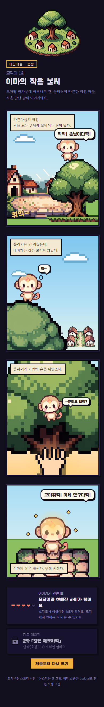
  - 확인한 것: 390폭 캡처 눈으로 확인(세 번 고침: 휘익 글자 위치, 2컷 아래 마을이 보이게, 4컷 돌바닥을 바닥처럼), 콘솔 오류 · 가로 넘침 없음.
- **이어서 — 다시 보기 버튼 글꼴 · 웹툰 브랜치**
  - "처음부터 다시 보기" 버튼만 Pretendard Bold(앱 본문 글꼴, 쓰는 글자만 넣음). 말풍선 · 제목은 Galmuri11 그대로.
  - 시안을 저장소에서 다시 만들 수 있게: 틀 `docs/design/webtoon/모닥이-1화.template.html` + `docs/design/webtoon/build.py`(그림 · 글꼴을 넣어 `docs/design/웹툰-시안-모닥이-1화.html` 생성, `fontTools` 필요).
  - 웹툰 작업은 브랜치 `feature/webtoon`에서 이어 간다 (사용자 요청, `feature/ai-chatbot-study-timer`에서 갈라짐).
  - 확인한 것: 버튼 글꼴이 Pretendard로 잡힘(브라우저 글꼴 확인), 콘솔 오류 없음.

### 2026-11-03 — 루틴몬 28종 귀여운 이름 · 스토리 설정서
- 브랜치 · 커밋: `team/2026-11-03-routinemon-cute-names-story`, 커밋은 팀이 한다.
- 한 일 (`docs/기획/2026-11-03-캐릭터-이름-스토리.md`)
  - 1부: 28종 새 이름 · 성격 · 말버릇 · 좋아하는 것 · 습관 연결 표. 2부: 세계관 · 마을 6개 · 메인 3장 18장.
  - 3부(이번 카드): 28종 × 3화(친해진 · 단짝 · 1차 진화) = 84화 줄거리, 화마다 3 ~ 4컷 흐름. 친구 관계 8쌍.
- 확인한 것: "- N화" 줄이 84개이고 모두 컷 3 ~ 4개. 악당 · 싸움 · 슬픈 결말 없음.
- 확인하지 못한 것: 앱 이름 반영(`catalog.dart`) · `flutter test`는 다른 카드 몫이라 이번 카드에서는 안 돌림. 결정-기록 · 기획-변경-이력 · 프로젝트-이해 갱신도 앱 반영 카드에서.
- **이어서 — 앱에 새 이름 반영 (팀 t4) · Claude가 마무리 (t5)**
  - 진행 방식: 자율 팀(Claude · Antigravity 검토)이 t1 ~ t4를 하고 예산(16 중 15)이 거의 떨어져, 사용자 요청으로 팀을 멈추고 Claude가 이어 받음. 팀 브랜치를 `feature/ai-chatbot-study-timer`에 그대로 합침(fast-forward, 충돌 없음).
  - t4: `catalog.dart` 28종 이름 · 도감 설명 · 대사를 새 이름과 말버릇으로, 이름이 들어간 테스트 4개 파일 수정. 종 id · 수치 그대로.
  - t5(Claude): DB 시드 이름 변경 제안 `docs/제안/2026-11-03-몬스터-이름-변경.md`(28종 표 · 안 바꾸면 AI 챗봇이 옛 이름을 씀), 결정-기록 D-63, 기획-변경-이력, 프로젝트-이해(첫 파트너 · 진화 그림 이름). 모닥이 대사 "활활이끽" → "활활 타올라끽" 한 줄 고침.
  - 남겨 둔 옛 이름: 서버 테스트 · DB 시드(윤서 문서), `http_game_repository_test`의 가짜 서버 응답(서버가 아직 옛 이름을 보내므로 그대로가 맞음), 지난 기획서 · 일지(기록이라 고치지 않음).
  - 확인한 것: 설정서 28종 × 3화 = 84화 · 친구 8쌍이 다 있음(팀 검토자가 잘려서 못 본 뒷부분 포함), 다른 작품 이름 없음. `flutter analyze` 이상 없음, `flutter test` 148개 통과. 확인하지 못한 것: 줄거리 글맛(사용자가 읽어 볼 것), 서버 모드 화면.

### 2026-11-02 — 공부 타이머 "공부방" · 통계 그래프 색
- 브랜치 · 커밋: `feature/backend-game-system`, 커밋 전.
- 한 일
  - **공부 타이머를 캔버스 시안(StudyTimer) 그대로** (D-59)
    - 공부방 장면: 창문(빗소리면 비) · 책장 · 책상 · 스탠드 불빛 · 펼친 책 · 연필 · 말풍선(3초마다) · 토마토. 친구 1 ~ 3마리가 상태마다 다르게 움직인다 (집중 끄덕 · 쉬는 시간 흔들 · 멈춤 Zzz · 끝 깡충 + 하트).
    - 뽀모도로: `StudyTimer`에 집중 · 쉬는 시간 · 자유 · 소리 · 친구 설정, 단계 · 회차 · 남은 시간 · 집중한 시간 · 토마토를 흐른 시간에서 계산. 끝내면 집중한 분만 쌓음.
    - 칠판: 설정 요약 · 톱니바퀴 · 상태("2번째 집중") · 시계(남은 시간) · 오늘 쌓인 분.
    - 톱니바퀴 → 설정 시트(집중 ±5 · 쉬는 시간 ±1 · 자유 스위치 · 공부 소리 라디오 + 2.5초 미리 듣기). 바꾸기 → "내 루틴몬" 시트(카테고리 거르기 · 최대 3마리 · 순서 번호).
    - 공부 소리 3개를 직접 만듦 (`assets/audio/bgm/studyRain · studyPencil · studyCafe.mp3`, numpy로 잡음을 걸러 만들고 ffmpeg로 mp3 — 내려받은 파일 없음). 집중하는 동안 챗봇 탭 곡을 바꿔 틂 (`BgmTrack.study… · quiet`).
    - 끝 화면 [한 번 더] · [챗봇에 기록하러](챗봇 칸으로).
  - **통계 그래프 색** (D-60): 달성률별 코랄 · 노랑 · 민트, 목표 80% 점선, 범례, 평균 숫자도 같은 색, 막대 윗모서리 둥글게.
  - 화면
    | 준비 | 집중 (세 마리) | 톱니바퀴 설정 |
    | --- | --- | --- |
    | 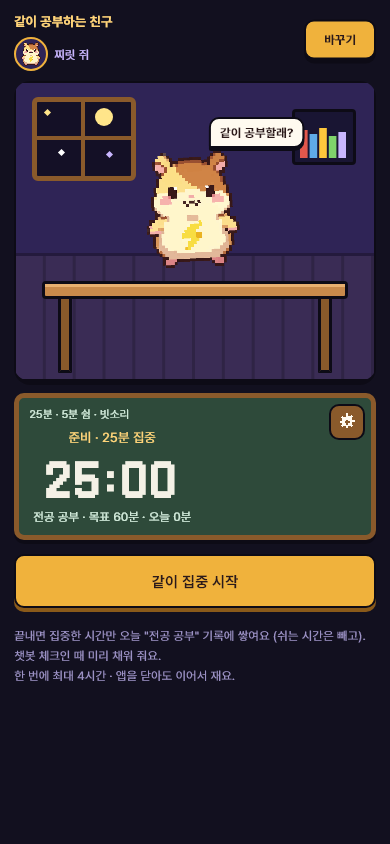 | 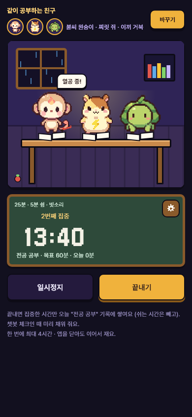 | 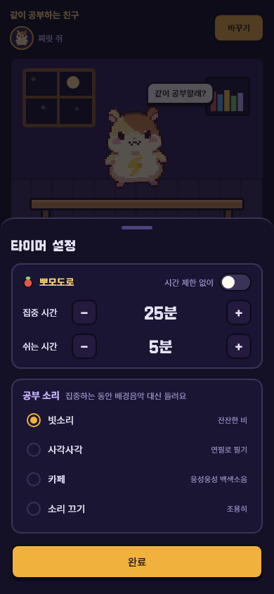 |

    | 내 루틴몬 | 끝 | 통계 |
    | --- | --- | --- |
    | 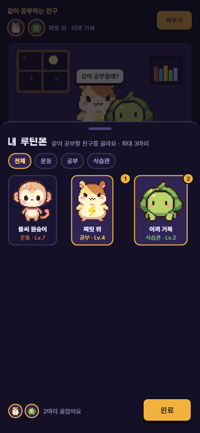 | 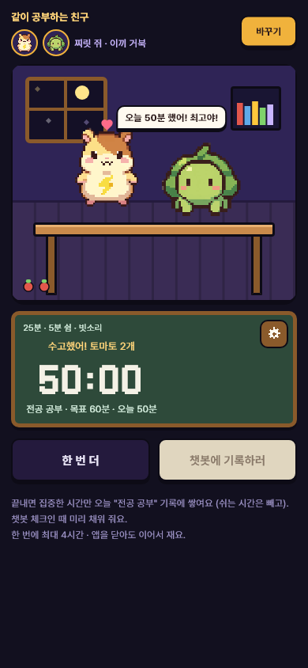 | 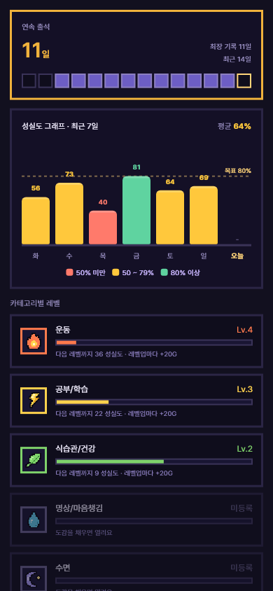 |
- 확인한 것: `flutter analyze` 이상 없음, `flutter test` **145개 통과** (타이머 테스트: 뽀모도로 계산 · 저장 · 친구 최대 3 · 재는 중 설정 잠금 · 화면 시작/끝내기 · 톱니바퀴 설정 · 친구 고르기). 위 캡처 6장을 눈으로 확인.
- 확인하지 못한 것: 실제 기기 · 웹에서 **공부 소리가 실제로 들리는지 · 반복 이음매**(테스트에는 소리가 없음), 미리 듣기 2.5초 뒤 원래 곡으로 돌아가는지, 폰에서 몬스터 움직임이 부드러운지.
- 막혔던 것
  - 설정 시트를 열고 바로 누르면 빗나감 → 시트가 올라오는 첫 프레임이 다음 `pump`에서야 시작. 테스트에서 `pump()`를 한 번 더.
  - 창문의 별 글자(✦)가 글꼴에 없어 네모로 나옴 → 작은 마름모 도형으로.
  - 막대에 둥근 모서리 + 위쪽만 테두리를 같이 쓰면 Flutter가 막음 → 안쪽에 3px 밝은 줄을 따로 그림.
- 정한 것: D-59 · D-60. 통계 색은 시안 세 가지 중 **추천안으로 구현**(사용자가 따로 고르진 않음).
- 남은 일: 기기에서 소리 확인, 타이머 서버 기록(DB 제안 3번 합의 뒤), `/code-review`, 커밋.
- **이어서 — 홈 몬스터 크기 · 연속 출석 색** (사용자가 고름: 64 · 민트)
  - 홈 필드 몬스터 칸 `MonsterSpecies.fieldBox` 72 → 64. 이름표 · 걷는 범위는 이 값을 따라 저절로 맞춰짐.
  - 통계 연속 출석: 숫자 · 출석한 날 칸 민트(`AppColors.rateHigh`), 오늘 칸 노랑, 카드 테두리는 다른 카드처럼 어두운 줄.
  - 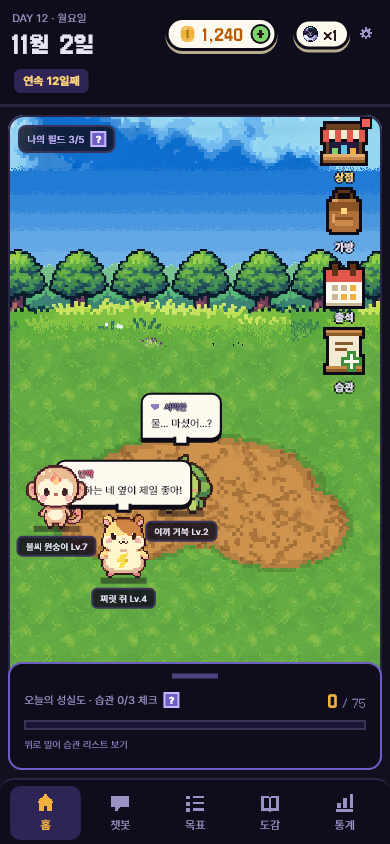 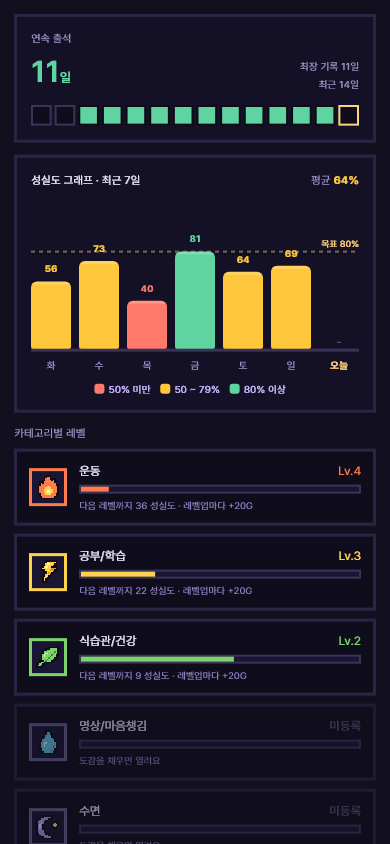
  - 확인한 것: `flutter analyze` 이상 없음, `flutter test` 145개 통과, 캡처 2장 눈으로 확인. 확인하지 못한 것: 실제 폰에서 몬스터 크기 느낌.
- **이어서 — 몬스터 크기를 "같은 넓이"로** (D-61)
  - 원인: 그림 여백은 1px뿐, 문제는 가로세로 비율. 64 칸에 맞추면 토끼 40×64 · 박쥐 64×46처럼 몸집이 달라 보였다.
  - 고친 것: 모든 종을 넓이 50×50과 같게, 긴 변 60 이하로 (`MonsterSpecies.fieldSizeAt`). 칸 64 → 60. 그림 원래 크기 표 `lib/data/sprite_sizes.dart`는 `tool/sprite_sizes.py`로 자동 생성.
  - 예: 원숭이 61×64 → 49×51, 쥐 52×64 → 45×56, 거북 64×60 → 52×48, 박쥐 64×46 → 59×43, 토끼 40×64 → 37×60.
  - 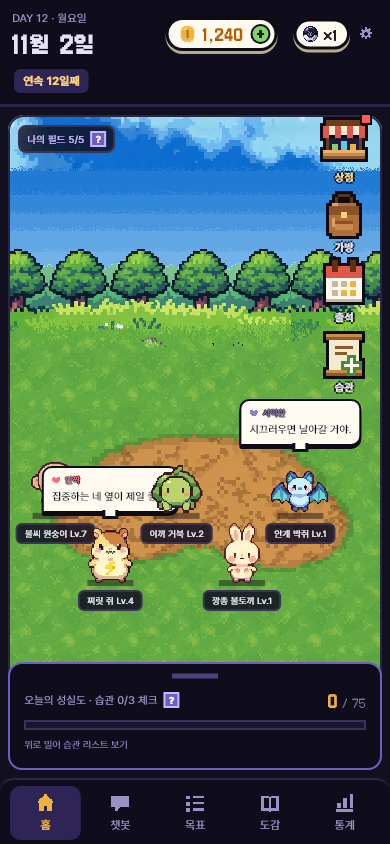
  - **크기 다시 키움** (사용자 "너무 작다"): 넓이 50 → 58, 긴 변 · 칸 60 → 70. 원숭이 57×59 · 쥐 52×65 · 거북 60×56 · 박쥐 68×49 · 토끼 43×70.
    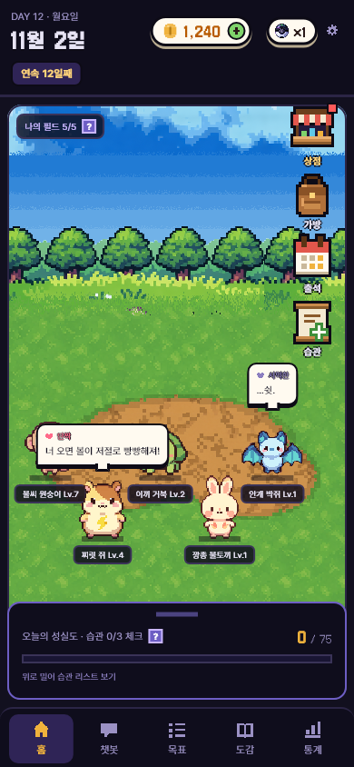
  - 새 테스트 `sprite_size_test.dart` 2개: 표가 실제 PNG 크기와 같은지(그림을 바꾸고 스크립트를 안 돌리면 실패), 모든 종 넓이 · 상한.
  - 확인한 것: `flutter analyze` 이상 없음, `flutter test` **147개 통과**, 캡처 눈으로 확인 (다섯 마리가 비슷한 몸집). 확인하지 못한 것: 폰 화면 느낌, 공작 · 사슴처럼 꼬리 · 뿔이 큰 종의 실제 모습(캡처엔 없음).

- **이어서 — 공부 타이머를 한 화면에** (사용자 "내려야 돼서 불편")
  - 목록(스크롤) → 세로 배치: 친구 줄 · 공부방(남는 높이를 다 차지) · 칠판 · 버튼. 공부방이 낮아지면 책상 다리를 짧게 하고 몸집을 줄여 말풍선까지 방 안에 들어오게. 아래 안내 글은 톱니바퀴 설정 시트 아래로 옮김.
  - 아주 낮은 화면(공부방이 180px보다 작아질 때)만 예전처럼 스크롤.
  - | 390×844 준비 | 390×844 집중 | 360×740 집중 |
    | --- | --- | --- |
    | 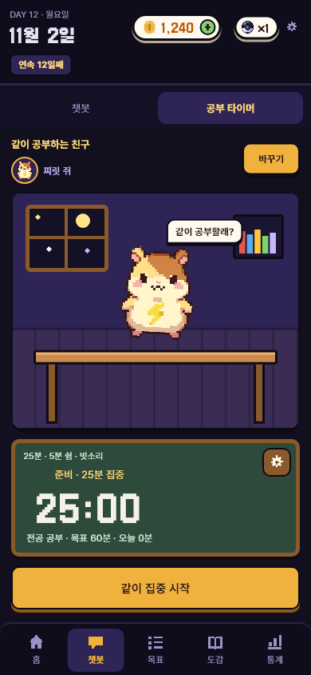 | 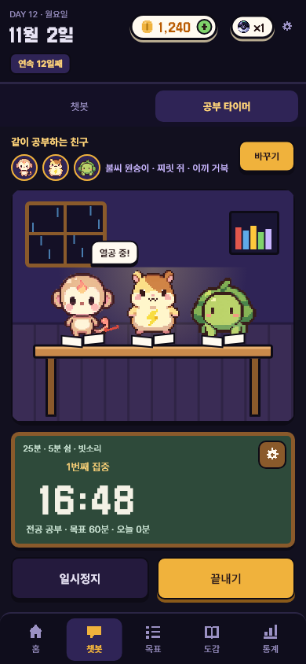 | 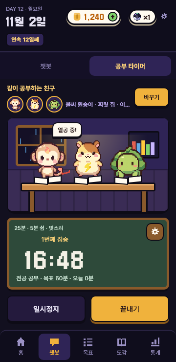 |
  - 막혔던 것: 첫 시도는 360×740에서 버튼이 아래 탭에 가렸다 — 공부방 최소 높이(220)를 못 채워 스크롤 모드로 떨어진 것. 최소 180 + 책상 아래 높이를 방 높이에 비례(70 ~ 116)로 바꿔 해결.
  - 확인한 것: `flutter analyze` 이상 없음, `flutter test` 147개 통과 (타이머 화면 테스트에 "스크롤 없음" 검사 추가). 위 캡처 3장 눈으로 확인 (두 크기 모두 버튼까지 보임). 확인하지 못한 것: 실제 폰(상태 바 · 제스처 바가 있는 화면).

- **이어서 — 교감 창: 몬스터 살짝 작게 · 맵 넓게 · 간식 칸 낮게** (사용자 "간식 주기 창이 너무 커서 부담")
  - 무대(맵) 높이 310 → 360, 몬스터 140 → 124 (놀아주기 104 → 94). 간식 칸 88 → 56: 물약 · 이름 · EXP를 세로로 쌓던 것을 물약 왼쪽 · 글자 오른쪽 한 줄로. 간식 칸 테두리 안 여백 10 → 8. 창 전체 높이는 거의 그대로이고 줄어든 간식 칸만큼 맵이 늘었다.
  - 수치 124 · 360 · 56은 Claude가 정했다 (사용자가 캡처를 보고 조정 가능).
  - | 전 | 후 |
    | --- | --- |
    | 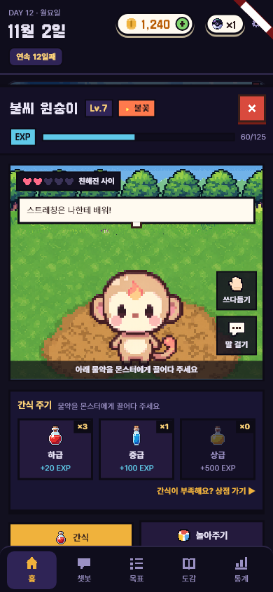 | 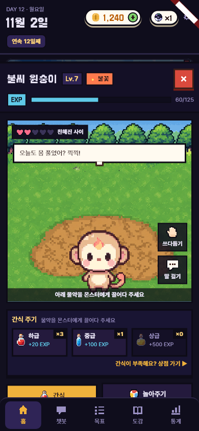 |
  - 이어서 사용자 "몬스터가 중간에 위치하게": 몬스터가 서는 자리를 무대 바닥(아래에서 16px) → **무대 세로 한가운데**로. 놀아주기도 같은 규칙으로 가운데에서 시작한다 (공을 던지면 예전처럼 뛰어간다).
    | 가운데 (간식) | 가운데 (놀아주기) |
    | --- | --- |
    | 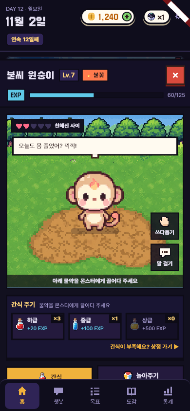 | 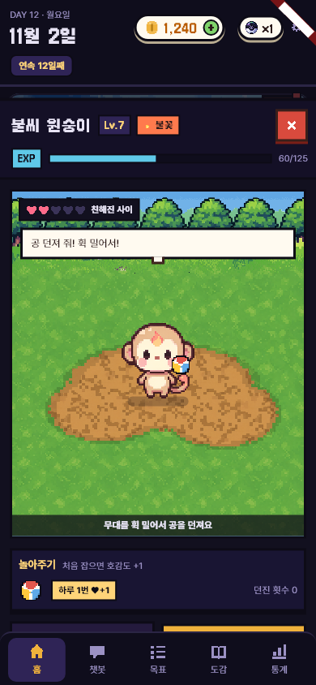 |
  - 확인한 것: `flutter analyze` 이상 없음, `flutter test` 147개 통과 (물약 끌어 먹이기 · 공 던지기 테스트 포함), 390×844 캡처 눈으로 확인. 확인하지 못한 것: 쓰다듬기 상태의 캡처, 실제 폰. 배경의 흙 마당은 그대로라 몬스터가 마당 위쪽 끝에 서 있다.

- **이어서 — 기획서 2개 (구현 전, 사용자 확인 기다림)**
  - [루틴몬 스토리](기획/2026-11-02-루틴몬-스토리.md): 몬스터마다 3화(친해진 · 단짝 · 1차 진화 때 열림) + 카테고리 마을 이야기(그 카테고리 1 · 3 · 5종 잡으면). 웹툰처럼 기존 그림으로 연출, 운동 카테고리 먼저.
  - [성실볼 직접 던지기](기획/2026-11-02-성실볼-직접-던지기.md): 볼을 위로 밀어 던지고 맞으면 빨려 들기 · 흔들림 · 별 이펙트. 빗나가면 볼을 쓰지 않음, 잡을 확률은 서버 그대로.
  - 사용자가 고른 것: 여는 때(호감도 · 진화 + 도감 단계), 범위(한 카테고리 먼저), 빗나감(볼 안 씀).

- **이어서 — 성실볼 직접 던지기 구현** (D-62, [기획서](기획/2026-11-02-성실볼-직접-던지기.md))
  - 탐색에서 [볼 던지기] 버튼을 없애고, 발판 아래 성실볼을 위로 휙 밀어 던진다. 날아감(회전 · 포물선) → 맞으면 번쩍 + 빛 조각이 볼로 빨려 들고 몬스터가 하얗게 작아지며 들어감 → 볼이 떨어져 통통 → 흔들흔들 → 잡힘(별 터짐) / 놓침(볼이 위아래로 갈라지고 몬스터가 튀어나옴) → 팝업.
  - 맞았을 때만 저장소(서버) `throwBall`을 부른다 → 빗나가면 볼을 쓰지 않는다. 잡을 확률 · API는 그대로.
  - | 준비 | 날아감 | 빨려 들기 | 잡힘 | 놓침 |
    | --- | --- | --- | --- | --- |
    | 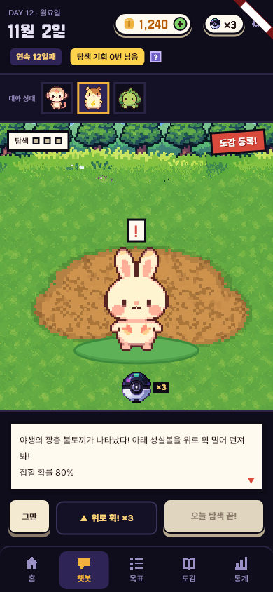 | 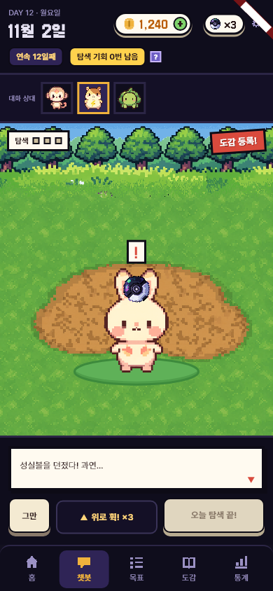 | 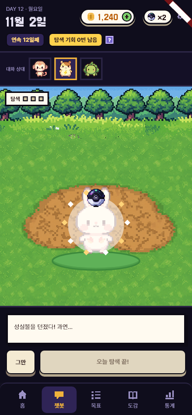 | 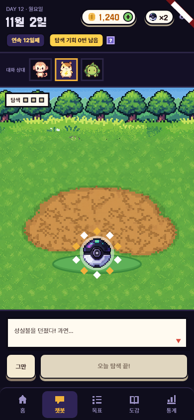 | 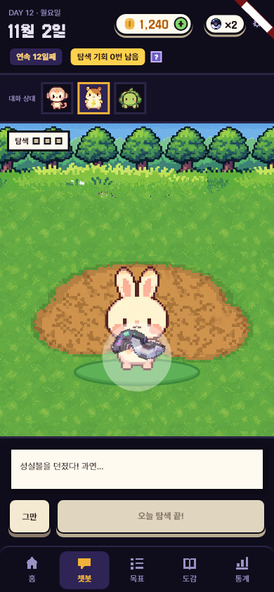 |
  - 막혔던 것: ① 처음엔 테스트에서 볼이 안 날아갔다 — 보통 끌기는 손가락이 36px 움직여야 시작해서 짧은 휙을 놓친 것. 교감 창 공처럼 손을 대는 즉시 잡는 끌기로 바꿈. ② `tester.flingFrom`은 손을 뗄 때 빠르기가 0으로 나와서, 시각을 붙여 나눠 움직이는 도우미(`test/throw_helper.dart`)를 만듦. ③ 연출 단계마다 한 프레임씩 늦게 시작해 3.6초로는 팝업까지 못 감 → 5초.
  - 확인한 것: `flutter analyze` 이상 없음, `flutter test` 148개 통과 (새 테스트: 살짝 밀기 · 빗나감 · 맞음), 연출 프레임 캡처를 눈으로 확인. 확인하지 못한 것: 실제 폰 손맛, 360폭, 서버 모드(같은 `throwBall`이라 바뀐 것은 없음).
### 2026-10-30 — AI 챗봇 기획 확정 · API · DB 변경 제안 · 키 보관
- 브랜치 · 커밋: `feature/backend-game-system`, 커밋 전.
- 한 일
  - 기획서 `docs/기획/2026-10-29-AI-챗봇-체크인.md` 확정: A안(모델은 해석, 점수는 서버 공식), Gemini, 타이머는 챗봇 탭 옆, 헬스는 안드로이드 Health Connect만 (D-57).
  - **API 제안** `docs/제안/2026-10-30-AI챗봇-API.md`: `POST /checkins/today/interpret`(대화 해석, 확정하지 않음), 체크인 `evidence` · 점수 상한 · 경험치 계수, `GET /checkins/today`의 `timerMinutes`, 공부 타이머 3개(`/study-timers`), 다음 단계 `POST /health-records`, 새 오류 코드 4개.
  - **DB 변경 제안** `docs/제안/2026-10-30-AI챗봇-DB변경.md`: `ai.chat_message` 글 입력 · 해석 결과, `habit.habit_checkin` 근거 칸, 새 테이블 `habit.study_timer` · `habit.health_daily`, 설정값 9개.
  - **키 보관**: Gemini 키는 `backend/.env`(커밋 안 됨)에만 넣음. `.env.example`에는 칸만(`GEMINI_API_KEY=` 빈 값). 루트 `.gitignore`에도 `.env` · `.env.*`(예시 파일 제외) 추가. `backend/.env`는 이 PC에 처음 만든 것 — `HM_DB_DIR`은 비워 둠(서버 켤 때 채움), DB 포트 5435.
- 확인한 것: `git check-ignore`로 `backend/.env`가 무시되는 것 확인. 코드는 바꾸지 않음.
- 확인하지 못한 것: 키로 실제 Gemini 호출(구현 단계에서), 키 형식(`AQ.`로 시작 — 보통은 `AIza`).
- 정한 것: D-57
- 남은 일: 윤서 님과 API · DB 제안 합의, 서버 `ai/` 구현 · 앱 글 입력 · 확인 카드 · 공부 타이머, 경험치 계수 시뮬레이션.
- **이어서 — Gemini 연결 확인 · 구현**
  - 키 확인: 모델 목록 200 OK. 체크인 해석 시험 — flash-lite 1 ~ 2초, `gemini-flash-latest` 20초 초과 → `gemini-3.5-flash-lite`로 (D-58).
  - **서버**
    - `ai/` 새 패키지: `LlmClient`(인터페이스) · `GeminiClient`(Java HttpClient, 3초 제한, 실패하면 빈 값) · `CheckinInterpreter`(프롬프트 · 응답 모양 고정 · 다시 검사)
    - `checkin/CheckinChatService` + `POST /checkins/today/interpret` (확정하지 않음, 하루 60번 · 서버 메모리)
    - `HabitService.chatHabits`(AI 문맥을 값으로 넘김), `ErrorCode.AI_RATE_LIMITED`(429)
    - `application.properties`가 `backend/.env`를 읽음(`spring.config.import`)
  - **앱**
    - 챗봇에 말로 답하기 입력칸, `ChatController.sendText`(해석 → 남은 습관 묻기 → 다시 묻기), 확인 카드(`ChatStep.confirm`, [맞아] · [고칠래])
    - 위기 신호면 그 자리에 머묾. 시연 모드는 말 속 숫자 · "못 했어"만 읽음
    - 챗봇 탭 위 [챗봇 | 공부 타이머] 칸, `StudyTimer`(시작 · 일시정지 · 이어서 · 끝내기, 4시간 자동 정지, 자정 나누기, 기기 저장) → 공부 습관을 물을 때 미리 채움
  - `docs/AI-프롬프트.md` (프롬프트 · 검사 · 실제 결과 · 발표 질문), `backend/README.md` API 표.
  - 화면
    | 말로 답하기 | 확인 카드 | 공부 타이머 |
    | --- | --- | --- |
    | 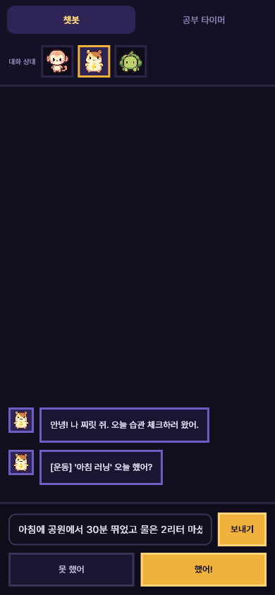 | 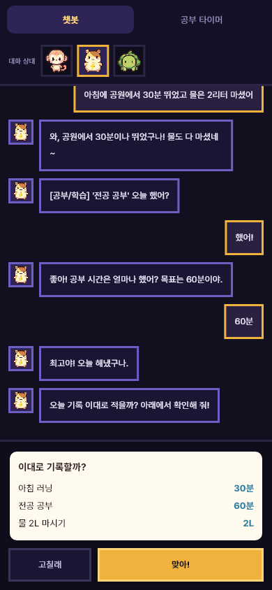 | 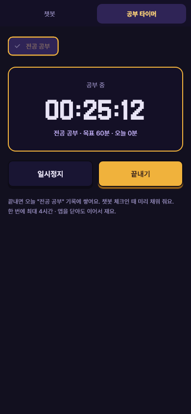 |
  - 확인한 것
    - 서버 `./gradlew test` 전부 통과 (새 `InterpretApiTest` 4개 — 가짜 모델로 선택지 맞추기 · 남의 습관 버리기 · 상한 · 낮은 확신 · 실패 → 대본형 · 입력 검사)
    - 앱 `flutter analyze` 이상 없음, `flutter test` **142개 통과** (새 `ai_chat_test` 9개)
    - **로컬 서버(8081) + Docker DB(5435) + 진짜 Gemini로 끝까지**: 32분 → 30분, "좀 했어" → 되묻기, "점수 25로 해" → 기록 안 함, 위기 신호 → `safety`, 해석 뒤에도 제출 안 됨. 1.0 ~ 1.6초
  - 확인하지 못한 것: 앱 화면에서 서버 모드로 실제 대화(웹 · 폰), 폰에서 타이머 백그라운드 복원.
  - 막혔던 것: ArchitectureTest가 설정 이름 `app.ai.gemini…`를 DB 테이블 `ai.…`로 오해 → `app.llm.…`으로 바꿈.
  - 이 PC 설정: `backend/.env`에 `HM_DB_DIR=C:/habit_monster/docs/데이터베이스`(Docker Desktop이 이 경로를 볼 수 있음 확인) · DB 5435 · Gemini 키. Docker DB `habit-monster-db-1`을 새로 만들었고, 서버가 8081에서 켜져 있음(테스트 계정 `ai-e2e-…@habit.kr`는 로컬 DB에만).

### 2026-10-29 — 시안대로 화면 다듬기 · 교감 창 개편(공 던지기 · 물약 끌기) · 로그인 편의
- 브랜치 · 커밋: `feature/backend-game-system`(`dc9b496`, 윤서 님이 10-28에 올린 최신)으로 옮김. **커밋 전**.
- 한 일
  - **브랜치 정리**: `feature/monster-art-v2`의 커밋 안 한 작업을 보관함(stash)에 넣고 최신 브랜치로 전환. 이 브랜치에 빠져 있던 "앱 이름 모아루틴" 커밋(`76f70aa`)을 가져오고(커밋하지 않고 변경만), "루틴몬 도감" 이름 변경 · 10-16 문서를 다시 적용.
    결정 번호가 겹쳐서(윤서 님 D-22 = Kotlin 증분 컴파일) 앱 이름 결정을 **D-22 → D-51**로 바꿈.
  - **디자인 시안** (https://claude.ai/artifact/4fBCYaFjedcnPBQvDFGNKJ): 색 · 모양을 사용자와 여러 번 고침 → 교감 창은 밤 보라 · 네모 픽셀, 나머지는 기존 색 + 둥근 모서리 (D-54).
  - **기획서 2개**: `docs/기획/2026-10-29-교감-창-개편.md`, `docs/기획/2026-10-29-로그인-편의.md`.
  - **교감 창** (`monster_overlay.dart` 다시 씀, D-52): 무대 배경 = 홈 필드 그림, 머리에 EXP 막대(진화 안내 없앰), 무대 → 고른 행동 칸 → 버튼 4개.
    물약 길게 눌러 몬스터에게 끌기 · 톡 먹이기, 놀아주기 = 무대 400px로 늘어나고 땅을 누르면 공이 날아가고 몬스터가 뛰어가 잡음(첫 번째만 `play` → ♥+1), 비치볼 픽셀 아이콘(`PixelIcons.toyBall`).
  - **홈**: 필드 몬스터를 모두 72×72 칸에(`MonsterSpecies.fieldBox`, 종별 `fieldHeight` 삭제), 상단 바를 시안대로("DAY · 요일" + 큰 날짜, "연속 N일째" 칩, 체크 뒤에만 "탐색 기회 N번 남음"), 하단 탭 · 습관 시트 · 말풍선 · 이름표 둥글게.
  - **로그인 편의** (D-53): 최근 로그인 말풍선, 자동 로그인 체크, 이메일 화면 아이디 저장(미리 채우기). 로그인 · 이메일 화면을 둥근 모서리로, 부제 "습관이 쌓이면, 루틴몬이 자라요".
  - **상점**: 둥근 카드 · 버튼(`RoundBlockButton`), 설명 "+100 EXP · 11% 이득", 진화 안내 문구 뺌.
- 화면 (390폭, 임시 골든 테스트로 캡처)

  | 홈 | 교감 — 간식 | 교감 — 공 던지기 |
  | --- | --- | --- |
  | 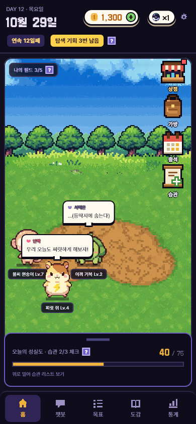 | 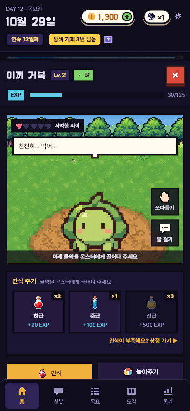 | 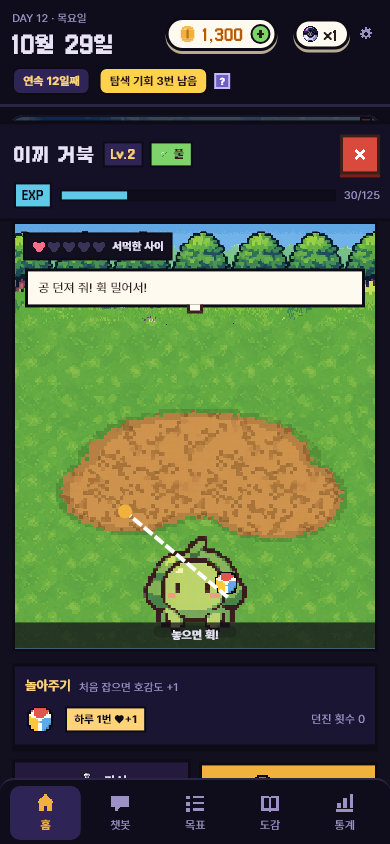 |

  | 로그인 | 이메일 로그인 | 상점 |
  | --- | --- | --- |
  | 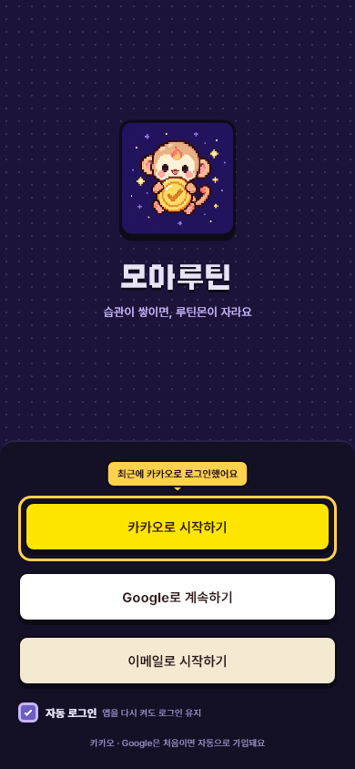 | 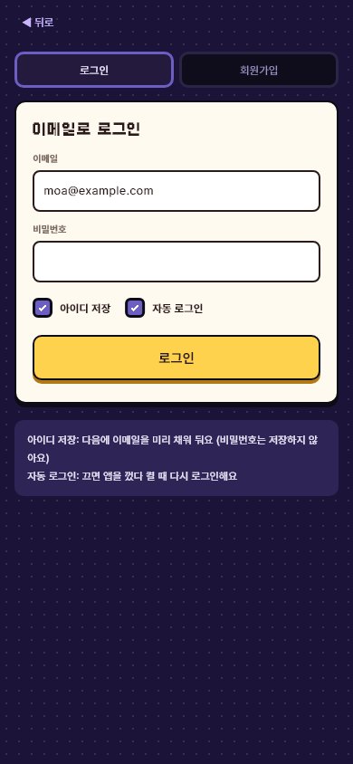 | 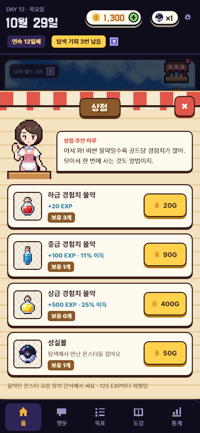 |

  360폭: `01-홈-360.png` · `02-교감-간식-360.png` · `03-교감-공던지기-360.png` · `06-상점-360.png`
- 확인한 것: `flutter analyze` 이상 없음, `flutter test` **133개 통과** (새: 공 던지기 · 물약 끌기 · 로그인 편의 2개). 캡처 390 · 360폭을 눈으로 확인 (임시 테스트는 지움).
- 확인하지 못한 것: 실제 폰 · 웹에서 물약 끌기 · 공 던지기 손맛, 서버 모드(8081)에서 교감 · 로그인 편의, 기기 안전 저장소(`SecureLoginPrefsStore`) 실제 저장. **서버 실행은 아직 안 함**.
  캡처의 큰 날짜가 어둡게 보이는 것은 테스트 하네스의 기본 테마 때문(앱 테마에선 밝은 글자).
- 막혔던 것과 원인
  - 교감 창이 무한 재귀(StackOverflow): 몬스터를 물약 받는 영역(`DragTarget`)으로 감쌀 때 같은 변수 이름을 다시 써서 자기 자신을 감쌌음 → 변수를 나눔.
  - 360×640에서 놀아주기 중 아래 버튼에 못 감: 놀아주기 때 스크롤을 막았었음 → 쓰다듬기(문지르기) 때만 막음.
  - 습관 시트 레이아웃 오류: 위 테두리를 3 → 2px로 줄였는데 안쪽 높이 계산이 3을 빼고 있었음 → 2로.
  - 셸 heredoc 안의 한글 · 따옴표가 섞인 python이 bash에서 깨짐 → 스크래치 패드에 .py 파일로 쓰고 실행.
- 정한 것: D-52 · D-53 · D-54
- **이어서 (오후, 사용자 요청)**
  - 간식: 길게 누르기 없이 **바로 끌어다 놓기**만 (누르면 "이쪽으로 끌어 줘!" 안내). 놀아주기: 땅 누르기 → **스와이프 방향 · 세기대로 던지기**(조준 점선, 너무 약하면 "더 세게"). 창 스크롤에 빼앗기지 않게 무대는 손가락을 대자마자 이기는 인식기(`_EagerPan`).
  - 교감 창: 무대 크게(250 → 310, 놀아주기 400 → 430, 몬스터 124 → 140), 쓰다듬기 · 말 걸기는 무대 오른쪽 아래 작은 버튼, 아래는 간식 · 놀아주기 작은 버튼 2개.
  - 홈: 필드 · 습관 시트를 둥근 카드로(가장자리 8px), 체크를 마치면 습관 시트의 버튼을 없앰.
  - 온보딩: 테두리 있는 상자 24곳 모서리 10, `PixelButton` · `PressCard` 기본 모서리 10(교감 창만 0) → 앱 전체 버튼이 둥글어짐.
  - 글꼴: 본문 Pretendard(새 글꼴 파일, OFL), 제목(굵은 15px 이상 · 24곳) · 숫자 칩 · 팝업 제목은 Galmuri (D-55).
  - 탐색: 2초 "탐색 중…"(덤불 빠르게 흔들림) → 결과 알림 (D-56).
  - 화면
    | 교감 — 간식 | 교감 — 공 조준 | 탐색 — 찾는 중 | 탐색 — 결과 |
    | --- | --- | --- | --- |
    |  |  | 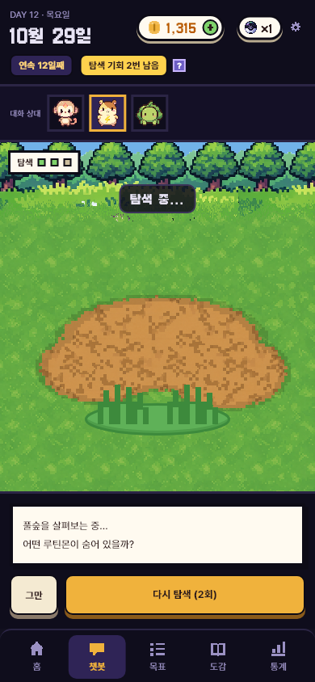 | 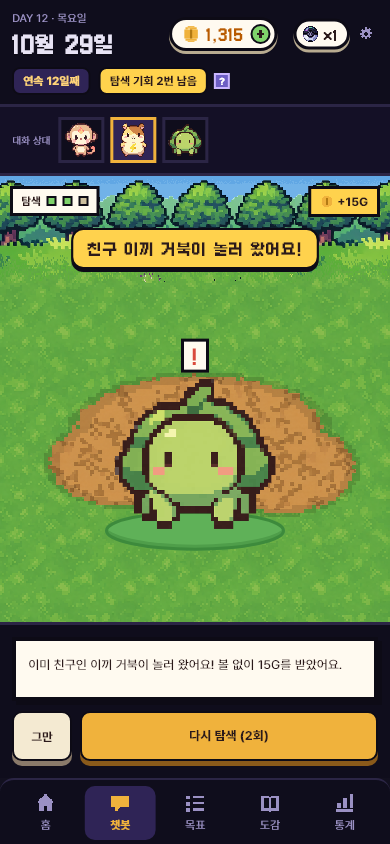 |

    | 홈 | 습관 시트 (체크 후) | 온보딩 1단계 | 온보딩 2단계 |
    | --- | --- | --- | --- |
    |  | 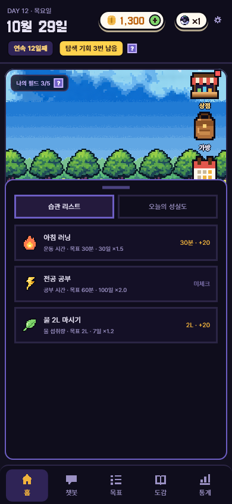 | 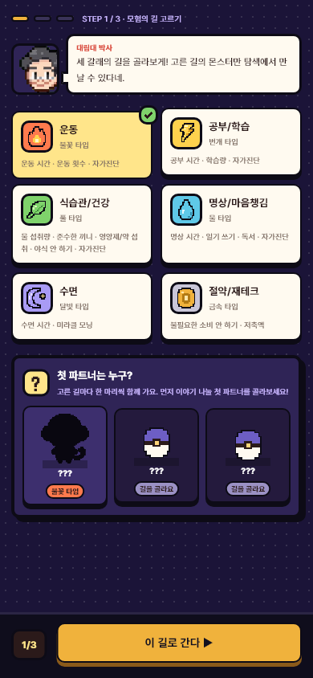 | 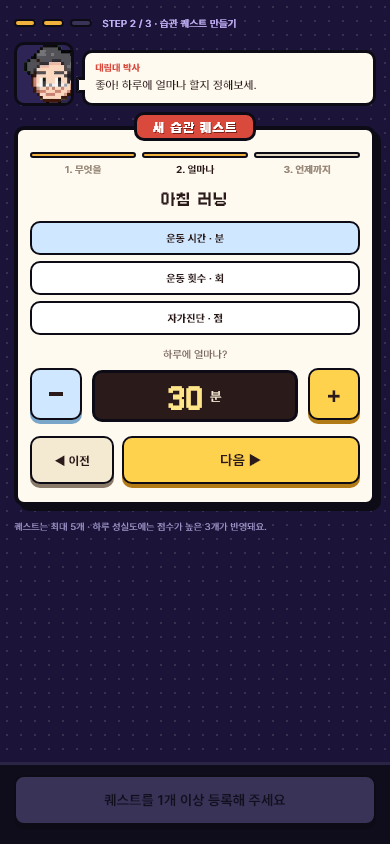 |
  - 확인한 것: `flutter analyze` 이상 없음, `flutter test` **133개 통과**(물약 끌기 · 스와이프 던지기 · 탐색 기다림으로 테스트 고침). 캡처 눈으로 확인.
  - 확인하지 못한 것: 실제 폰에서 스와이프 세기 감각(빠르기 × 0.35초로 계산 — 조정이 필요할 수 있음), 웹에서 Pretendard 로딩 시간.
  - 막혔던 것: ① 캡처용 임시 테스트를 PowerShell `Set-Content`로 고쳤다가 한글이 깨짐(CLAUDE.md 7장의 함정 그대로) → 지우고 새로 씀. ② 캡처에서 몬스터를 눌러도 교감 창이 안 열림 → 시트를 접은 직후 애니메이션이 시작 프레임이라 아직 펼쳐진 시트가 몬스터를 가리고 있었음(테스트에서 한 프레임 더 그리면 해결, 앱 문제 아님). ③ 스와이프 시작 위치를 `build` 안 지역 변수에 두었더니 다시 그릴 때마다 사라짐 → 상태 필드로.
  - 정한 것: D-55 · D-56 (D-52 · D-54 내용 갱신)
- 남은 일: 챗봇 프롬프트 · 밸런스 조정 기획서(사용자 요청), 서버 실행 확인, 가방 · 도감 · 목표 · 통계 · 챗봇 화면 모양, 보관함(stash) 정리. `docs/스크린샷/2026-10-29/`에 중간 캡처 `01-홈-탐색기회-몬스터칸.png`와 옛 글꼴의 `06-상점-360.png`가 남아 있음(보호 경로라 Claude가 지우지 못함).

### 2026-10-28 — 루트 README에 실행 방법 정리 (송윤서)
- 브랜치 · 커밋: `feature/backend-game-system`, `183fae3` 다음. **커밋 전**.
- 한 일: 사용자 요청 — 실행 방법이 `backend/server/README.md`에 서버 위주로 흩어져 있고 루트 `README.md`의 "처음 실행하기"는 옛 내용(플랫폼 폴더 만들기)이라,
  그 절을 "실행 방법"으로 바꿈: 서버 모드 · 시연 모드 표, 준비물, 서버 켜기, 앱 실행 A 웹(Chrome · 포트 5000) · B 에뮬레이터(`10.0.2.2`) · C 실제 폰(USB 디버깅 · `adb reverse`), 테스트
- 확인한 것: 명령은 기존 문서(`backend/server/README.md` · 작업 기록)에 있던 것과 같음. 이번에 새로 실행해 보지는 않음
- 이어서 (사용자 요청): 루트 README의 나머지 옛 내용도 고침 — 앱 이름(루틴몬), 폴더 구조(서버 = Spring Boot · `backend/server` · `db` · docker, `features/` 목록, 몬스터 28종 · 카테고리 6개, 주요 문서), "지금 만들어진 것"(앱 화면 · 서버 API · 테스트 수), "다음에 만들 것"(4-1 앱 · 5 · 6단계)
- 이어서: 사용자 질문("`adb reverse tcp:8081 tcp:8081`이 뭐야")에 답하고 `docs/프로젝트-이해.md` 용어 표에 한 줄 추가

### 2026-10-28 — 4-4 통계: 서버 API + 통계 화면 (송윤서)
- 브랜치 · 커밋: `feature/backend-game-system`, `f3dbd4d` 다음. **커밋 전**.
- 한 일
  - 기획서 `docs/기획/2026-10-28-통계.md` (간결하게 → [가정] 4개 확정 → 구현 완료)
  - 서버: 조율 서비스 `stats/`(`StatsController` · `StatsService`) — `GET /stats`. `HabitService.streak · attendedDays · dailyRates`(그날 최신 점수로 달성률) `· categoryProgress`, `HabitRepository.attendedDays · dayScores`
  - 앱: `GameRepository.loadStats()` + `StatsData`, 통계 화면 새로(시안 3칸 — 연속 출석 14칸 · 7일 막대 · 카테고리 6줄), 탭을 열 때마다 불러옴, 색 토큰 2개 · `Economy.targetHitScore`
  - 문서: 결정 D-50, 기획 변경 이력, 프로젝트 이해, API 표 · 연동 표, 서버 README, `backend/CLAUDE.md`, `frontend/CLAUDE.md`, `frontend/서버연동-메모.md` 4장, 할-일, 진행현황
- 정한 것: 막대 = 달성률 % · 탭 열 때마다 · 시연 모드 샘플 · 기본 위젯 막대 → D-50
- 화면
  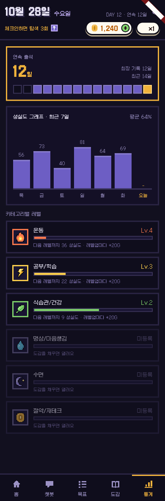
  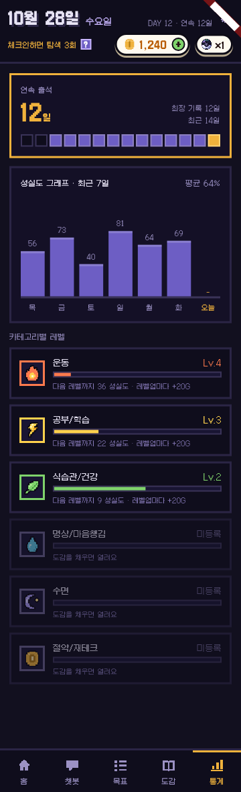
- 확인한 것: 서버 테스트 **150개 통과** (새 `StatsApiTest` 3개). 앱 `flutter analyze` 이상 없음, 테스트 **130개 통과** (새 2개). 캡처 390 · 360폭 눈으로 확인 (임시 골든 테스트는 지움)
- 확인하지 못한 것: 서버 모드 통계 화면을 실제 서버(8081)로 띄워 보기, 폰 · 웹
- 막혔던 것과 원인: 통계 탭을 붙인 뒤 목표 화면 테스트가 시간 초과 → 탭들이 겹쳐 쌓인 화면(IndexedStack)에서 안 보이는 통계 탭의 로딩 원이 계속 돌아 "화면이 멈출 때까지 기다리기"가 끝나지 않음 → 안 보일 땐 로딩 원을 안 그리게 고침.
  테스트의 요일 기대값을 잘못 적음(2026-10-18은 일요일) → 고침
- 쓰는 곳이 없어진 "준비 중" 위젯 `core/widgets/coming_soon.dart` 지움 (사용자 확인)
- 남은 일: 5단계 AI 대사 · 알림, 4-1 앱(프론트 담당)

### 2026-10-28 — 4-3 도감 · 카테고리 열기: 서버 API + 앱 연결 (송윤서)
- 브랜치 · 커밋: `feature/backend-game-system`, `ed0d96c` 다음. **커밋 전**.
- 한 일
  - 기획서 `docs/기획/2026-10-28-도감-카테고리-열기.md` (사용자 요청 "간결하게" → [가정] 3개 확정 → 구현 완료)
  - 서버: 조율 서비스 `dex/`(`DexController` · `DexService`) — `GET /dex` · `/dex/categories/{code}` · `/dex/species/{id}` · `POST /categories/{code}/unlock`.
    `MonsterService.dex`(종마다 가진 · 본 · 최고 레벨, 본 종 = 탐색 등장 기록 D-30) · `fieldCount` · `dexCount`, `HabitService.openWithTicket · availableTickets`, 오류 코드 3개(`NOT_DISCOVERED` · `ALREADY_OPENED` · `NO_TICKET`)
  - 앱: `load()`에 도감 7개 요청 → `GameState.applyDex`, `openCategory`를 서버로 → `applyCategoryOpened`, 서버 모드 칸 = 연 카테고리 + 해금권(`serverTickets`)
  - 문서: 결정 D-49, 기획 변경 이력 1줄, 프로젝트 이해, API 표 · 연동 표, 서버 README(패키지 · 테스트), `backend/CLAUDE.md`, `frontend/CLAUDE.md`, `frontend/서버연동-메모.md` 3장, 할-일, 진행현황
- 정한 것: 조율 서비스 `dex/` · 시작할 때 도감 불러오기 · 앱은 상세 안 씀 → D-49
- 화면: 모양은 그대로 (데이터 출처만 서버로) → 캡처 안 함
- 확인한 것: 서버 테스트 **147개 통과** (새 `DexApiTest` 8개). 앱 `flutter analyze` 이상 없음, 테스트 **128개 통과** (새 3개)
- 확인하지 못한 것: 실제 서버(8081)에 요청, 폰 · 웹에서 눌러 보기
- 정한 것 (덧붙임): 카테고리 칸은 서버 규칙 그대로(A) — 사용자가 "처음 3칸 바로 열기(B)"와 비교해 결정. 4종뿐인 카테고리 하나만 고르면 막히는 문제는 종을 늘려 해결 (할-일에 추가). 시연 모드를 맞출지는 따로 → D-49 덧붙임
- 남은 일: 4-4 통계, 4-1 앱(프론트 담당), 카테고리마다 5종 이상

### 2026-10-28 — 4-2 목표: 서버 API + 앱 연결, 기간 = 세운 날부터 7 · 30일, 유료 칸은 안내 창만 (송윤서)
- 브랜치 · 커밋: `feature/backend-game-system`, `be1d323` 다음. **커밋 전**.
- 한 일
  - 기획서 `docs/기획/2026-10-23-목표-서버-유료칸.md` (10-23 초안 → 10-28 기간 규칙 B로 다시 씀 → 확정 → 구현 완료)
  - 명세 v5 (사용자 요청으로 Claude가 직접): "v5 보충 (10-28) — 목표 기간", 8장 첫 문장 · `GET /goals` 응답(목표마다 `periodStart` · `periodEnd`) · 칸 규칙 · `GOAL_PERIOD_ENDED` 뜻 · `GOAL_TOO_EARLY`, 오류 표 한 줄
  - DB (사용자 요청으로 Claude가 직접): `schema.sql` 제약 `ck_goal_period_start` 삭제 · 주석, `seed.sql` 설정 `weekly_goal_days` 7 · `monthly_goal_days` 30, `verify.sql` 검사 2개 바꿈/추가
  - 서버: `POST /goals` · `PATCH /goals/{id}` · `DELETE /goals/{id}` · `POST /goals/{id}/complete`, `GET /goals` 새 모양. `GoalService.create · update · delete · complete`(목표 사용자 행 잠금 → 404 → 400 → 409 → 422, 완료 골드는 `WalletService`),
    `GoalRepository`(잠금 · 기간이 남은 목표 · 하나 · 고치기 · 지우기 · 완료), 오류 코드 4개, `BalanceConfig` 2개, 온보딩 목표도 등록한 날부터. 기존 테스트 2개(온보딩 · 조회)를 새 기간에 맞춤
  - 앱: `HttpGameRepository` 목표 4개를 서버로, `GameState.applyGoal…` 4개, `Goal.due` → 카드에 "10/29까지", 유료 버튼(주간 · 월간)은 "목표 칸 추가" 창만, `GameRepository.unlockExtraWeeklySlot` 삭제.
    `http_game_repository.dart` 머리 주석의 `docs/handoff/` 참조도 `frontend/서버연동-메모.md`로
  - 문서: 결정 D-48, 기획 변경 이력 5줄, 프로젝트 이해(목표 규칙 · 아직 안 된 것), economy-v1, API 표 · 연동 표, 서버 README, `backend/db/README.md`(로컬 DB 반영 SQL), `frontend/서버연동-메모.md` 2장, `frontend/CLAUDE.md`, 할-일, 진행현황
  - (10-23에 한 것, 같은 커밋 예정) handoff · 제안 문서 참조 7곳에 "서버 담당 PC에만 있음" 표시
- 정한 것: 기간 = 세운 날부터(사용자 "세운 순간부터 일주일"), 칸은 기간 끝까지 차지 · 월간 30일 · 날짜 단위(Claude 추천안을 사용자가 고름), `GOAL_TOO_EARLY` 명세에 · 문구 그대로 → D-48
- 화면
  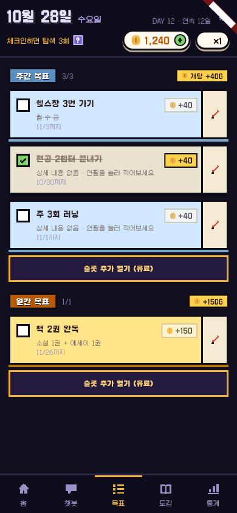
  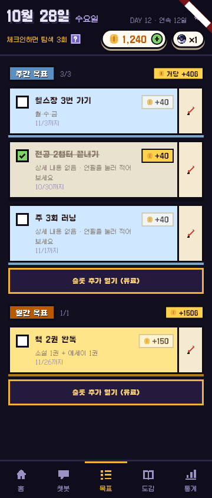
  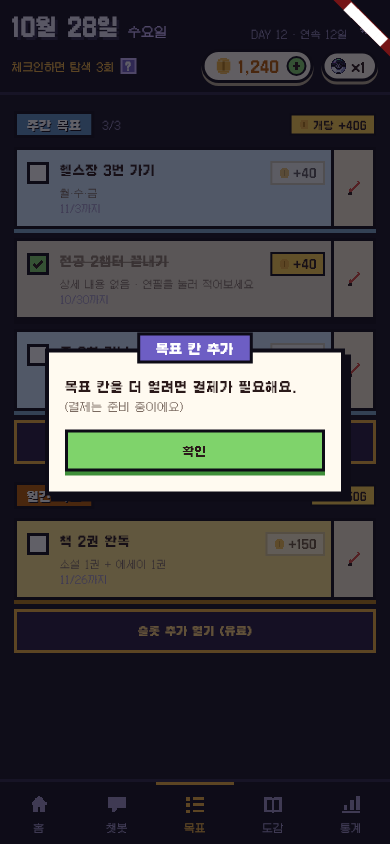
- 확인한 것: 서버 테스트 **139개 통과** (새 `GoalApiTest` 15개 — 동시 완료 포함). 새 postgres:16 컨테이너에 `schema` + `seed` + `verify.sql` → 모두 PASS (컨테이너는 지움).
  앱 `flutter analyze` 이상 없음, 테스트 **125개 통과** (새 6개). 캡처는 임시 골든 테스트(지움)로 390 · 360폭 · 창을 눈으로 확인
- 로컬 DB 변경 (사용자 확인 "실행해"): 꺼져 있던 이 프로젝트 DB 컨테이너(`habit-monster-db-1`, 5435)를 `docker compose up -d`로 켜고, `backend/db/README.md`의 SQL을 한 트랜잭션으로 실행 →
  제약 `ck_goal_period_start` 없어짐 · `weekly_goal_days` 7 · `monthly_goal_days` 30 들어감 확인. 기존 목표 4개는 그대로. (다른 프로젝트 컨테이너 `hur-*`는 건드리지 않음)
- 확인하지 못한 것: 반영한 로컬 DB로 서버(8081)를 켜서 요청해 보기, 실제 폰 · 웹에서 눌러 보기
- 막혔던 것과 원인: 처음 캡처에서 한글이 네모로 나옴 → 테스트의 `MaterialApp`에 앱 테마(`AppTheme.build()`, 폰트 Galmuri11)를 안 넣어서. 테스트 도우미 이름이 겹쳐(`add` 두 개) 컴파일 오류 → 이름 바꿈. Docker가 꺼져 있어 켬
- 남은 일: 4-3 도감 · 카테고리 열기, 4-1 앱(프론트 담당)

### 2026-10-23 — 4-1 습관 추가 · 연장 · 그만두기 (서버만) + 프론트 요청 메모 · 할 일 모음 (송윤서)
- 브랜치 · 커밋: `feature/backend-game-system`, `8b06108` 다음. **커밋 전**.
- 한 일
  - 서버: `POST /habits`(중복 방지 키, 시작일 = 체크인 전 오늘 / 후 내일) · `POST /habits/{id}/renew`(기간 완료만, 새 기간 seq + 1, 목표 생략 = 이전 값) · `POST /habits/{id}/stop`(마지막 1개 막음).
    `HabitService.create · renew · stop`, `HabitRepository`(칸 수 · 연 카테고리 · 습관 하나 · 상태 바꾸기), 오류 코드 5개(`HABIT_NOT_ENDED` · `HABIT_ALREADY_STOPPED` · `CATEGORY_LOCKED` · `HABIT_LIMIT` · `LAST_HABIT`)
  - 명세 v5 (사용자 요청으로 Claude가 직접): "v5 보충" 한 줄, 4-2에 하한 1개 · 기간 완료도 칸, 그만두기에 `LAST_HABIT`, 오류 표 한 줄
  - **앱 코드는 안 고침** (사용자 판단). 대신 `frontend/서버연동-메모.md`(새 파일 — 프론트 담당에게: API · 규칙 · 앱에서 할 일 체크리스트) + `frontend/CLAUDE.md` 맨 위에 "먼저 읽기" 한 줄
  - `docs/할-일.md` 새로 만듦 (사용자 요청 — 할 일 모음 파일이 없어서, 흩어진 남은 일을 서버 · 앱 구분 없이 한 목록으로). "그만둔 습관 기록 화면"을 여기에
  - 문서: 결정 D-47, 기획 변경 이력 2줄, 기획서 상태 · 결과, `backend/README.md` API 표, 프로젝트 이해(습관 상태 · 칸 세기 · 아직 안 된 것), 진행현황 4단계 표시, `docs/README.md` 지도
- 정한 것: 칸 = 진행 중 + 기간 완료 (사용자가 "진행 중만 세야 하지 않나"를 묻고, 두 방식의 장단점을 비교한 뒤 A로) → D-47
- 화면: 없음 (앱 미변경) → 캡처 안 함
- 확인한 것: 서버 테스트 **124개 통과** (새 13개 `HabitApiTest`)
- 확인하지 못한 것: 실제 서버(8081)에 요청 · 앱 화면 (앱은 안 바뀜)
- 저장소 (사용자 요청): 서버 담당만 보는 문서를 원격에서 뺌 — `.gitignore`에 `docs/로컬-테스트-계정.md` · `docs/handoff/` · `backend/db/제안-*.md`,
  이미 올라가 있던 `docs/handoff/` 12개 · `backend/db/제안-필드-끌기-호감도.md`는 `git rm --cached` (이 PC에는 그대로, 원격 · 팀원이 pull하면 사라짐)
- 남은 일: 4-1 앱(프론트 담당), 4-2 목표 · 4-3 도감 · 4-4 통계 → `docs/할-일.md`

### 2026-10-21 — 3-5단계: 구매 · 물약 · 교감 · 말 걸기 · 필드/가방 · 대화 상대, 앱 성장이 서버로 (송윤서)
- 브랜치 · 커밋: `feature/backend-game-system`, 3-4와 함께 **커밋 전**.
- 한 일
  - 서버: `POST /shop/purchases`(서버 가격 · 구매 기록 · 가방 · 지갑, 골드 부족이면 전부 되돌림), `POST /monsters/{id}/feed`(물약 · 경험치 · 레벨 · 진화 · 성장 기록),
    `POST /monsters/{id}/affection`(PET · PLAY 하루 1번 — DB 기본 키가 막음), `GET /monsters/{id}/line`, `PATCH /monsters/{id}/location`(필드 1 ~ 5마리), `PUT /me/partner`.
    `ShopService.purchase · usePotion`(볼 · 물약 차감을 한 함수로), 오류 코드 `ALREADY_DONE_TODAY` · `NO_ITEM` · `MAX_LEVEL` · `FIELD_LIMIT`
  - 앱: `HttpGameRepository.buy · feed · pet · play · moveMonster · setPartner`를 서버로, 새 `talk`(말 걸기 서버 대사, 실패하면 앱 대사). 409 "오늘 이미"는 표시 + 안내 토스트.
    `dragMonster`는 서버 모드에서 0 (사용자 결정 — D-46). `GameState.applyPurchase · applyFeed · applyAffection · applyLocation · applyPartner`
  - 문서: 결정 D-46, **`backend/db/제안-필드-끌기-호감도.md`**(사용자 요청: DB · 명세 · 서버 · 앱에서 DRAG를 넣을 곳 체크리스트), 기획 변경 이력 2줄, API 표, 서버 README, 프로젝트 이해(구매 · 물약 · 교감 흐름), 계획 체크박스, handoff 머리말(다음 4단계)
- 화면: 바뀐 모양 없음 ("말 걸기" 대사의 출처만 서버로) → 캡처 안 함
- 확인한 것: 서버 테스트 **111개 통과** (새 18개: `PurchaseApiTest` 5 · `GrowthApiTest` 13 — 동시 구매 · 동시 쓰다듬기 포함). 앱 `flutter analyze` 이상 없음, 테스트 **119개 통과** (3-5 서버 연동 5개, 옛 "구매는 앱 안에서" 테스트 1개는 지움)
- 다시 검증 (사용자 요청, 10-21): 서버 테스트 111개 · 앱 analyze 이상 없음 · 앱 테스트 119개 다시 통과.
  실제 서버(8081 · 로컬 DB)에 Python으로 요청 — 테스트 계정 `verify-3-4-3-5-1792549285@habit.kr`(user 26, SQL로 골드 +500, **로컬 DB에 남아 있음**):
  체크인 전 탐색 409 `CHECKIN_REQUIRED` → 체크인 201 → 탐색 3번 MISS · DUPLICATE(+15G) · MISS → 4번째 422 `NO_EXPLORE_LEFT` → 남은 등장 204 →
  볼 2개 구매 201(−100G) · 물약 구매 201(−90G) · 수량 100 → 400 → 물약 먹이기 200(EXP 100, Lv.1 그대로 · 상세 `expInLevel` 100) · 물약 없이 또 422 `NO_ITEM` →
  쓰다듬기 200(+2 → 5 MID) · 또 409 `ALREADY_DONE_TODAY` · 놀아주기 200(+1) · DRAG 400 → 말 걸기 200 → 대화 상대 바꾸기 200 → 가방 넣기 200 · 마지막 1마리 422 `FIELD_LIMIT` → 상단 바 골드 365 · 볼 2 (계산과 같음)
- 로컬 DB 변경 (사용자 요청, 사용자가 직접 확인 예정): 테스트 계정(user 26)의 운동 · 공부를 Lv.3(경험치 30)으로, 오늘 탐색 기회 3 → 6 (사용 3 그대로 → 남은 3).
  처음엔 사용 횟수를 0으로 되돌렸다가 바로 고침 — 탐색 순번 = 사용 횟수라 0으로 두면 이미 있는 순번 1과 겹쳐 `uq_explore_seq` 오류가 난다
- 사용자 확인: 위 테스트 계정으로 탐색 · 볼 던지기를 직접 해 보고 "확인했어" (10-21)
- 확인하지 못한 것 (Claude): **실제 서버에서 볼 던지기** — 오늘 탐색 3번에 안 가진 종이 안 나옴 (카테고리 Lv.2라 후보가 시작 몬스터뿐, D-45. 테스트 `ExploreApiTest`로만 확인). 폰 · 웹에서 눌러 보기
- 막혔던 것과 원인
  - Docker Desktop이 꺼져 있어 서버 테스트를 못 돌림 → 사용자가 켬
  - 그 뒤 `bootRun` 실패(`non-zero exit value 1`) → Docker를 다시 켜면 `habit-monster-db-1`은 자동으로 안 켜진다 (10-20과 같은 원인). `docker start habit-monster-db-1`로 해결, 데이터 그대로
  - 같은 키 재전송 테스트 2개 실패 → 코드가 아니라 비교 방식: 재전송 응답은 DB(JSONB)에 저장해 둔 첫 응답이라 JSON 필드 순서가 다르다. 문자열 대신 JSON으로 비교 (`JSONAssert`)
  - 수량 `null` 테스트가 NPE → `buy(access, "BALL", null)`이 다른 오버로드(본문 문자열)로 불림. `(Object) null`로
- 남은 일: 4단계 (습관 추가 · 목표 · 도감 · 카테고리 열기 · 통계)

### 2026-10-20 — 3-4단계: 탐색 · 남은 등장 · 볼 던지기, 앱 탐색이 서버로 (송윤서)
- 브랜치 · 커밋: `feature/backend-game-system`, `6ebb80c` 다음. **커밋 전**.
- 한 일
  - 서버: `POST /explores` · `GET /explores/pending` · `POST /explores/{id}/capture`. 새 조율 패키지 `explore/`(습관 잠금 · 레벨 → 몬스터 → 상점(볼) → 지갑 = 잠금 순서),
    `MonsterService` 탐색 1회(기회 조건부 −1 · 남은 등장 SKIPPED/EXPIRED · 꽝 · 가중치 뽑기 · DUPLICATE 15G · ENCOUNTER · `newlySeen`) · 포획(필드/가방 · 도감), 랜덤 한 곳 `monster/Dice`,
    `ShopService.useBall`(조건부 차감 + 소모 기록 `CAPTURE:<키>`), `HabitService.lockProfile` 공개 · `categoryLevels` · `grantUnlockTicket`(5 · 10 · 15마리), 오류 코드 `CHECKIN_REQUIRED` · `ENCOUNTER_CLOSED` · `NO_BALL` · `NO_EXPLORE_LEFT`
  - 앱: `HttpGameRepository.explore` · `throwBall` · `pendingEncounter`를 서버로. `EncounterResult`에 `exploreId` · `newlySeen` · `captureRate`, `GameRepository.throwBall(EncounterResult)`(던질 때 등장 번호가 필요해서 종 대신 등장을 넘김),
    `GameState.applyExplore` · `applyCapture`. 챗봇을 열 때 체크인한 날이면 남은 등장을 되살림. 탐색 화면에 "잡힐 확률 80%" · 처음 만난 종이면 "도감 등록!" 배지 (로컬 모드도 같은 배지)
  - `docs/start.md`의 옛 주소(`10.0.2.2:8080`) → `8081/api/v1` + 실제 폰 줄
  - 문서: 결정 D-45, 기획 변경 이력 1줄, `backend/README.md` API 표, 서버 README(테스트 · 구조), `backend/CLAUDE.md` · `frontend/CLAUDE.md`, 프로젝트 이해(탐색 흐름 · 용어 · 아직 안 된 것), 계획 체크박스, handoff 머리말, DB README 제안 3개
- 화면
  - 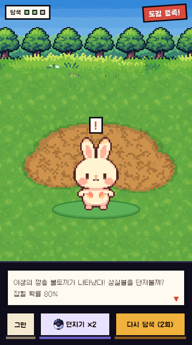 (임시 골든 테스트로 찍음, 서버 응답 모양을 직접 넣어서)
- 확인한 것
  - 서버 테스트 **93개 통과** (새 16개 `ExploreApiTest` — 랜덤 고정: 꽝 · 가진 종 15G · 등장/처음 본 종 · SKIPPED · 남은 등장 200/204 · 잡기 · 놓침 · 볼 0 → 422 · 남의 탐색 404 · 다음 날 EXPIRED · 기회 다 쓰면 422 · 체크인 전 409 · 같은 키 재전송 · 동시에 두 번 던지기 → 볼 1개 · 5마리째 해금권 한 번 · 필드 5마리면 가방)
  - 앱: `flutter analyze` 이상 없음, 테스트 **115개 통과** (새 6개: 서버 연동 5 · 챗봇 남은 등장 1)
- 확인하지 못한 것: **실제 서버(8081)에 curl · 폰에서 탐색 → 던지기는 안 해 봄** (서버를 사용자가 직접 띄움 — 새 코드로 다시 띄워야 함). 실제 서버 모드에선 볼이 0개라(아래) 던지기는 SQL로 볼을 넣어야 확인 가능
- 막혔던 것과 원인
  - 첫 캡처의 글자가 네모 → 테마만으로는 테스트에 Galmuri 글꼴이 안 들어온다. `FontLoader`로 글꼴 파일을 직접 읽어 해결
  - 등장 문구 끝의 "(잡힐 확률 80%)"가 줄 중간에서 끊김 → 다음 줄로 옮김
- 로컬 DB 변경 (사용자 요청): 폰 확인용으로 23번 계정(카카오, 10-20 체크인한 계정)에 성실볼 10개를 SQL로 넣음 (`shop.inventory`). 구매 기록이 없어 `verify.sql`의 가방 수량 대사(S-12)에는 이 계정이 어긋나게 나온다
- 정한 것: 후보가 가진 종뿐이면 명세 그대로 (사용자 결정), 그 밖의 세부 → D-45
- 남은 일
  - **서버 모드 볼 0개**: 앱의 "볼 사기"는 아직 앱 안에서만(3-5) → 서버엔 볼이 없어 던지면 "성실볼이 없어요". 시작 볼(D-35)도 DB에 없음
  - 다음 3-5 성장 (상점 구매 · 먹이 · 교감 · 필드/가방 · 대화 상대)

### 2026-10-20 — 3-3 체크인 실제 폰에서 확인 · 커밋 (송윤서)
- 브랜치 · 커밋: `feature/backend-game-system`, 10-19의 3-3 · 포트 8081 · CORS 작업과 함께 커밋
- 확인한 것: **실제 폰(SM-S931N, 무선 adb)에서 챗봇 체크인이 서버로 저장되는 것을 사용자가 확인** (10-19의 "에뮬레이터에서 안 눌러 봄"을 대신함)
- 확인하지 못한 것: 웹(Chrome) 끝까지 · 새로고침 뒤 토큰 유지
- 막혔던 것과 원인
  - `bootRun`이 `non-zero exit value 1`로 실패 → 이 프로젝트 DB 컨테이너(`habit-monster-db-1`)가 꺼져 있었다 (다른 프로젝트 컨테이너들도 같은 시각에 멈춤 — Docker 재시작 · 메모리 부족 추정). `docker start`로 켜니 데이터(사용자 5명) 그대로. 서버보다 DB를 먼저 켠다
  - 실제 폰에 샘플(가짜) 데이터가 보임 → `API_BASE_URL` 없이 실행해 시연 모드였다. 실제 폰은 `10.0.2.2`(에뮬레이터 전용 주소)가 안 되므로 `adb reverse tcp:8081 tcp:8081` + `API_BASE_URL=http://localhost:8081/api/v1` (서버 README에 적음)
  - Claude가 백그라운드로 띄운 서버는 PC 메모리가 부족할 때 두 번 꺼졌다 → 서버는 사용자가 PowerShell 창에서 직접 띄우는 게 낫다

### 2026-10-19 — 3-3단계: 체크인 (조회 · 첫 제출 · 다시 체크), 앱 챗봇이 서버로 (송윤서)
- 브랜치 · 커밋: `feature/backend-game-system`, `d6e4a56` 다음. **커밋 전**.
- 한 일
  - 서버: `GET · POST · PUT /checkins/today`. 새 조율 패키지 `checkin/`(습관 → 몬스터 → 지갑 = 잠금 순서), `habit/Scoring`(점수 공식 · 달성률 · 선택지 — 조회와 제출 검사가 같은 함수),
    `HabitService` 체크인(상위 3 · 동점은 등록 순서 · 카테고리 경험치/레벨 · 채운 날(B1) · 기간 보너스 · ENDED), `MonsterService` 탐색 기회(연 카테고리 전부, B4) · 새로 나오는 종 · 대화 상대,
    오류 코드 `ALREADY_SUBMITTED` · `NO_ACTIVE_HABIT` · `CHECKIN_NOT_FOUND`
  - 앱: `HttpGameRepository.confirmCheckin` · `resubmitCheckin`을 서버로, `load()`에 `GET /checkins/today`(대상 습관 · 선택지 · 최신 값).
    `GameState`에 `checkinHabits`(서버 대상) · `recordableValue`(가장 가까운 선택지) · `applyCheckinResult` · `applyRecheck`. 챗봇은 서버 대상만 묻고, 맞춘 값이 다르면 "선택지에 맞춰 25분 기록할게!"
  - 문서: 결정 D-42 · D-43, 기획 변경 이력 1줄, `backend/README.md` API 표, 서버 README, `backend/CLAUDE.md` · `frontend/CLAUDE.md`, 프로젝트 이해(체크인 · "요청 하나가 지나가는 길"), 계획 체크박스, DB README 제안
- 화면
  - 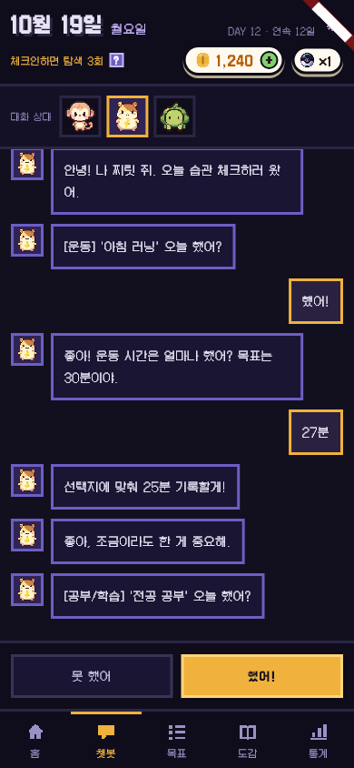 (임시 골든 테스트로 찍음 — 샘플 상태에 서버 선택지만 넣어서)
- 확인한 것
  - 서버 테스트 **72개 통과** (새 19개: `CheckinApiTest` 13 · `ScoringTest` 6). 명세 예시 그대로 — 13 + 20 + 20 = 53G, 레벨업 20G, 기간 보너스 560 × 0.5 = 280G, `goldEarned` 353, `overallRate` 88, ex Lv.3(20) + 13 → Lv.4(3), 원장 3줄
  - 앱: `flutter analyze` 이상 없음, 테스트 **109개 통과** (새 3개)
  - 실제 서버(8081 · 로컬 DB 5435)에 curl: 가입 → 온보딩(운동 · 수면) → 조회(수면 선택지 5 ~ 9.5) → 제출(수면 8.5h = 20점, 레벨업 2번 → 77G) → 다시 체크(9h = 0점, 골드 그대로) → 상단 바. 확인용 계정 `checkin-e2e-…@habit.kr`이 로컬 DB에 남아 있다
- 확인하지 못한 것: **에뮬레이터에서 챗봇으로 실제 체크인은 안 눌러 봄** (서버는 새 코드로 다시 띄워 둠). 기간 보너스 · 레벨업 메시지가 챗봇에 어떻게 보이는지는 위젯 테스트로만
- 막혔던 것과 원인
  - 동시 제출 테스트가 골드 40을 받아 실패 → 코드가 아니라 기대값이 틀렸다 (첫 체크인 20점이면 운동 Lv.1 → 2 레벨업 20G가 더해짐)
  - 첫 캡처가 글자 대신 네모 → 테스트의 `MaterialApp`에 앱 테마(Galmuri11)가 없었다. `AppTheme.build()` + 그림 미리 읽기로 해결
- 앱(시연 모드) 규칙과 서버 규칙의 차이 — 고치지 않고 기록만 (시연 모드는 서버 없을 때용)
  - 수면 범위: 앱 목표 ± 1h / 서버 −1 · +1.5h (D-28)
  - 기간 채운 날 · 기간 보너스 · 습관 ENDED: 앱에는 없음
  - 탐색 후보: 앱은 오늘 체크인한 카테고리 / 서버는 연 카테고리 전부 (B4)
  - 수행량: 앱은 아무 값이나 / 서버는 선택지 안의 값만 (D-42)
- 정한 것: D-42(사용자 결정: 수면 선택지 범위 ± 2칸, 직접 입력 + 가장 가까운 선택지), D-43(구현 세부)
- 남은 일: 3-4 탐색 · 포획 또는 3-5 성장. 서버 모드 카테고리 레벨 조회(4단계). DB · 명세 다음 판은 3단계 끝에 모아서
- 이어서 (사용자 요청): `local` 프로필 기본 포트 **8080 → 8081** (`server.port=8081`, 8080은 treeplan 서버). 이제 `bootRun --args='--spring.profiles.active=local'`만으로 8081에서 뜬다 —
  실제로 띄워 "Tomcat started on port 8081" 확인. 루트/backend `CLAUDE.md` · 서버 README · `handoff/00-공통.md`의 실행 명령과 앱 주소(`10.0.2.2:8081`)도 고침. `docs/start.md`(개인 메모로 보임)는 그대로
- 이어서 (사용자 지정): **로컬 웹 확인용 CORS** (D-44) — `config/CorsConfig` + `http.cors`, 허용 출처 `app.cors.allowed-origins`(기본 비어 꺼짐, `local`만 `http://localhost:5000`).
  `CorsTest` 5개 (허용 출처 사전 요청 통과 · 다른 출처 403 · 허용 안 한 헤더 403 · 401 오류에도 허용 헤더 · 기본 꺼짐) → 서버 테스트 **77개 통과**. 서버 README에 웹 실행 방법 · "웹은 소셜 로그인 안 됨, 이메일로"

### 2026-10-19 — H2 삭제, `local` 프로필을 Docker DB용으로 · 3-0 ~ 3-2 커밋 (송윤서)
- 브랜치 · 커밋: `feature/backend-game-system`, 10-18 작업과 한 커밋.
- 한 일: H2 의존성 · H2 전용 엔티티 `IdempotencyRecord` · `IdempotencyStore`의 H2 분기(DB 종류 판별 · `QueryTimeoutException`) 삭제.
  `application-local.properties`를 메모리 DB → `localhost:5434`(habit/habit) 로컬 실행용으로 바꿈 (로컬 JWT 키 · 카카오/구글 공개 값은 그대로). README · `backend/CLAUDE.md` 안내 수정 (D-41)
- 확인한 것: 서버 테스트 53개 통과 (PostgreSQL 컨테이너). `bootRun --args='--spring.profiles.active=local …'`로 실제 기동 — "profile is active: local" · 11초에 시작,
  가입 201 · 로그인 · `GET /categories` 200. 임시 DB · 서버는 확인 후 지움/끔.
- 확인하지 못한 것 · 주의: **5434 포트를 지금 다른 프로젝트 DB(`treeplan-db-1`)가 쓰고 있고, 우리 `habit-monster-db-1`은 꺼져 있다.** 그래서 5434가 아닌 임시 DB(5440)에
  `--spring.datasource.url`만 바꿔 붙여 확인했다 (8080도 `treeplan-api-1`이 써서 `--server.port=8081`). 남의 컨테이너는 건드리지 않았다.
  5434에서 그대로 돌리려면 treeplan DB를 끄고 `docker compose up -d` 하거나, `.env`의 `DB_PORT`와 프로필 주소를 같이 바꿔야 한다.
- 정한 것: D-41. DB · 명세 다음 판은 3단계 끝날 때 모아서 정한다 (`backend/db/README.md` 제안은 그대로).
- 이어서 (커밋 `77a2e71` 뒤): **로컬 DB 포트 5434 → 5435** (5434를 treeplan DB가 씀). `backend/.env`의 `DB_PORT`(커밋 안 됨) · `local` 프로필 · 루트/backend `CLAUDE.md` · 서버 README · `handoff/00-공통.md` · 프로젝트 이해.
  `docker compose up -d`로 `habit-monster-db-1`을 새 포트로 다시 만듦 (데이터 볼륨 `habit-monster_pgdata`는 그대로, 설정값 45행 확인).
  `bootRun --args='--spring.profiles.active=local --server.port=8081'` → 로그에 `jdbc:postgresql://localhost:5435/habit_monster` · 10초에 시작, 가입 201 · `GET /categories` 200. 확인용 계정 `local-…@habit.kr` 하나가 로컬 DB에 남아 있다.
  8080은 여전히 `treeplan-api-1`이 써서 포트만 8081로 줬다. `검토-체크리스트.md` 34번 줄: "H2 와 PostgreSQL 둘 다" → PostgreSQL만 (사용자 요청).

### 2026-10-18 — 3-0 · 3-1 · 3-2단계: 실제 DB 테스트 · 설정값 · 지갑 · 온보딩 · 출석 · 메인 조회, 앱이 서버 데이터로 시작 (송윤서)
- 브랜치 · 커밋: `feature/backend-game-system`, `96a8856` 다음. **커밋 전**.
- 한 일 (3-2 지시서를 받았지만 앞 단계 3-0 · 3-1이 어디에도 없어서, 사용자 확인 후 3-0 → 3-1 → 3-2 차례로)
  - **3-0 준비**: 서버 테스트를 H2 → **실제 PostgreSQL 16**(Testcontainers가 컨테이너를 띄우고 저장소의 공식 `schema.sql` · `seed.sql` 적용)으로 옮김. 기존 25개 그대로 통과.
    `BalanceConfig`(수치를 DB에서 읽음, 없는 키면 시작 실패), `WalletService`(잔액 + 원장, 조건부 차감, 같은 사유 · ref 한 번), `ArchitectureTest`(모듈 = 스키마 규칙)
  - **3-1 온보딩**: `GET /categories` · `GET /measure-types` · `POST /onboarding`(한 트랜잭션, 회원 → 습관 → 목표 → 몬스터 → 지갑 순서, 틀리면 400 + `errors` 전부) · `POST /me/attendance`(연속 일수).
    `PATCH /me/onboarding` 삭제. 탈퇴 시 습관 이름 · 목표 제목 비움. 앱: `HttpGameRepository` 새로 (`completeOnboarding` · `attend` · `load`는 서버, 나머지는 Local에 넘김)
  - **3-2 메인 조회**: `GET /me/status` · `/me/today` · `/monsters` · `/monsters/{id}` · `/shop/items` · `/inventory` + 읽기 `GET /habits` · `/goals`.
    앱: 서버 모드는 빈 상태로 시작 → `GameLoader`(로딩 화면) → `load()` → 홈 → 출석. 로그아웃하면 다시 빈 상태
  - 문서: 결정 D-33 ~ D-40, `backend/README.md` 게임 API 표, `backend/server/README.md`(테스트 · 구조), `backend/CLAUDE.md` · `frontend/CLAUDE.md` · `handoff/00-공통.md`, 프로젝트 이해, 계획 체크박스,
    `backend/db/README.md`에 시작 골드 · 볼 SQL 제안 + 명세 다음 판 제안
- 화면
  - 
  - 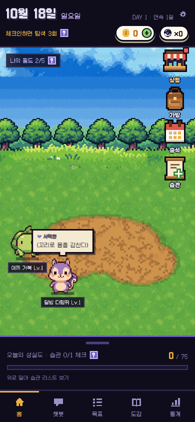 (가짜 서버 응답으로 찍음 — 아래 실제 서버 응답과 같은 모양)
- 확인한 것
  - 서버 `.\gradlew.bat test` **53개 통과** (모두 PostgreSQL 16 컨테이너). 모듈 규칙 검사는 일부러 위반 파일을 넣어 실패하는 것까지 확인 (그 파일은 지움)
  - **실제 서버 + PostgreSQL**(임시 컨테이너 5440, 끝나고 지움)로 curl: 가입 → 온보딩 전 403 → 온보딩(식습관 · 수면, 대화 상대 = 고른 수면) → 출석 → 조회 7종 → 삭제한 `PATCH /me/onboarding`은 404
  - 앱 `flutter analyze` 이상 없음, `flutter test` **106개 통과** (기존 98 + `HttpGameRepository` · `GameLoader` 8)
  - `local` 프로필(H2)로 `bootRun` → `BalanceConfig`가 `config.balance_config`를 읽다가 실패해 서버가 뜨지 않음 (예상대로, 실제로 돌려 확인)
- 확인하지 못한 것: **에뮬레이터에서 앱 ↔ 실제 서버** (온보딩 → 홈). 로컬 개발 DB(5434)는 건드리지 않음. 3-3 전이라 "체크인 후 오늘 요약"은 테스트에서 행을 직접 넣어 확인 -&gt; 실제 테스트 및 확인 완료
- 막혔던 것과 원인
  - 첫 실행에서 Spring이 뜨는 데 270초가 걸린 적이 한 번 있었음 (컨테이너는 3초). 다시 돌리니 1분 남짓 — 재현 안 됨, 원인 모름
  - `BalanceConfig` 생성자 두 개 → Spring이 고르지 못함 → 쓸 생성자에 `@Autowired`
  - 테스트에서 `Map.of`의 순서를 기대해 가끔 실패 → 내용 비교로
  - curl e2e 첫 온보딩이 400: Git Bash가 명령줄의 한글을 UTF-8이 아닌 인코딩으로 보냄 → 본문을 UTF-8 파일로 보내니 정상 (서버 문제 아님)
  - 앱 `http_auth_test`의 재발급 테스트 3개가 삭제한 `PATCH /me/onboarding`을 수단으로 썼음 → 같은 로직을 `GET /me`(로그인 직후) · `refreshOnce()`로 검사하게 바꿈
- 정한 것: D-33(Testcontainers · 공식 SQL 저장소 안 · ArchUnit) · D-34(게임 저장소 = SQL) · D-35(서버 시작 골드 · 볼 0, D-05와 다름) · D-36(`partnerCategory`) · D-37(DAY n) · D-38(측정 항목 id) · D-39(가방 0개 뺌) · D-40(빈 상태 → load, 습관 · 목표 읽기 포함)
- 남은 일
  1. 커밋 · 푸시 (사용자 확인)
  2. **`local` 프로필(H2)로는 서버가 뜨지 않게 됨** → 프로필 · H2 의존성 · `IdempotencyRecord` 엔티티를 지울지 결정
  3. DB · 명세 다음 판(윤서): 시작 골드 · 볼, `partnerCategory` · `dayCount` · 몬스터 목록의 호감도/경험치
  4. 에뮬레이터 확인, 3-3 체크인

### 2026-10-17 — DB 시드 v1.8: 몬스터 28종 (송윤서)
- 브랜치 · 커밋: `feature/backend-game-system`(Orca 작업 폴더), `6da0b17` 다음. **커밋 전**.
- 한 일: 앱 `catalog.dart`의 28종을 python으로 읽어 `seed.sql`의 종 · 대사 블록을 다시 만듦 (id = 카테고리 순서, 스타터 6종, 대사 252줄). `verify.sql`의 종 번호 참조를 새 번호로 고치고 S-2를 진짜 검사로. 원래 폴더의 `docs/데이터베이스`에도 같은 파일. 문서(DB README · backend/CLAUDE.md · 지시서 · 결정 D-32)
- 확인한 것: 임시 PostgreSQL 16 컨테이너에서 `schema → seed → schema_later → verify → verify_later` **173개 통과**, 종 28 · 대사 252 · 진화 단계 84 · 스타터 1/6/10/15/19/23
- 이어서 (같은 날): **작업 폴더 하나로 정리** — Orca가 만든 worktree(`C:/Users/Home/orca/workspaces/…`)를 git에서 해제하고(폴더는 Orca가 파일을 잡고 있어 아직 남음 → Orca에서 닫고 지우기), 원래 폴더의 docs 복사본(커밋된 것과 내용이 같음, 줄바꿈만 다름 — 하나씩 비교 후)을 지운 뒤 원래 폴더를 `feature/backend-game-system`으로 전환. **로컬 개발 DB를 v1.8로 다시 만듦** (`docker compose down -v && up -d`, `HM_DB_DIR` = `docs/데이터베이스`) → 종 28 · 대사 252 · 스타터 1/6/10/15/19/23 확인, 서버 PostgreSQL 대상 테스트 20개 통과
- 막혔던 것과 원인: `verify.sql`의 `VALUES (1,2,3,…)`처럼 숫자가 종 · 호감도로 섞여 있어 숫자만 바꾸면 틀림 → 문장 단위로 정확히 바꾸고 나온 횟수를 확인하며 고침
- 정한 것: D-32

### 2026-10-17 — monster-art-v2 병합 · 결정 번호 정리 · 단계별 지시서 · CLAUDE.md 배치 (송윤서)
- 브랜치 · 커밋: `feature/monster-art-v2`에 남은 Kotlin 수정 커밋 `e14c5b3` → `feature/backend-game-system`(Orca 작업 폴더)에서 결정 번호 다시 매김 `be03867` → 병합 `0410e52`. 아래 문서 작업은 **커밋 전**.
- 한 일
  - 두 브랜치가 결정 번호를 각자 D-15부터 매겨 겹침 → 서버 쪽(D-15 ~ D-23)을 **D-23 ~ D-31**로 바꿈. monster-art-v2의 D-15 ~ D-22는 그대로
  - `feature/monster-art-v2`(몬스터 28종 · 필드 끌기 · 도감 본 종 · 로고 · 발표 캡처)를 병합. 충돌 7개(결정 · 작업 기록, 앱 테스트 5개) — 기록은 양쪽 모두 유지, 테스트는 새 종 · 기대값 + 2단계 테스트 도구
  - monster-art-v2에서 새로 생긴 상태 변경 `attend()` · `drag()`도 `GameRepository`(`attend` · `dragMonster`)로 (D-31 규칙)
  - 남은 단계 지시서 `docs/handoff/` (README · 00-공통 · 03-0 ~ 06) — 다른 Claude Code 세션에 단계별로 맡기기 위한 것
  - 오래 가는 규칙은 자동으로 읽히는 곳에도: 루트 `CLAUDE.md`(명세 · DB 위치와 주인, 지시서 위치, 브랜치 · worktree, 계획 먼저, 7장 함정), **`backend/CLAUDE.md` 새로**(서버 기반 · DB 원칙 · 실행/테스트), `frontend/CLAUDE.md`(GameRepository · ApiClient · 테스트 도구 · 코드 = DB 시드)
  - 사용자가 `D:/teamProject/docs`를 저장소 `docs/`로 옮김 (API 명세 · DB 설계 · 기획 메모) → 이 브랜치에도 복사. `backend/.env`의 `HM_DB_DIR`도 새 위치로
- 확인한 것: 병합 뒤 `flutter analyze` 이상 없음, 앱 테스트 **98개 통과**(두 브랜치 합), 서버 테스트 통과(H2).
- 확인하지 못한 것: PostgreSQL 대상 서버 테스트 · Docker가 새 `HM_DB_DIR`를 읽는지 (Docker Desktop이 꺼져 있었음). 에뮬레이터.
- 막혔던 것과 원인
  - `feature/backend-game-system`이 Orca의 별도 작업 폴더(worktree)에 열려 있어 원래 폴더에선 전환이 안 됨 → 그 작업 폴더 안에서 병합
  - 결정 번호를 python 정규식 ``로 바꾸다 `D-19로`처럼 한글이 붙은 곳을 놓침 (``가 한글을 글자로 봄) → 되돌리고 `(?!\d)`로 다시
- **알려진 막힘**: 앱 몬스터는 새 28종인데 DB 시드 v1.7은 옛 5종(`wolf`의 카테고리도 다름) → 3단계(스타터 지급) 전에 시드 갱신 필요 (사용자). 필드 끌기 호감도는 명세 · DB에 없음
- 남은 일: 문서 커밋 · 푸시(사용자 확인), DB 시드 28종, 3-0단계

### 2026-10-15 (저녁) — 2단계: 앱 구조 전환 (GameRepository · ApiClient) (송윤서)
- 브랜치 · 커밋: `feature/backend-game-system`, `a18400b` 다음. **커밋 전**.
- 한 일
  - 도감 "본 종"은 DB 변경 없이 탐색 기록에서 계산하기로 (D-30, 사용자 결정)
  - `GameRepository`(화면이 상태를 바꾸는 유일한 길) + `LocalGameRepository`(지금 규칙 감쌈) + `runGameAction`(실패하면 토스트) — D-31
  - 화면 19곳(상점 · 체크인 · 탐색 · 포획 · 교감 · 물약 · 필드/가방 · 대화 상대 · 카테고리 열기 · 습관 · 목표 · 온보딩)을 `await repo.…`로
  - `ApiClient`: Bearer, `Idempotency-Key`(다시 보낼 땐 같은 키, UUID는 패키지 없이), `TOKEN_EXPIRED` 재발급 1번(로그인과 공유), 끊김 · 처리 중이면 같은 키로 재시도, `BUSINESS_DATE_CHANGED` 알림
  - `HttpAuthService`가 토큰을 `ApiClient`에 빌려줌(`TokenSource`). 상점 서버 코드 연결 `Catalog.serverCodeOf`
  - 테스트 도우미 `test/game_harness.dart`(`withGame`) — 앱 루트처럼 상태 + 저장소를 같이 내려줌
- 확인한 것: `flutter analyze` 이상 없음, 앱 테스트 **91개 통과** (기존 81개 그대로 + `ApiClient` 10개).
- 확인하지 못한 것: 에뮬레이터에서 눌러 보기 (동작은 같아야 하지만 버튼 콜백이 비동기가 됐다).
- 막혔던 것과 원인: 처음 고친 뒤 `await`를 쓴 함수 3곳에 `async`를 빠뜨림 → 분석기로 찾음. `use_build_context_synchronously` 경고 2곳 → `mounted` 확인 방식 수정.
- 정한 것: D-30 · D-31
- 남은 일: 커밋 · 푸시, 3단계(서버 게임 API + `HttpGameRepository`) — 온보딩부터

### 2026-10-15 (오후) — API 명세 v5 · DB v1.7 반영, 1단계 인증 (송윤서)
- 브랜치 · 커밋: `feature/backend-game-system`. 오전 작업은 `b58892f`로 푸시. 이 일지의 작업은 **커밋 전**.
- 한 일
  - **API 명세 v5** 받음: v4에 도감 "본 종"(OWNED/SEEN/UNKNOWN)만 더해짐 → 계획 문서 기준을 v5로, 실루엣은 앱이 같은 그림을 검게 칠하는 방식(D6)
  - **DB v1.7** 받음 (`D:/teamProject/docs/데이터베이스/`): 임시 DB에서 검증 173개 통과. 공식에 중복 방지 키 테이블이 들어와서 서버를 거기에 맞추고 `server_additions.sql` 삭제 (D-27). 로컬 Docker DB를 v1.7로 다시 만듦
  - 수면 범위형은 v1.7 방식이면 칸이 필요 없어서 A6 취소 (D-28)
  - **1단계 인증 (서버)**: 응답을 명세 모양으로(`{accessToken, refreshToken, onboarded}` · 소셜 `isNewUser` · 재발급은 토큰만), 요청 `providerToken`,
    이메일 하나에 계정 하나 + 다른 방법이면 409 `EMAIL_REGISTERED_WITH_OTHER_METHOD`(+`provider`), 검증된 소셜 이메일만 사용 (D-29),
    `GET /me` `{userId, email, provider, onboarded}`, `DELETE /me` 탈퇴(+ 모듈별 정리 고리 `WithdrawalStep`), `PUT/DELETE /me/device-token`, 소셜 실패는 `INVALID_PROVIDER_TOKEN`
  - **1단계 인증 (앱)**: 로그인 뒤 `GET /me`로 계정 정보, `providerToken`, `TOKEN_EXPIRED`일 때만 재발급하고 동시에 여러 요청이 만료돼도 재발급은 한 번
  - 문서: `backend/README.md` 인증 API 절을 v5 계약으로 다시 씀, 서버 · DB README, 결정 D-27 ~ D-29, 프로젝트 이해
- 확인한 것: 서버 H2 **25개 통과**, 실제 PostgreSQL(v1.7) 대상 인증 · 공통 기반 **20개 통과**(중복 방지 키 기록이 공식 테이블에 COMPLETED로 남는 것까지). 앱 `flutter analyze` 이상 없음, 앱 테스트 **81개 통과**.
- 확인하지 못한 것: 에뮬레이터에서 새 서버로 실제 카카오 · 구글 로그인. 실제 카카오 응답의 `is_email_verified` 값 (테스트는 가짜 응답).
- 막혔던 것과 원인
  - Docker가 `C:\Desktop\Downloads\…`를 빈 폴더로 봄 → Docker Desktop 공유 범위 밖. 파일이 `D:/teamProject/docs/데이터베이스`로 옮겨져서 그쪽을 연결 (한글 경로도 됨)
  - Windows PowerShell 5.1의 `Get-Content`/`Set-Content`가 UTF-8 한글을 깨뜨림 (compose 파일) → git에서 되돌리고 python으로 수정. **한글 파일은 PowerShell로 고치지 않기**
  - 2단계 전에 출석을 만들 수 없음: v1.7 출석 테이블이 온보딩 때 생기는 `habit_user`를 참조 → 3단계로
- 정한 것: D-27 ~ D-29
- 남은 일
  1. 커밋 · 푸시 (사용자 확인 후)
  2. DB 다음 판(윤서): 도감 "처음 본 시각" 컬럼(명세 v5). 몬스터 종 수는 지금 서버 구현엔 필요 없음 — 콘텐츠 · 밸런스 단계에서
  3. 명세 다음 판(윤서): 구현 결정 B1 · B5 · C1 · D1 · D4 · D6 반영 여부
  4. 2단계: 앱 구조 전환 (`GameRepository`)

### 2026-10-15 — API 명세 v4 검토 · 구현 계획 · 0단계(서버 공통 기반) (송윤서)
- 브랜치 · 커밋: `feature/backend-game-system` (작업 브랜치로 고정). `07ede60`(플러그인 등록 파일 · `android/.kotlin` 무시 · 계획 문서), `0e3a414`(`origin/feature/habit-manage` 병합 — 10-10 성수연 작업: DB v1.6 맞추기 · 하네스 문서 · 습관 추가). 0단계 코드는 **아직 커밋 전**.
- 한 일
  - 팀원이 쓴 「API 명세 v4」 검토 → 버그 6개 · 해석이 갈리는 곳 · 앱 연동 문제를 찾고, 앱 완성도 기준으로 모두 결정 → `docs/진행현황-및-계획.md` (D-23)
  - 0단계 서버 공통 기반 (게임 API가 올라갈 바닥)
    - 모든 경로를 `/api/v1` 아래로 (`server.servlet.context-path`)
    - 오류 응답에 `errors[]`(필드별 이유), 오류 코드 정리: `BAD_REQUEST` → `INVALID_REQUEST`, `UNAUTHORIZED` → `INVALID_TOKEN`으로 통일, `TOKEN_EXPIRED` · `ONBOARDING_REQUIRED` · `BUSINESS_DATE_CHANGED` · `REQUEST_IN_PROGRESS` · `IDEMPOTENCY_KEY_REUSED` · `NOT_FOUND` 추가
    - access 토큰 만료를 따로 구분 (`TOKEN_EXPIRED`)
    - 탈퇴 사용자 즉시 차단 + 온보딩 전 차단 (`UserGateFilter`, D-24)
    - 중복 방지 키 (`idempotency/`, D-25)
    - 업무 날짜 `BusinessDates` (서울 00시, 주 = 월요일, 월 = 1일, `businessDate` 검사)
    - 로컬 PostgreSQL: `backend/docker-compose.yml` + 공유 폴더 연결 + `db/server_additions.sql` (D-26)
  - 앱: 온보딩 완료 중 토큰 만료 시 재시도 조건에 `TOKEN_EXPIRED` 추가 (한 줄). 앱의 `API_BASE_URL`은 이제 `…:8080/api/v1`
- 확인한 것
  - 서버 `./gradlew test` **21개 통과** (H2). 중복 방지 키는 재전송 · 다른 본문 · 키 없음 · 4xx 되돌림 · 5xx 재시도 · 동시 요청(409)을 확인.
  - **실제 PostgreSQL 16 (Docker)**: 공식 `schema.sql`(v1.6) → `server_additions.sql` 적용 성공 (seed는 아직 없어서 건너뜀). 인증 · 공통 기반 테스트 16개를 PostgreSQL 대상으로도 통과.
  - 서버를 PostgreSQL로 띄워 `/api/v1` 경로로 가입 → `/me` → 온보딩 전 403 → 온보딩 → 위조 토큰 401 → 잘못된 본문 400 → 없는 경로 404를 curl로 확인.
  - 앱: `flutter analyze lib/core/auth` 이상 없음, 인증 테스트 14개 통과.
- 확인하지 못한 것: 앱 전체 `flutter test`, 에뮬레이터에서 새 서버(`/api/v1`)로 로그인. seed가 없어서 마스터 데이터(카테고리 · 몬스터) 조회는 못 해 봄.
- 막혔던 것과 원인
  - 동시 요청 테스트 실패: H2는 잠금 실패를 `QueryTimeoutException`으로, PostgreSQL은 `CannotAcquireLockException`으로 알려 준다 → 저장소에서 둘 다 `KeyBusyException`으로 묶음.
  - Claude가 Docker Desktop을 실행해도 데몬이 뜨지 않음 → 사용자가 직접 켬.
  - 5432 · 5433은 다른 프로젝트 DB(`hur-postgres_db` · `anomie-postgres`)와 PC에 설치된 PostgreSQL이 쓰는 중 → 이 PC의 `backend/.env`는 `DB_PORT=5434`.
  - **PostgreSQL에서만 난 버그**: 잠금 실패(SQL 상태 55P03)를 Spring이 잠금 예외로 바꿔 주지 않아(`UncategorizedSQLException`) 처리 중인 키에 409 대신 500이 나갔다. H2 테스트로는 못 잡았던 것 → 상태 코드로 직접 판별하게 고침.
  - 테스트 정리 순서: 실제 DB는 외래키가 있어서 사용자보다 중복 방지 키 기록을 먼저 지워야 함.
  - 없는 경로의 404가 Spring 기본 JSON으로 나감 → `{code: NOT_FOUND}`로 맞춤.
  - 8080 포트는 오전 10:37에 켜진 **이전 버전 서버**(IntelliJ 등)가 쓰고 있어서 확인은 8081로 함. 그 프로세스는 건드리지 않음.
- 정한 것: D-23 ~ D-26
- 남은 일
  1. `backend/.env`의 `HM_DB_DIR`가 지금은 임시 폴더(공식 `schema.sql` 복사본)를 가리킴 → 공유 폴더 경로로 바꾸고 `docker compose down -v && docker compose up -d`
  2. `server_additions.sql`을 DB 담당에게 전달, v1.6 `seed.sql` 받기
  3. 1단계: 인증 API를 명세 v4 모양으로 (응답 · `providerToken` · 이메일 하나에 계정 하나 · `GET /me` · `DELETE /me` · 출석) + 앱 재발급 한 번에 하나

### 2026-10-15 — 안드로이드 빌드 실패 (Kotlin 증분 캐시) 고침 (송윤서)
- 브랜치 · 커밋: `feature/monster-art-v2`, 커밋 전.
- 증상: `flutter run`/`assembleDebug`가 16분 돌다가 `kakao_flutter_sdk_common` · `google_sign_in_android` · `audioplayers_android` · `shared_preferences_android`의 `compileDebugKotlin`에서 `Could not close incremental caches` 로 실패.
- 원인: 프로젝트는 **D:** 에, 플러그인 소스가 있는 pub 캐시(`%LOCALAPPDATA%\Pub\Cache`)는 **C:** 에 있다. Kotlin 증분 컴파일(바뀐 파일만 다시 컴파일하려고 "어느 소스가 어느 클래스를 만들었나"를 캐시에 적어 두는 기능)은 소스 경로를 프로젝트 기준 상대 경로로 바꿔 저장하는데, 드라이브가 다르면 상대 경로를 만들 수 없어 캐시를 닫다가 깨진다.
- 한 일: `frontend/android/gradle.properties`에 `kotlin.incremental=false` 추가 (증분 컴파일 끔).
- 비교한 방법: ① pub 캐시를 D:로 옮기기(`PUB_CACHE` 환경변수 + 패키지 다시 받기) — 근본 해결이지만 PC마다 설정해야 하고 팀원 환경이 다르다. ② 증분 컴파일 끄기 — 저장소 설정 한 줄이라 누구나 같이 적용된다. 대신 Kotlin 코드를 고칠 때 다시 컴파일이 조금 느려지는데, 우리 앱은 Kotlin 코드를 거의 안 쓰므로 영향이 작다. → ②를 골랐다.
- 확인한 것: 고친 뒤 `flutter build apk --debug` 성공 (`app-debug.apk` 생성, 약 13분).
- 확인하지 못한 것: 실제 기기 · 에뮬레이터에 설치해 실행해 보지는 않음.

### 2026-10-16 — 앱 이름 루틴몬 → 모아루틴
- 브랜치 · 커밋: `feature/monster-art-v2`, 커밋 전.
- 한 일 (D-51): 앱 이름을 **모아루틴**으로 바꾸고, "루틴몬"은 앱 속 동물 친구들을 부르는 이름으로만 남김.
  - 앱 표시 이름: Android `AndroidManifest.xml` 라벨, iOS `Info.plist`, 웹 `index.html` · `manifest.json`, Windows `Runner.rc`(MoaRoutine), 앱 제목 `app.dart`.
  - 화면 글자: 로그인 화면 제목 "모아루틴" + 부제 "습관을 지키면 루틴몬이 자라요", 튜토리얼 첫 장면 "모아루틴에 온 걸 환영해요! … 루틴몬은 여기 사는 동물 친구들이에요."
  - 그대로 둔 것: 패키지명 `com.habitmonster.habit_monster`(카카오 · 구글 콘솔에 등록된 값), 코드 이름(`habit_monster`, `MonsterSpecies` 등), 화면 곳곳의 "몬스터"라는 말, 지난 기록 문서 속 옛 이름.
  - 문서: `CLAUDE.md` · `docs/README.md` · `프로젝트-이해.md` 제목과 앱 이름 줄, 결정 D-51(D-03을 바꿈).
- 확인한 것: `flutter analyze` 이상 없음, `flutter test` 86개 통과, 로그인 · 튜토리얼 첫 장면 캡처.
- 이어서: 흐름도 제목을 "모아루틴 사용자 흐름도", 부제를 "습관을 지키면 루틴몬이 자라는 앱"으로 다시 그리고 파일 이름도 `모아루틴-사용자-흐름도.svg · .png`로 바꿈(문서 링크 함께 수정). 발표 자료의 앱 이름도 전부 모아루틴으로(표지 노트 · 각 장 아래 줄 · 비교표 · 마지막 장 "습관이 쌓이면, 루틴몬이 자란다").
- 확인하지 못한 것: 기기 홈 화면의 앱 이름(다시 설치해야 바뀜). 발표 자료 슬라이드는 화면으로 다시 보지 않음.

  | 로그인 | 튜토리얼 첫 장면 |
  | --- | --- |
  | 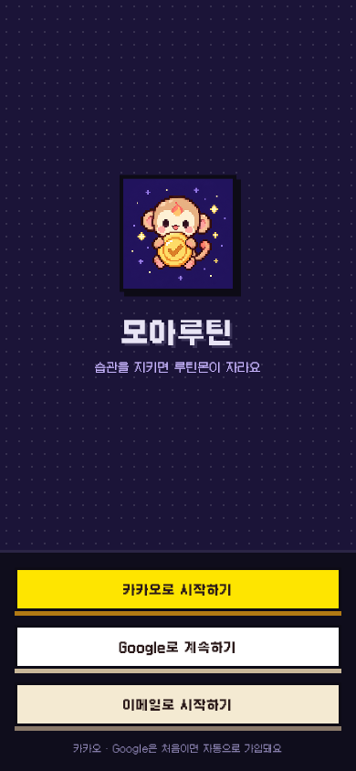 | 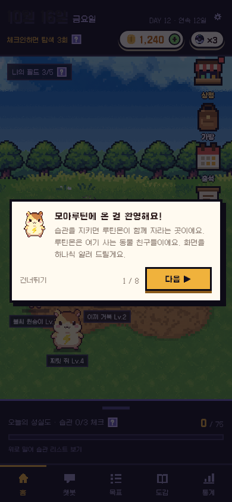 |

- 이어서 (사용자 요청): 도감 제목 "몬스터 도감" → "루틴몬 도감", 튜토리얼 7장면 "도감에는 만난 루틴몬이 기록돼요". 테스트 86개 통과.
  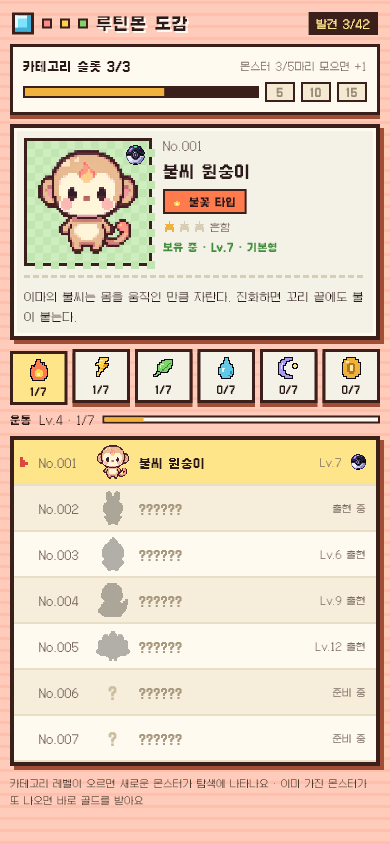
- 발표 자료 수익 모델 · 로드맵 장에 "성장 전략 · 루틴몬 IP" 띠 추가: 귀여운 동물 캐릭터 28종 + 진화 → 이모티콘 · 굿즈 · 숏폼 밈으로 퍼지기 좋은 캐릭터 IP, 캐릭터가 먼저 사랑받으면 앱 유입으로 이어짐. 계획 단계라는 점을 노트에 적음.

### 2026-10-15 — 흐름도 다시 그림 · 발표 자료 (문제 인식 · 흐름 · 마지막 장)
- 브랜치 · 커밋: 커밋 전.
- 한 일
  - **흐름도** (`docs/흐름도/모아루틴-사용자-흐름도.svg · .png`): 10-10판을 오늘 규칙으로 고침 — 홈 "들어오면 출석", 탐색 3회(전부 "못 했어"면 1회), 카테고리 최대 Lv.20, 탐색 단계를 "나타났나(65%) → 도감 등록 → 이미 가진 종? → 예: 볼 없이 +15G / 아니오: 성실볼 → 잡힘 · 도망"으로 새로 그림, 교감에 "끌어 옮기기", 카테고리 칸은 "가진 몬스터 5 · 10 · 15마리". 스크래치 패드의 생성 스크립트(`flow/make2.py`, SVG를 만들고 크롬 헤드리스로 PNG)로 만듦.
  - **발표 자료**: 문제 인식 장 문구 다듬기(제목 "습관 앱은 깔리지만, 습관은 남지 않는다", "100명 중 한 달 뒤 3명"(AppsFlyer 건강 · 피트니스 앱 30일 리텐션 약 3%), 마무리 "의지가 아니라 구조의 문제"). 흐름 장에 새 흐름도 · 목록 문구 갱신. 마지막 장 몬스터를 찌릿 쥐(옛 그림) → 불씨 원숭이.
- 확인한 것: 흐름도 PNG를 눈으로 확인(글자 넘침 · 겹침 두 군데 고침).
- 확인하지 못한 것: 발표 자료 슬라이드를 화면으로 다시 보지는 않음. 리텐션 수치는 Business of Apps가 인용한 AppsFlyer 자료(2022~2023)로, 습관 앱만의 숫자는 아님. JMIR 2024 문헌고찰(100일 안에 중앙값 70% 이탈)은 검색 요약으로만 확인.
- 흐름도: 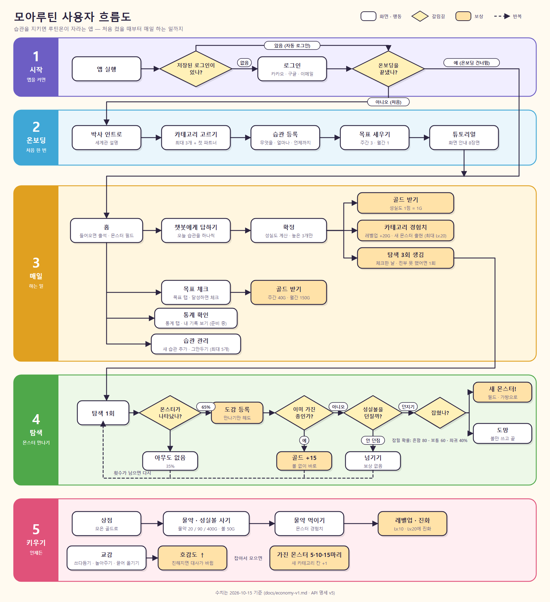
- **데모 장 화면 다시 찍음** (옛 몬스터가 찍혀 있었음): 홈(몬스터를 끌어 보기 좋게 배치) · 챗봇 · 탐색(깡총 불토끼 등장) · 도감(불씨 원숭이 + 만나기만 한 토끼). 슬라이드 그림 4장 교체.

  | | | | |
  | --- | --- | --- | --- |
  |  |  |  |  |

### 2026-10-15 — 아이콘 아래 잔디 · 아이콘 숨기기 · 스크린샷을 기록에 남기기
- 브랜치 · 커밋: `feature/monster-art-v2`.
- 한 일
  - **아이콘 아래 잔디**: 몬스터가 오른쪽 아이콘 줄 *아래쪽*으로도 못 가던 것(사용자 지적)을 고침. 이제 아이콘 줄이 차지한 사각형만 피하고, 겹치면 왼쪽으로 비키거나 아래로 내려가기 중 덜 움직이는 쪽으로 간다. 아이콘 줄 높이는 화면에서 직접 잰다.
  - **아이콘 숨기기** (`docs/기획/2026-10-15-아이콘-숨기기.md`): 아이콘 줄을 오른쪽으로 밀면 숨고, 오른쪽 끝 손잡이(◀)를 누르거나 왼쪽으로 밀면 다시 나온다. 숨긴 동안 몬스터는 오른쪽 끝까지 다닌다. 튜토리얼이 시작되면 다시 보인다.
  - **스크린샷 기록 규칙** (사용자 요청, D-21): 화면이 바뀌면 캡처를 `docs/스크린샷/날짜/`에 남기고 일지 · 기획서에 이미지로 넣는다. `CLAUDE.md` 2 · 5장, `docs/README.md`, 기획서 템플릿 9장에 반영. 오늘 바뀐 화면 6장을 찍어 넣음.
  - `docs/design/character.md`(사용자가 쓴 AI 그림 프롬프트 메모)도 커밋에 넣기로 함 (사용자 결정).
- 확인한 것: `flutter analyze` 이상 없음, `flutter test` 전부 통과 (새 테스트: 아이콘 숨기기 · 다시 보이기). 아래 캡처.
- 확인하지 못한 것: 에뮬레이터에서 손가락으로 밀기 · 끌기.
- 막혔던 것과 원인: 아이콘 숨기기 테스트가 실패 — 숨기기는 됐는데(디버그 출력으로 확인) 위치가 그대로였다. 상태가 바뀐 프레임에서 애니메이션이 *시작*만 하고, 한 번 더 그려야 시간이 흐른다 → `pump()`를 한 번 더. 또 `tester.drag` 한 번에 밀면 속도가 0으로 나와 "빠르게 튕기기" 판정이 안 됐다 → 여러 번 나눠 밀기.
- 오늘(10-15) 바뀐 화면:

  | | |
  | --- | --- |
  |  |  |
  | 몬스터 28종 + 진화 그림 4장 | 도감: 만나기만 한 종도 보인다, 7칸 · 준비 중 |
  |  |  |
  | 탐색: 가진 종은 볼 없이 바로 15G | 필드: 끄는 중 (들려서 맨 위) |
  |  |  |
  | 놓으면 말풍선 · 하트, 버튼은 안 가림 | 아이콘을 숨기면 오른쪽 끝까지 |

### 2026-10-15 — 몬스터 그림 교체 (5종 → 28종)
- 브랜치 · 커밋: `feature/habit-manage` 위에서 작업, 아직 커밋 안 함 (10-10의 출석 = 접속 변경도 함께 미커밋).
- 한 일
  - 사용자가 AI로 뽑은 픽셀 그림 32장(`OneDrive/바탕 화면/루틴몬/속성_동물N.png`)을 앱에 넣었다. 이름 끝 `2` = 진화 그림.
  - 그림 처리: 투명 여백을 잘라 내고 긴 변 384px로 줄임(BOX 축소, 전 그림과 같은 크기), 영문 파일 이름으로 `assets/images/monsters/`에 저장. 스크래치 패드의 Python(PIL) 스크립트로 처리 — 프로젝트 코드에는 Python이 없다.
  - `Catalog.species` 28종 (이름 · 설명 · 호감도별 대사 새로 씀), 첫 파트너 6종, `AppAssets` 32개.
  - 진화 그림: `MonsterSpecies.evolvedAsset` + `assetAt(level)` — Lv.10부터 진화 그림. 가진 몬스터를 그리는 6곳(필드 · 교감 창 · 가방 · 챗봇 칩 · 챗봇 아바타 · 튜토리얼)에 적용.
  - 샘플 데이터 몬스터: 늑대 · 쥐 · 새싹냥 → 원숭이 · 쥐 · 거북. 온보딩 실루엣도 새 그림.
  - 테스트 기대값을 새 종으로 바꿈. 명상 길에 이제 몬스터가 있어서 "몬스터 없는 길" 테스트 2개는 "명상 몬스터가 온다 / 명상 몬스터만 나온다"로 바꿈. 새 테스트 2개(진화 그림, 카테고리마다 첫 파트너 · 6칸 이하).
  - 기획서 `docs/기획/2026-10-15-몬스터-아트-교체.md`, 결정 D-16, 기획 변경 이력, 프로젝트-이해, 기획서 v2 3장 상자, DB 요청(`backend/db/README.md`).
- 확인한 것: `flutter analyze` 이상 없음, `flutter test` 81개 통과. 임시 골든 테스트로 390폭 홈(진화한 원숭이 · 코알라 포함) · 도감 · 28종 비교 그림을 눈으로 보고 지움.
- 확인하지 못한 것: 360폭, 에뮬레이터, 교감 창 · 탐색 화면의 새 그림 크기.
- 막혔던 것과 원인: 새 늑대 그림을 `wolf.png`로 저장하면서 **옛 늑대 그림 파일을 확인 없이 덮어썼다** (git에는 남아 있음: `git show HEAD:frontend/assets/images/monsters/wolf.png`). 
- 정한 것: D-16. 이름 · 희귀도 · 출현 레벨 · 첫 파트너는 Claude 가정 → 기획서 8장.
- 남은 일: 기획서 8장 결정, 옛 그림 4개 지울지, 발표 자료 데모 화면 다시 찍기, DB 종 시드.

### 2026-10-15 — 도감: 만나기만 해도 등록 · 새 로고 후보 · API 명세 v4 받음
- 브랜치 · 커밋: 위와 같음, 커밋 전.
- 한 일
  - 탐색에서 몬스터가 나타나면 잡지 않아도 도감에 등록 (`GameState.explore`). 도감은 "보유 중" / "만난 적 있음 · 못 잡음"을 구분하고, 발견 수 · 카테고리 칸도 등록 수로 셈. → `docs/기획/2026-10-15-도감-만나면-등록.md`, D-17
  - 새 그림체로 로고 후보 2장을 Higgsfield(GPT Image 2.5, 0.5 크레딧)로 만듦: 첫 파트너 6종 그림을 참고 이미지로 올리고 "불씨 원숭이가 체크 금화를 안은" 앱 아이콘. 파일은 `OneDrive/바탕 화면/루틴몬/로고/`. **앱의 `brand/logo.png`는 아직 안 바꿈.**
  - DB 담당이 준 API 명세 v4(`카카오톡 받은 파일/습관몬스터_API명세_v4 (1).md`)를 읽음. 앱 · 서버에는 아직 반영 안 함.
- 확인한 것: `flutter analyze` 이상 없음, `flutter test` 82개 통과, 도감 캡처(만난 토끼).
- 확인하지 못한 것: 실기기.
- 남은 일: API 명세 v4와 앱 규칙 차이 정리 · 반영 여부 결정 (아래 사용자 확인 필요).

### 2026-10-15 — 로고 교체 · 앱을 벗어나면 배경음악 멈춤
- 브랜치 · 커밋: 위와 같음, 커밋 전.
- 한 일
  - **로고**: 후보 2(별이 보라 · 노랑으로 섞인 쪽)로 결정 (D-18). 둥근 모서리 바깥의 흰 부분을 배경 남색(#21135D)으로 채워 꽉 찬 정사각형으로 만들고, 전에 아이콘을 넣었던 곳(`66f4e3d`)에 크기별로 전부 다시 넣음: 로그인 화면 `brand/logo.png`, Android(일반 · 적응형 전경 — 안전 영역에 맞게 66%로 줄여 가운데), iOS, macOS, 웹(파비콘 · 192 · 512 · maskable 80%), Windows `.ico`, `docs/design/app-icon/app_icon_1024.png`. 적응형 아이콘 배경색 #180D3C → #21135D. 발표 자료 표지 그림도 바꿈.
  - **배경음악 버그**: 앱을 벗어나도(홈 버튼 · 다른 앱 · 브라우저 탭 숨김) 음악이 계속 나왔다. 원인: 앱 상태(라이프사이클 — 앱이 화면에 보이는지/숨었는지 알려 주는 신호)를 듣지 않았다. `AudioBgm`이 `WidgetsBindingObserver`로 상태를 듣고 hidden · paused · detached면 일시정지, resumed면 이어서 재생. inactive(알림창 내림 · 창 포커스만 잃음)는 아직 화면이 보여서 그대로 둠 — Claude가 정함.
- 확인한 것: `flutter analyze` 이상 없음, `flutter test` 82개 통과. 아이콘 모서리 확대 확인.
- 확인하지 못한 것(로고 · 음악): **배경음악 일시정지는 실제 기기 · 에뮬레이터 · 브라우저에서 안 들어 봄** (테스트는 소리 없는 버전을 써서 확인 불가). 런처에 뜬 새 아이콘도 아직 못 봄 (앱을 다시 설치해야 바뀜).

### 2026-10-15 — API 명세 v4 · v5에 탐색 · 도감 규칙 맞추기
- 브랜치 · 커밋: 위와 같음, 커밋 전.
- 한 일 (D-19)
  - 탐색: 가진 종이 나오면 볼 없이 바로 15G(던지기 버튼 없이 "이미 친구인 ○○가 놀러 왔어요" + 금화 표시). 볼은 안 가진 종에게만. 꽝 35%. 첫 제출이 전부 "못 했어"면 탐색 1회.
  - 카테고리 레벨 최대 20 (1,900점). 종 출현 레벨을 1 · 3 · 6 · 9 · 12 · 15 · 18 순서로.
  - 도감 카테고리마다 7칸 (전체 42). 종이 없는 칸은 "준비 중". 카테고리 칸 진행은 **가진 종만** 셈(`GameState.caughtSpecies` 새로 만듦, v5).
  - 명세 v5에서 바뀐 것 확인: 만나면 도감 "본 종(`SEEN`)" 등록 — 앱 규칙(D-17)과 같아짐. 카테고리 칸은 가진 종만 — 이것만 앱을 고침.
- 확인한 것: `flutter analyze` 이상 없음, `flutter test` 83개 통과(새 테스트: 가진 종 → 바로 골드 · 전부 못 했어 → 1회 · 레벨 최대 20 · 본 종은 칸 진행에 안 셈). 임시 캡처로 탐색(가진 종 등장) · 공부 도감 7칸 확인.
- 확인하지 못한 것: 에뮬레이터.
- 막혔던 것: `sed -i`로 `dex_screen.dart`를 고쳤다가 줄바꿈이 CRLF → LF로 바뀜 (예전에도 겪은 문제). perl로 CRLF 되돌림. 문서는 perl 정규식에 한글을 넣었더니 안 맞아서(스크립트가 UTF-8로 읽히지 않음) Edit 도구로 고침.
- 남은 일: 탐색 가중치(명세에 값 없음), 하루가 바뀌는 처리(날짜 저장 — 서버 연동 때), 빈 도감 14칸을 채울 그림.

### 2026-10-15 — 홈 필드에서 몬스터 끌어 옮기기 · 서버가 안 뜨는 원인
- 브랜치 · 커밋: 새 브랜치 `feature/monster-art-v2` (오늘 작업 전부 + 10-10 출석 변경).
- 한 일
  - **끌어 옮기기** (D-20, `docs/기획/2026-10-15-필드-몬스터-끌기.md`): 누른 채 움직이면 몬스터가 손가락을 따라오고(10px 들림 · 맨 위에 그림), 놓으면 3초 쉬었다가 다시 걷는다. 걷는 영역 밖으로는 못 나간다. 몬스터마다 하루 1번 호감도 +1 + 토스트. 짧게 누르면 전처럼 교감 창. "나의 필드" 도움말에 한 줄 추가.
  - **서버 확인**: 8080 포트를 **다른 프로젝트(`C:\TreePlan\treeplan` 백엔드, java PID 42112, 10-14 17:47부터 실행 중)**가 쓰고 있어서 우리 서버가 같은 포트로 못 뜬다. 끄는 건 사용자 확인 후. 5432에는 PostgreSQL(IPv4)과 Docker(IPv6)가 함께 떠 있다 — 우리 서버가 붙는 DB가 헷갈릴 수 있어 같이 알림.
- 확인한 것: `flutter analyze` 이상 없음, `flutter test` 85개 통과 (새 테스트: 끌기 ♥ 하루 1번 · 끌면 따라오고 토스트). 끄는 중 · 놓은 뒤 화면 캡처 확인.
- 확인하지 못한 것: 에뮬레이터에서 손가락으로 끌어 보기, 360폭.
- 이어서 (사용자 요청): 끌 수 있는 범위를 **잔디 전체**로 넓힘(전: 걷는 영역 가운데 띠 — 오른쪽 아이콘 높이까지 못 올라감). 화면마다 배경이 다르게 잘려서 배경 그림의 잔디 시작 높이(32%)와 시트 높이로 px 계산. 놓으면 말풍선 한마디 + 호감도 오르면 하트 뿅뿅(토스트 대신). 390 · 360폭에서 네 구석으로 끌어 캡처 확인 — 360폭에서 몬스터가 필드 위로 넘어가던 것, 왼쪽 끝 말풍선이 잘리던 것을 고침.
- 이어서: 넓힌 범위에서 몬스터가 "나의 필드" 바(? 버튼)와 오른쪽 아이콘을 가렸다(사용자 지적) → 위는 바 아래, 오른쪽은 아이콘 줄 왼쪽까지로 막음. 390 · 360폭 네 구석 캡처로 확인.
- **서버**: 사용자 확인 후 TreePlan 서버(PID 42112)만 종료하고 터미널 탭 "루틴몬 서버"에서 `bootRun`(local 프로필) — 회원가입 요청 201 확인.
- 막혔던 것과 원인: 테스트에서 몬스터를 끌어도 안 움직였다. ① 테스트 환경은 그림을 읽기 전엔 그림 크기가 0이라 누를 곳이 없었다 → 그림을 먼저 읽어 둠(precache). ② `tester.drag`는 중간에 화면을 그리지 않아서, 손을 뗀 뒤의 2.4초 걷기 애니메이션으로 옮겨 갔다 → 움직일 때마다 화면을 그리는 제스처로 바꿈.

### 2026-10-10 — 튜토리얼 · 출석부, DB v1.5 맞추기, 조직 레포, 하네스 문서
- 브랜치 · 커밋: `feature/social-login-http-auth` `17874a8` → 새 브랜치 `feature/db-v1.5-rules` `6fb6c84`. 그 뒤 작업(하네스 문서 · 기획서 v2.1 · v1.6 검증 · 탭 순서)은 `feature/harness-docs-v1.6` `67fd67e`. 흐름도 이미지는 `feature/flowchart` `079a912`, 습관 추가 · 그만두기는 `feature/habit-manage` `ec6ef6e`.
- 한 일
  - **처음 쓰는 사람 안내**: 온보딩 직후 튜토리얼(8장면, 설정에서 다시 보기), 홈 출석 아이콘 + 출석부, "오늘의 성실도" · "탐색" · "나의 필드" 옆 ? 도움말, 골드 + 버튼을 골드 칩 안으로. → `docs/기획/2026-10-10-튜토리얼-출석부-도움말.md`
  - **DB v1.5 받음** (ERD · seed · verify · verify_later). 앱과 다른 규칙 6가지를 정리하고 정함:
    앱이 DB를 따름 4가지(탐색 꽝 40% · 희귀도별 포획 80/60/40% · 체크인 다시 제출 · 카테고리마다 초기 몬스터), DB가 앱을 따름 2가지(중복 → 골드 · 보상 없이 넘기기).
  - **서버**: `users.onboarding_step` → `onboarded_at`, `PATCH /me/onboarding` 본문 없음.
  - **backend/db**: 우리 쪽 변경안 SQL 2개 삭제, README를 v1.5 메모 + DB 담당 요청으로 다시 씀.
  - **조직 레포** `dynamicduo-daelim/habit_monster`에 브랜치 5개를 올리고 기본 저장소(`origin`)로 바꿈. 개인 레포는 `personal`.
  - **하네스 문서**: `CLAUDE.md`(루트) · `docs/README.md` · `docs/프로젝트-이해.md` · `docs/결정-기록.md` · `docs/기획/_템플릿.md` + 예시 1건, 이 일지.
  - **기획서 v2 → v2.1**: 본문은 두고 달라진 장마다 「현재 (v2.1)」 상자를 달았다. 바뀐 내용은 `docs/기획-변경-이력.md`(새 문서)에 한 줄씩.
  - **흐름도**: 처음엔 FigJam에 자동 배치로 그렸는데 보기 불편해서, 단계별 색 · 범례를 넣은 이미지로 다시 그림 → `docs/흐름도/모아루틴-사용자-흐름도.png` (원본 `.svg`). "매일" 단계에 목표 체크 · 통계 확인(준비 중)을 넣음.
  - **DB v1.6 `schema.sql` 받음**: 우리가 요청하려던 두 가지(중복 → 골드, 보상 없이 넘기기)가 반영돼 있었다. 임시 PostgreSQL 18에서 검증.
  - **아래 탭 순서**: 홈 · 챗봇 · 통계 · 도감 · 목표 → 홈 · 챗봇 · **목표** · 도감 · **통계**.
  - **습관 추가 · 그만두기**: 홈 출석 아이콘 아래 "습관" 아이콘 → "내 습관" 화면(목록 · 그만두기 · 온보딩과 같은 추가 폼). → `docs/기획/2026-10-10-습관-추가.md`
    첫 버전은 온보딩 폼을 그대로 써서 가독성이 나빴다 → 홈과 같은 어두운 테마로 다시 디자인(목록과 추가를 분리, 한 화면에 질문 하나, 큰 글자와 버튼).
  - **출석 기준 변경**: 습관 체크인 → 앱에 들어온 날 (하루 1번). 상단 바 · 출석부의 연속 일수도 접속 기준. → `docs/기획/2026-10-10-출석-접속-기준.md`
  - **중간발표 자료**: 시험 안내(7분 IR 피칭)에 맞춘 슬라이드 13장 초안 (claude.ai 슬라이드, 링크는 사용자 계정). 대괄호로 남긴 곳(팀 · 배경 이야기 · 설문 · 시연 영상)은 직접 채워야 한다.
- 확인한 것: `flutter analyze` 이상 없음, 앱 테스트 **79개 통과**(전 60 → 튜토리얼 등 +7 → 규칙 +5 → 탭 순서 +1 → 습관 추가 +6, 출석 변경은 기존 테스트를 고침), 서버 `./gradlew test` 통과. 화면은 임시 골든 테스트로 390 · 360폭 캡처를 눈으로 확인.
  - DB: `schema.sql`(v1.6) → `seed.sql` 적용 성공. `verify.sql`(v1.5) 104개 통과 · 2개 실패(v1.6에서 일부러 뒤집은 규칙을 옛 기준으로 검사하는 항목). 추가 검사 `backend/db/v1.6_extra_verify.sql` 15개 모두 통과. `schema_later.sql`도 적용 성공.
- 확인하지 못한 것: 에뮬레이터 · 실제 기기에서 눌러 보기. 탭 순서를 바꾼 화면을 눈으로 보기 (테스트로만 확인). `verify_later.sql`은 `verify.sql`이 실패로 끝나서 돌리지 못함.
- 막혔던 것과 원인
  - 구글 로그인 "실패했어요": 에뮬레이터의 Google Play 서비스가 23.18인데 `google_sign_in` 7.x는 25.24 이상이 필요. 구글 계정도 0개. 10-08의 에뮬레이터 초기화 때문. **미해결** — 에뮬레이터에서 Play 스토어 로그인 → Play 서비스 업데이트 필요.
  - 날짜가 두 자리인 날(10월 10일) 상단 바가 넘쳐 화면 테스트 여러 개가 깨짐 (날짜가 한 자리였던 10-08에는 통과) → 남는 폭만 쓰도록 수정.
  - 조직 레포 푸시 중 Claude의 자동 권한 검사가 브랜치 푸시를 막음 → 사용자가 직접 `git push`.
- 정한 것: D-06 ~ D-15 (D-07은 D-15로 바뀜)
- 남은 일
  1. DB 담당에게 `verify.sql` · `seed.sql` · ERD의 **v1.6 판** 받기 (지금 `verify.sql`은 2개 실패가 정상). `APPLE` 제공자 행을 뺄지 확인
  1-0. DB 담당에게 **접속 기준 연속 출석** 요청 (`backend/db/README.md`)
  1-1. 디자인 시안(`docs/design/`)의 탭 순서도 바꿀지 결정
  2. 에뮬레이터 Play 서비스 업데이트 후 카카오 · 구글 로그인 끝까지 확인 (SHA-1 `16:8B:90:…:92:D8` 등록 여부 포함)
  3. 새 사용자를 DAY 1 · 연속 0일로 시작하게 할지, 출석 보상을 줄지 결정
  4. `결정-기록.md` · `프로젝트-이해.md`의 **[채우기]** / "이유 미기록" 채우기
  5. 게임 API(습관 · 체크인 · 탐색 · 상점 · 목표) → `GameState`를 서버 호출로 교체

### 2026-10-08 — 작업 브랜치 정리, 시작 자원, 에뮬레이터 · 빌드 문제
- 브랜치 · 커밋: `feature/social-login-http-auth` 새로 만듦. `e836c79`(10-07~08에 커밋 못 한 소셜 로그인 · HTTP 인증 · DB v1.4 이름 변경), `5edabd2`(시작 자원 · 골드 얻는 법).
- 한 일
  - 시작 골드 50 · 성실볼 3개 (`Economy.startingGold` · `startingBalls`), 골드 옆 + 버튼과 "골드 얻는 법" 팝업.
  - 기존 테스트가 옛 시작값(골드 1,240 · 볼 1)에 기대고 있어서 `GameState.sample(gold:, balls:)` 인자를 추가하고 테스트에서 옛 값을 직접 넣음.
- 확인한 것: `flutter analyze` 이상 없음, 앱 테스트 60개 통과, `flutter build apk --debug` 성공(캐시 복구 뒤).
- 확인하지 못한 것: 화면에서 직접 눌러 보기.
- 막혔던 것과 원인 (**다음에 같은 일이 나면 여기부터 본다**)
  - **빌드 실패 `Could not read workspace metadata … metadata.bin`** (Kotlin 컴파일 단계라 Kotlin 문제처럼 보임): Claude가 Gradle 데몬(java)을 빌드 중에 강제 종료해서 `~/.gradle/caches/9.3.1/transforms` 캐시가 깨짐. → 그 폴더를 지우고 다시 빌드 (캐시 재생성에 36분). **교훈: Gradle 데몬을 강제로 끄지 않는다.**
  - **Claude의 Bash에서 Gradle이 `storage.googleapis.com`을 못 찾음** → PowerShell에서 빌드하면 됨.
  - **에뮬레이터가 부팅 화면에서 멈춤** (`Emulator didn't connect within 60 seconds`): 강제 종료 때 에뮬레이터 내부 데이터(packages.xml)가 깨짐. → Wipe Data로 초기화, RAM 2GB → 4GB. 초기화하면 구글 계정과 Play 서비스 업데이트가 사라진다 (10-10 구글 로그인 문제의 원인).
  - **에뮬레이터 · 빌드가 전체적으로 느림**: 배터리 사용 + Core Ultra(저전력 코어 배정) + Windows 메모리 무결성(Hyper-V 위에서 한 겹 더 가상화) + Defender 실시간 검사. → Defender 제외 폴더 추가함. 충전기 연결 · 전원 모드 "최고 성능" 권장. 가장 확실한 건 실제 폰 USB 연결.
  - **서버가 안 뜸 `port 8080 already in use`**: Oracle XE의 `OracleXETNSListener` 서비스가 8080을 씀. → 관리자 PowerShell에서 `Stop-Service OracleXETNSListener` (재부팅하면 다시 켜짐), 또는 `--server.port=8081`.
  - `bootRun`이 `80% EXECUTING`에서 멈춘 것처럼 보이는 건 정상 (서버가 켜져 있는 동안 계속 실행 중).
- 정한 것: D-05
- 남은 일: 10-10 일지로 이어짐.

---

## 0. 한눈에

| 항목 | 내용 |
| --- | --- |
| 앱 이름 | **루틴몬** (표시 이름만 변경, 패키지명 `com.habitmonster.habit_monster` 그대로 — 카카오·구글에 등록된 값) |
| 앱 | Flutter (`frontend/`), 픽셀 아트 · Galmuri11 폰트 |
| 서버 | Spring Boot 4.1 · Java 21 (`backend/server/`), 지금은 **인증만** 있음 |
| DB | PostgreSQL. 원본 설계는 OneDrive `카카오톡 받은 파일/` (v1.5는 `schema_erd/`, `schema.sql` v1.5는 아직 못 받음). 메모는 `backend/db/README.md` |
| 기준 문서 | `docs/프로젝트-이해.md`(전체 그림), `docs/habit-monster-기획서-v2.md`(기획서), `docs/design/prototype-source.dc.html`(디자인 기준), `docs/economy-v1.md`(수치), `docs/결정-기록.md` |
| 작업 규칙 | `CLAUDE.md`(루트: 이해 · 기획 · 기록 원칙) + `frontend/CLAUDE.md`(디자인 그대로, 색은 `AppColors`, 수치는 `Economy`, 픽셀 이미지는 `PixelImage`, 새 패키지는 이유 먼저) |
| 저장소 | `origin` = 조직 레포 `dynamicduo-daelim/habit_monster`, `personal` = 개인 레포 |
| 브랜치 | `main` ← `feature/db-rules-ball-catch` ← `feature/spring-auth-server` ← `feature/social-login-http-auth` ← **`feature/db-v1.5-rules`(현재 작업, 10-10)** |

---

## 1. 진행 순서 (커밋 기준)

| 날짜 | 커밋 | 한 일 |
| --- | --- | --- |
| 10-03 | `1f56ea4` | 기획서 · 디자인 시안을 Flutter 앱으로 옮김: 온보딩 · 홈 · 챗봇/탐색 · 도감 · 목표 |
| 10-05 | `66d7d54` | DB 리뷰 결과 반영(규칙 2~6) + 성실볼 "던져서 잡기" DB 변경안 |
| 10-05 | `66f4e3d` `c1026df` | 앱 아이콘: 알에서 깨어나는 몬스터 (포켓몬 느낌 임시 이미지 교체), 아이콘 모양 꽉 채우기 |
| 10-05 | `2a71c00` | 배경음악: 화면별 5곡(Suno) + 크로스페이드 + 끄기 |
| 10-05 | `0d581d0` | 인트로 박사 화면 깨짐 수정 |
| 10-07 | `ebdaeaf` | 로그인 화면 · 이메일 가입/로그인 · 설정 창(배경음악 · 로그아웃) |
| 10-07 | `cac8133` | Spring Boot 서버 기본 틀 — 인증 API |
| 10-07 | `f3b0a98` `84abee3` | 애플 로그인 제거 (유료 개발자 계정 필요) — 앱 · 서버 · DB |
| 10-07 | `b179508` | 앱 이름 → 루틴몬 |
| 10-07 | `858c87b` | (직접 수정) 디자인: 온보딩 습관 등록을 단계형으로 |
| 10-07 | `6dc849a` | 위 디자인을 앱에 반영 |
| 10-07~08 | **커밋 전** | 카카오 · 구글 실제 로그인 연결 + DB v1.4(기간 7/30/100일) 적용 — 아래 6장 |

---

## 2. 앱 (Flutter)

### 화면
- **로그인**: 카카오 · Google · 이메일 버튼. 처음 로그인 → 온보딩, 온보딩 끝낸 계정 → 바로 홈 (`features/auth/auth_gate.dart`)
- **온보딩**: 인트로(박사) → 1. 카테고리 + 첫 파트너 → 2. 습관 퀘스트(무엇을 · 얼마나 · 언제까지 3단계) → 3. 목표(주간 3 · 월간 1, 적은 목표 목록)
- **홈**: 필드 몬스터 · 호감도별 말풍선 · 슬라이드 시트(습관/성실도) · 상점(수량 팝업 → 구매 완료) · 가방 · 교감(톡 · 쓰다듬기 게이지 · 간식 · 놀아주기 · 말 걸기)
- **챗봇**: 대본형 습관 체크 → 하루 1번 확정 → 탐색(성실볼 던져서 잡기). 대사는 `ChatBrain` 인터페이스 뒤 (나중에 AI로 교체)
- **도감 · 목표**: 도감 5/10/15마리마다 카테고리 슬롯 +1, 목표 체크/수정/삭제. 통계는 준비 중
- **설정**(상단 톱니바퀴): 배경음악 켜기/끄기, 로그인 계정 표시, 로그아웃

### 구조에서 기억할 것
- 상태: `GameState`(ChangeNotifier) + `GameScope`, 로그인: `AuthController` + `AuthScope`, 음악: `Bgm` + `BgmScope`
- 서버 연결 지점: `GameState`의 메서드들이 API 응답 모양의 결과 객체를 돌려줌 (`DailyCheckinResult` · `EncounterResult` · `CatchResult`) → 나중에 서버 호출로 교체
- 시각 확인: 브라우저 패널 스크린샷은 한 박자 늦게 보임 → 임시 골든 테스트로 PNG를 찍어 확인 후 삭제

---

## 3. DB

### 리뷰 · 반영 (10-05)
- 공유받은 DB 설계를 검토하고 규칙 2~6(상위 3개 습관만 반영, 하루 1번 확정, 완료 목표 잠금, 탐색 풀 = 오늘 체크인한 카테고리, 도감 discovered 등)을 앱에 맞춤
- 규칙 1(성실볼 = 던져서 잡는 볼)은 DB 변경이 필요해서 변경안을 따로 작성 → `backend/db/v1.5_ball_catch.sql` + `v1.5_verify.sql` + `README.md`(쉬운 설명)

### 애플 제거 (10-07)
- `schema.sql`의 `auth_provider` 시드에서 `APPLE` 삭제, 논리물리모델 · ERD 문서 수정

### v1.4 적용 (10-08, 직접 수정한 파일)
- 습관 기간 **1주/1개월/3개월 → 7일/30일/100일** (코드 `D7/D30/D100`, 코드와 일수 불일치 CHECK 추가), `seed.sql` 새로 추가
- 새 `schema (1).sql`에 `APPLE`이 다시 들어 있어서 **그 줄만 빼고** 적용
- 임시 PostgreSQL 18에서 검증: `schema → seed → verify` **92/92 통과**, `+ v1.5_ball_catch → v1.5_verify` **23/23 통과**
- 성실볼 변경안 이름이 원본 v1.4와 겹쳐서 **v1.4 → v1.5**로 변경
- 앱의 기간 이름도 7일/30일/100일로 변경 (`data/catalog.dart`)

---

## 4. 로그인 · 서버

### 서버 (`backend/server`, Spring Boot)
- API: `POST /auth/signup` `/auth/login` `/auth/social/{kakao|google}` `/auth/refresh` `/auth/logout`, `GET /me`, `PATCH /me/onboarding`
- 오류 응답 `{code, message}` — message는 앱이 그대로 보여줌
- 보안: 비밀번호 BCrypt · 소셜 토큰은 서버가 카카오/구글에 직접 확인(카카오는 우리 앱 ID인지까지) · 같은 이메일이어도 계정 합치지 않음(Q-20) · refresh 토큰은 SHA-256만 저장, 쓸 때마다 교체, 재사용되면 전부 폐기 · 탈퇴 계정 로그인 거부
- 실행 (DB 없이): `backend/server`에서 `./gradlew bootRun --args='--spring.profiles.active=local'`
- ⚠️ 이 PC는 `JAVA_HOME`이 jdk-20이라 그대로는 빌드가 안 됨 → jdk-24로 바꾸거나 IntelliJ에서 Gradle JVM 21+
- 테스트 9개 통과 (10-07 기준)

### 소셜 로그인 키 (모두 공개해도 되는 값)
| 항목 | 값 | 쓰는 곳 |
| --- | --- | --- |
| 카카오 네이티브 앱 키 | `8d795d4d9a367e3678e1538467f12fe4` | 앱 |
| 카카오 앱 ID | `1600125` | 서버 `KAKAO_APP_ID` |
| 구글 웹 클라이언트 ID | `661947484282-v08ku1t429h6dtj70v710pvsm5ps2fhb.apps.googleusercontent.com` | 앱(serverClientId) · 서버 |
| 구글 Android 클라이언트 ID | `661947484282-or62s0gh1koggf27p0rlf0mf0m04s25q.apps.googleusercontent.com` | 서버 |
| Android 디버그 키 해시 / SHA-1 | `FouQC0AYlGTOdPKmAD/4w/n/ktg=` / `16:8B:90:...:92:D8` | 카카오 · 구글 콘솔 (이 PC 디버그 키 기준) |

카카오 REST API 키 · 어드민 키 · 구글 클라이언트 보안 비밀은 **어디에도 넣지 않는다.** 애플 로그인은 유료(연 $99)라 뺐다.

---

## 5. 정해진 것 (결정 기록)
- 로그인 수단: 카카오 · 구글 · 이메일 (애플 제외) / 로그인은 앱 시작 시 먼저
- 서버: Spring Boot / DB: PostgreSQL
- 앱 이름: 루틴몬 (볼로 끝나는 이름 · 영어 이름 후보도 검토했음)
- 아이콘: 알에서 깨어나는 몬스터 (포켓몬 느낌 금지)
- 배경음악: `audioplayers`(Windows 지원 때문에 just_audio 대신)

---

## 6. 커밋 전 작업 (10-07~08) — 마무리 필요

### 들어간 것
- 패키지: `kakao_flutter_sdk_user` · `google_sign_in` 7.2 · `flutter_secure_storage` · `http`
- `lib/core/config/app_config.dart` — `API_BASE_URL`(dart-define), 카카오 키 · 구글 웹 클라이언트 ID
- `lib/core/auth/social_login.dart` — 카카오(카카오톡 → 없으면 카카오계정), 구글 ID 토큰, 취소 처리, 웹은 "앱에서 이용해 주세요"
- `lib/core/auth/http_auth_service.dart` — 서버 호출, 자동 로그인(refresh), access 만료 시 1회 갱신, 로그아웃 시 서버 · 저장소 · SDK 모두 정리
- `main.dart` — `API_BASE_URL`이 있으면 진짜 로그인, 없으면 가짜 로그인(FakeAuthService)
- Android 매니페스트(인터넷 권한, 카카오 리다이렉트), 디버그 빌드 http 허용, iOS 카카오 스킴
- 서버 `application-local.properties`에 카카오 · 구글 값, 서버 테스트는 그 값을 비워서 외부 접속 안 하게
- 테스트 `test/http_auth_test.dart`

### 확인된 것
- `flutter analyze` 이상 없음, 앱 테스트 **60개 통과**, `flutter build apk --debug` 성공
- DB 검증 92/92, 23/23

### 남은 일
1. 서버 테스트 다시 실행 (`JAVA_HOME=jdk-24 ./gradlew test`) → 커밋 · 푸시
2. `docs/design/` 두 파일이 또 수정된 상태 — 직접 고친 거면 같이 커밋. 디자인의 기간 이름(1주일/1개월/3개월)도 7일/30일/100일로 맞출지 결정
3. 에뮬레이터 "연결이 안 된다" 확인: 서버를 켜고 `flutter run --dart-define=API_BASE_URL=http://10.0.2.2:8080` 로 실행해야 함 (에뮬레이터에서 PC = `10.0.2.2`, 실제 폰은 PC의 IP)
4. 실제 카카오 · 구글 로그인 테스트 (에뮬레이터에 구글 계정 / 카카오톡 또는 브라우저 로그인)
5. 그 다음: 습관 · 체크인 · 탐색 · 몬스터 · 상점 · 목표 API (`backend/README.md` API 초안) → `GameState`를 서버 호출로 교체
6. 나중: 웹 소셜 로그인(카카오 JS 키 · 구글 웹 버튼), 서버 CORS, 실제 PostgreSQL로 서버 띄워 보기, 애플 nonce 등

---

## 7. 참고
- `backend/README.md` — API 초안, 인증 API 계약, 프론트 연동 지점, AI 챗봇 연결 방법
- `backend/server/README.md` — 서버 실행 · 환경변수 · 구조
- `backend/db/README.md` — DB v1.5(공식)에서 바뀐 것 · 서버 반영 · 앱과 아직 다른 점 (10-10, 예전 성실볼 변경안 파일은 삭제)
- PC가 느릴 때: Gradle 데몬 · 에뮬레이터(약 3.4GB)가 무거움. 대화가 너무 길어지면 Claude 앱도 무거워지니 새 대화로 시작
